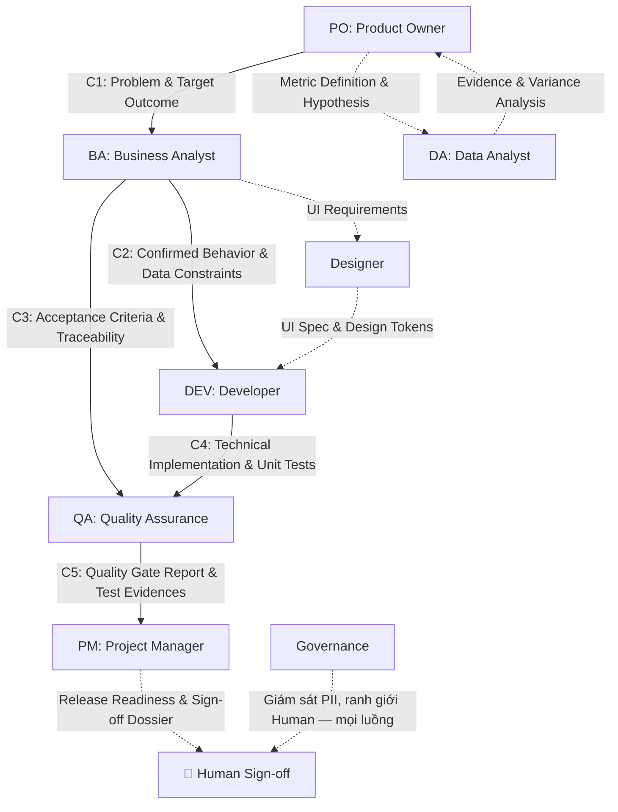

# Handoff Contracts — Multi-Agent Engineering

> **Phiên bản:** 1.0 | **Áp dụng cho:** Toàn bộ 7 vai trò + Governance  
> **Nguyên tắc cốt lõi:** Bàn giao qua **Artifact vật lý**, có ID phiên bản, kiểm tra được và có chữ ký xác nhận của vai trò bàn giao.

---

## 1. Sơ Đồ Handoff Tổng Thể

> **Thuộc:** Orchestration Harness (DEC-008). Số Contract trong sơ đồ khớp với mục chi tiết ở §2. Luồng nét đứt (`-.->`) **chưa có contract chi tiết** — xem `observability/open-questions.md` Q-010.

**Quy tắc định tuyến:** mỗi mũi tên là một lần đổi vai trò → drop context cũ, vai trò nhận chỉ nạp artifact đầu ra đã chốt + persona/rules của mình (`AGENTS.md` §7). Artifact không đạt Entry Gate → áp dụng §3 (Handoff Rejection Protocol).

---

## 2. Chi Tiết Các Hợp Đồng Bàn Giao (Contracts)

### Contract 1: PO → BA (Product Intent → Specification)
- **Artifact đầu vào:** `artifacts/product/PRD-[feature].md`
- **Mục bắt buộc (Mandatory Elements):**
  1. `Problem Statement`: Vấn đề của người dùng/doanh nghiệp cần giải quyết.
  2. `Target User Persona`: Chân dung đối tượng sử dụng (e.g., người chơi Keno thường xuyên).
  3. `Desired Business Outcome & Success Metrics`: Mục tiêu định lượng (e.g., tăng 15% tỷ lệ nạp tiền).
  4. `Prioritization & Scope Boundaries`: In-scope (MVP) và Out-of-scope có lý do.
  5. `Key Assumptions & Risks`: Danh sách giả định cần BA thẩm định.
- **Tiêu chí nghiệm thu đầu vào (Entry Gate):**
  - [ ] Không có giải pháp kỹ thuật bị áp đặt sớm từ PO.
  - [ ] Outcome và metric có công thức đo lường rõ ràng.
  - [ ] Human PO đã xác nhận (chưa có xác nhận → BA chỉ coi là đề xuất nghiên cứu).

---

### Contract 2: BA → DEV (Specification → Implementation)
- **Artifact đầu vào:** `artifacts/requirements/SRS-[feature].md`
- **Mục bắt buộc:**
  1. `Use Case / User Story Catalog`: ID duy nhất, mô tả theo format chuẩn.
  2. `Business Rules Reference`: Trỏ trực tiếp tới `knowledge/business-rules/`.
  3. `Data Dictionary & Flow`: Trường dữ liệu, validation rules, kiểu dữ liệu.
  4. `Exception Handling & Error States`: Timeout, mất mạng, tài khoản không đủ số dư, hủy giao dịch.
  5. `Traceability Matrix`: Trỏ ngược lại PRD của PO.
- **Tiêu chí nghiệm thu đầu vào:**
  - [ ] Không còn từ mơ hồ chưa giải thích (`.agents/rules/banned-words.md`).
  - [ ] Đã qua bước DEV Feasibility Review (DEV không phát hiện rào cản kỹ thuật bất khả thi).

---

### Contract 3: BA → QA (Specification → Test Design)
- **Artifact đầu vào:** `artifacts/requirements/SRS-[feature].md` & `artifacts/analysis/impact-analysis-[feature].md`
- **Mục bắt buộc:**
  1. `Acceptance Criteria (GWT format)`: Given - When - Then kiểm chứng được.
  2. `State Transition Matrix`: Bảng chuyển đổi trạng thái giao dịch (Init -> Pending -> Success/Failed).
  3. `Edge Cases Identified`: Các kịch bản biên từ bước BA Analysis.
  4. `Dependency & Impact Mapping`: Hệ thống bên ngoài liên đới (Telco SMS, Bank Gateway, Core Vietlott).
- **Tiêu chí nghiệm thu đầu vào:**
  - [ ] Tiêu chí Pass/Fail của từng kịch bản không bị lưỡng nghĩa (Unambiguous Test Oracle).

---

### Contract 4: DEV → QA (Code → Testing)
- **Artifact đầu vào:** `artifacts/technical/PR-[id]-notes.md` & Patch/Code commit
- **Mục bắt buộc:**
  1. `Git Commit / Branch ID`: Tên nhánh tuân thủ convention (`feat/`, `fix/`).
  2. `Unit Test Execution Log`: Kết quả chạy unit test với độ bao phủ (coverage >= 80%).
  3. `API Changes / Migration Notes`: Thay đổi schema DB hoặc hợp đồng API.
  4. `Known Limitations`: Điểm chưa hoàn thiện (nếu có) được chấp thuận trước.
- **Tiêu chí nghiệm thu đầu vào:**
  - [ ] Code compile sạch, không có lint error hoặc security warning nghiêm trọng.

---

### Contract 5: QA → PM / Release Gate (Test Execution → Deployment)
- **Artifact đầu vào:** `artifacts/testing/Quality-Gate-Report-[feature].md`
- **Mục bắt buộc:**
  1. `Test Execution Summary`: Tổng số TC, Pass, Fail, Blocked, Skipped.
  2. `Defect Triage List`: Danh sách bug còn tồn đọng (Zero Critical/High bugs).
  3. `Regression Test Evidence`: Bằng chứng Playwright/API test chạy thành công.
  4. `Security & Performance Baseline`: Xác nhận kiểm tra bảo mật OWASP cơ bản.
- **Tiêu chí nghiệm thu đầu vào:**
  - [ ] 100% tiêu chí Blocking trong checklist của QA đạt trạng thái PASS.

---

## 3. Quy Định Chặn Lỗi (Handoff Rejection Protocol)

Nếu Artifact bàn giao **không thỏa mãn** bất kỳ tiêu chí bắt buộc nào:
1. Role tiếp nhận **BẮT BUỘC TỪ CHỐI** bằng văn bản ngắn gọn, ghi rõ:
   - Mục bị thiếu hoặc vi phạm.
   - Bằng chứng vi phạm (dẫn chứng dòng/mục cụ thể).
   - Yêu cầu sửa đổi.
2. Trạng thái task chuyển về `BLOCKED` và quay lại role trước để sửa chữa theo chu trình Self-Correction.
