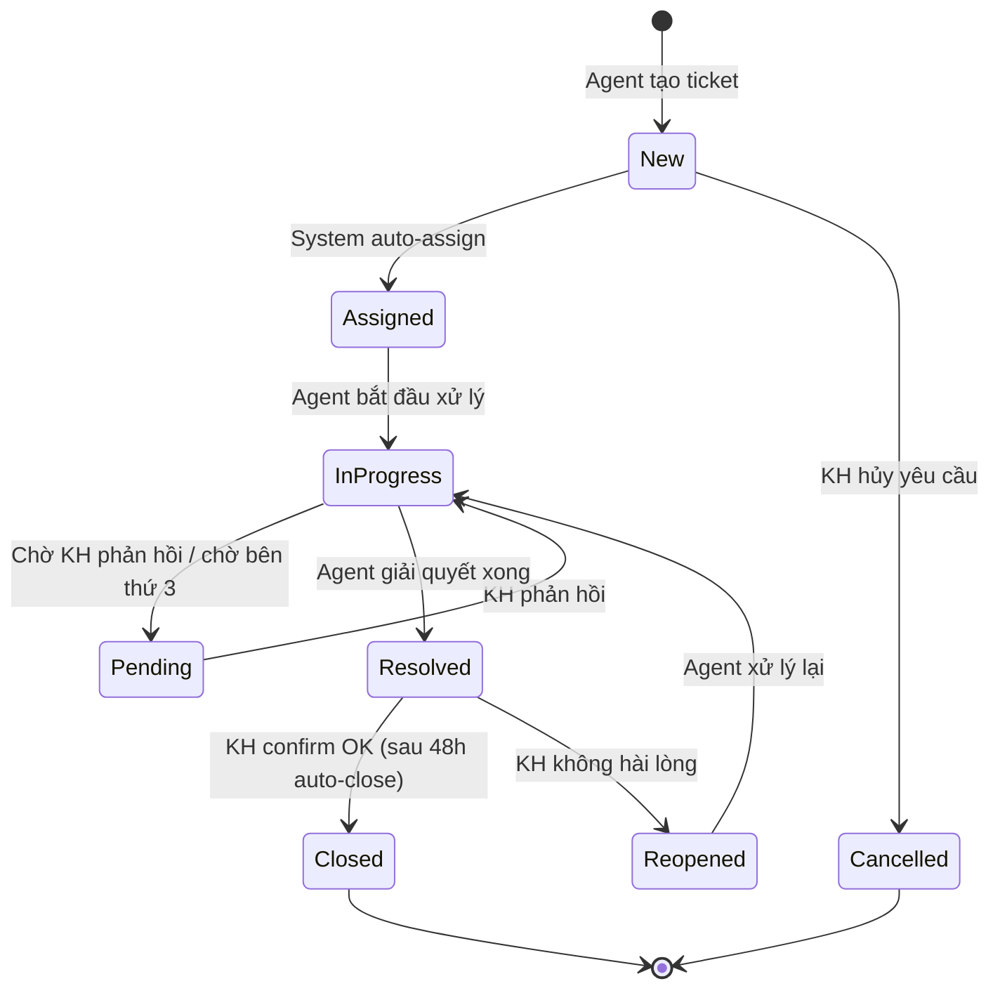

# Ví Dụ BA: User Story + Acceptance Criteria

## US-001: Đăng nhập hệ thống

**Epic**: Quản lý tài khoản
**Sprint**: Sprint 1
**Story Points**: 3
**Độ ưu tiên**: Must have

### Mô tả
Là **nhân viên CSKH**,
Tôi muốn **đăng nhập vào hệ thống bằng tài khoản được cấp**,
Để **truy cập thông tin khách hàng và xử lý yêu cầu**.

### Tiêu Chí Chấp Nhận

**AC-01: Đăng nhập thành công (Happy path)**
- Cho trước (Given): Nhân viên đã có tài khoản hợp lệ trong hệ thống
- Khi (When): Nhân viên nhập đúng username và password, bấm "Đăng nhập"
- Thì (Then): Hệ thống chuyển đến trang Dashboard và hiển thị tên nhân viên

**AC-02: Đăng nhập sai mật khẩu (Error case)**
- Cho trước (Given): Nhân viên có tài khoản hợp lệ
- Khi (When): Nhân viên nhập đúng username nhưng sai password
- Thì (Then): Hệ thống hiển thị thông báo "Tên đăng nhập hoặc mật khẩu không đúng" và không cho đăng nhập

**AC-03: Khóa tài khoản sau 5 lần sai (Edge case)**
- Cho trước (Given): Nhân viên đã nhập sai mật khẩu 4 lần liên tiếp
- Khi (When): Nhân viên nhập sai mật khẩu lần thứ 5
- Thì (Then): Hệ thống khóa tài khoản 30 phút và hiển thị thông báo "Tài khoản bị khóa. Vui lòng liên hệ admin hoặc thử lại sau 30 phút"

---

# Ví Dụ BA: Gap Analysis

## Phân Tích Gap — Module Tiếp Nhận Cuộc Gọi

| # | Khía cạnh | As-Is (Hiện tại) | To-Be (Mong muốn) | Gap | Giải pháp đề xuất |
|---|----------|-------------------|-------------------|-----|-------------------|
| 1 | Định tuyến cuộc gọi | Thủ công, agent tự chuyển | Tự động theo kỹ năng agent | Không có ACD | Triển khai ACD với skill-based routing |
| 2 | Nhận diện KH | Hỏi lại thông tin mỗi lần gọi | CRM popup tự động từ SĐT | Chưa tích hợp CRM-PBX | CTI integration Asterisk ↔ CRM |
| 3 | Ghi âm | Ghi toàn bộ, không phân loại | Ghi có tag + AI phân tích sentiment | Thiếu metadata | Module AI Speech Analytics |

---

# Ví Dụ BA: Edge Case Analysis

| Nhóm ngoại lệ | Mô tả kịch bản (Scenario) | Đề xuất hướng xử lý cho PO/Dev |
|----------------|---------------------------|-------------------------------|
| 🔲 Empty States | Nhân viên mới chưa có lịch sử cuộc gọi nào | Hiển thị "Chưa có cuộc gọi nào. Hãy bắt đầu ca trực!" |
| 🔴 Error States | Mất kết nối PBX giữa cuộc gọi | Auto-reconnect 3 lần, sau đó thông báo supervisor |
| 📏 Limits | Agent nhận quá 50 cuộc/ngày | Cảnh báo quản lý khi đạt 80% quota, tự động routing sang agent khác |
| 🔐 Permissions | Agent cố truy cập dữ liệu khách hàng ngoài phân vùng | Chặn + ghi audit log + thông báo quản lý |
| ⚡ Concurrency | 2 agent cùng pick 1 cuộc gọi trong queue | Locking mechanism — agent pick trước win, agent sau nhận cuộc tiếp theo |

---

# Ví Dụ BA: Use Case chi tiết (Waterfall)

## UC-001: Tiếp nhận yêu cầu khách hàng

| Mục | Nội dung |
|-----|----------|
| **UC ID** | UC-001 |
| **Tên** | Tiếp nhận yêu cầu khách hàng |
| **Actor** | Agent CSKH |
| **Mô tả** | Agent tiếp nhận cuộc gọi từ KH, xác minh danh tính, ghi nhận yêu cầu |
| **Precondition** | Agent đã đăng nhập, trạng thái "Available" |
| **Postcondition** | Yêu cầu được ghi nhận, ticket được tạo |

### Main Flow (Luồng chính)
| Bước | Actor | Hành động |
|------|-------|----------|
| 1 | System | Tự động routing cuộc gọi đến Agent available |
| 2 | System | Popup thông tin KH (nếu SĐT đã có trong CRM) |
| 3 | Agent | Xác minh danh tính KH (hỏi 2/3 câu bảo mật) |
| 4 | Agent | Lắng nghe và ghi nhận yêu cầu vào form |
| 5 | Agent | Phân loại yêu cầu (Khiếu nại / Hỏi thông tin / Yêu cầu dịch vụ) |
| 6 | System | Tạo ticket với mã tự động |
| 7 | Agent | Đọc lại tóm tắt yêu cầu cho KH xác nhận |
| 8 | Agent | Kết thúc cuộc gọi, chuyển trạng thái sang "Wrap-up" |

### Alternative Flow
| ID | Tại bước | Điều kiện | Hành động |
|----|---------|-----------|----------|
| AF-01 | 2 | SĐT chưa có trong CRM | Agent hỏi thông tin KH, tạo profile mới |
| AF-02 | 5 | Yêu cầu ngoài thẩm quyền | Agent chuyển tiếp (transfer) cho bộ phận chuyên trách |

### Exception Flow
| ID | Tại bước | Điều kiện | Hành động |
|----|---------|-----------|----------|
| EF-01 | 3 | KH không trả lời được câu bảo mật | Agent từ chối cung cấp thông tin nhạy cảm, ghi nhận vào log |
| EF-02 | * | Mất kết nối giữa cuộc gọi | System tự động ghi log "Disconnected", Agent callback trong 5 phút |
| EF-03 | 6 | Hệ thống tạo ticket fail | Hiển thị lỗi, Agent ghi nhận offline, báo IT |

### Business Rules
| ID | Quy tắc |
|----|---------|
| BR-01 | KH chỉ được xác minh tối đa 3 lần/cuộc gọi |
| BR-02 | Mỗi ticket phải có ít nhất: tên KH, SĐT, loại yêu cầu, mô tả |
| BR-03 | Wrap-up time tối đa 2 phút |

---

# Ví Dụ BA: Decision Table

## Business Rule: Chính sách giảm giá theo phân hạng khách hàng

| # | Hạng KH | Giá trị đơn hàng | Phương thức TT | → Giảm giá | → Free Ship |
|---|---------|------------------|----------------|-----------|-------------|
| 1 | VIP | > 10M | Online | 15% | ✅ |
| 2 | VIP | > 10M | COD | 12% | ✅ |
| 3 | VIP | ≤ 10M | * | 10% | ✅ |
| 4 | Thân thiết | > 5M | * | 5% | ✅ |
| 5 | Thân thiết | ≤ 5M | * | 3% | ❌ |
| 6 | Thường | > 10M | * | 2% | ❌ |
| 7 | Thường | ≤ 10M | * | 0% | ❌ |

**Completeness check:** 3 hạng × 2-3 mức giá × 2 PTTT = 7 rules → ✅ Đủ
**Conflict check:** Không có 2 rule cùng input khác output → ✅ Không xung đột

---

# Ví Dụ BA: State Diagram — Vòng đời Ticket

| State | Mô tả | SLA | Ai có quyền chuyển? |
|-------|--------|-----|-------------------|
| New | Ticket vừa tạo | Auto-assign trong 5 phút | System |
| Assigned | Đã gán cho agent | Agent phải pick-up trong 15 phút | Agent |
| InProgress | Đang xử lý | Resolve trong 24h (normal) / 4h (urgent) | Agent |
| Pending | Chờ phản hồi | Auto-escalate sau 48h | System + Agent |
| Resolved | Đã giải quyết | KH confirm trong 48h hoặc auto-close | Agent + KH |
| Closed | Đóng | | System |
| Reopened | Mở lại | Resolve lại trong 12h | KH + Agent |
| Cancelled | Hủy | | Agent + KH |

---

# Ví Dụ BA: NFR Specification

## Yêu Cầu Phi Chức Năng — Hệ thống CSKH

### Performance
| Metric | Requirement | Priority | Measurement |
|--------|------------|----------|-------------|
| API Response Time (P95) | < 1.5 giây | Must | APM (New Relic) |
| Page Load Time | < 3 giây (3G) | Must | Lighthouse |
| Concurrent Users | ≥ 500 agents đồng thời | Must | Load test (k6) |
| Database Query | < 500ms per query | Should | Slow query log |

### Security
| Metric | Requirement | Priority |
|--------|------------|----------|
| Password Policy | Min 8 chars, uppercase, lowercase, number | Must |
| Session Timeout | 30 phút inactive → auto-logout | Must |
| Data Encryption | TLS 1.3 in transit, AES-256 at rest | Must |
| Audit Trail | All CRUD operations logged with UserID + Timestamp | Must |
| RBAC | Role-based access control, 4 levels (Agent/Supervisor/Admin/SuperAdmin) | Must |

### Availability
| Metric | Requirement | Priority |
|--------|------------|----------|
| Uptime SLA | ≥ 99.5% (8h46m downtime max/year) | Must |
| Planned Maintenance | Max 2h/tháng, ngoài giờ peak (22:00-06:00) | Should |
| Backup | Daily automated, RPO < 24h, RTO < 2h | Must |
