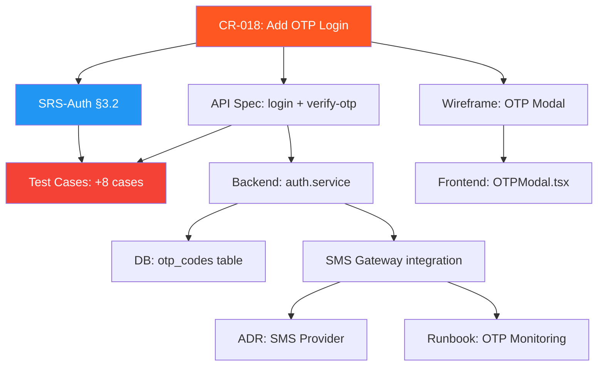

# Change Management Examples — Practical References

> Các ví dụ thực tế để tham khảo khi thực hiện Change Management tasks.
> **Vai trò thực hiện:** `[🟢 ROLE: BA]` (Change Management capability)

---

## Example 1: Impact Analysis Report — Thêm OTP vào luồng đăng nhập

```markdown
## Báo Cáo Đánh Giá Tác Động (Impact Analysis)
**Change Request ID:** CR-018
**Tên thay đổi:** Thêm xác thực OTP khi đăng nhập từ thiết bị mới
**Requester:** PO — Nguyễn Văn A
**Priority:** High
**Status:** Under Review

### 1. Phân loại
- **Mức độ:** Lớn (ảnh hưởng cross-module)
- **Breaking change:** ✅ Có — API login response format thay đổi

### 2. Impact Scoring
| Dimension | Weight | Score | Weighted |
|-----------|--------|-------|----------|
| Scope | 20% | 4 | 0.80 |
| Documents affected | 20% | 4 | 0.80 |
| Code changes | 15% | 4 | 0.60 |
| Testing effort | 15% | 3 | 0.45 |
| User impact | 15% | 5 | 0.75 |
| Risk level | 15% | 3 | 0.45 |
| **Total** | 100% | | **3.85** |

**Classification:** 🔴 Major — Cần full review team

### 3. Các Module Bị Ảnh Hưởng
| Module | File/Component | Mức độ tác động | Cần test lại |
|--------|---------------|-----------------|-------------|
| Auth API | `auth.controller.ts`, `auth.service.ts` | Thêm OTP verification step | ✅ |
| User Service | `user.service.ts` | Thêm device fingerprint tracking | ✅ |
| SMS Gateway | `sms.service.ts` | Tích hợp gửi OTP via SMS | ✅ |
| Frontend Login | `LoginForm.tsx`, `OTPModal.tsx` (NEW) | Thêm OTP input screen | ✅ |
| Database | `migrations/add-otp-table.sql` (NEW) | Thêm bảng `otp_codes` | ✅ |

### 4. Cascading Documents
| # | Document | Section | Action | Owner | Status |
|---|----------|---------|--------|-------|--------|
| 1 | SRS-Auth v1.4 | §3.2 Login Flow | Thêm OTP step vào flow | BA | ⏳ |
| 2 | API Spec v1.9 | POST /auth/login | Response thêm `requires_otp` field | BA | ⏳ |
| 3 | API Spec v1.9 | POST /auth/verify-otp (NEW) | Endpoint mới | BA | ⏳ |
| 4 | Wireframe Auth | Screen 2.1 | Thêm OTP modal | Designer | ⏳ |
| 5 | Test Plan v1.7 | §4.1 Auth Tests | +8 test cases OTP | QA | ⏳ |
| 6 | ADR | - | Review: SMS provider selection | SA | ⏳ |
| 7 | Runbook | - | Add OTP monitoring dashboard | DevOps | ⏳ |

### 5. Dependency Graph


### 6. Rủi Ro
| # | Risk | Probability | Impact | Mitigation |
|---|------|------------|--------|-----------|
| 1 | SMS API down → user không login được | Medium | Critical | Fallback: cho phép skip OTP sau 3 attempts failed + alert DevOps |
| 2 | OTP brute force attack | Low | High | Rate limit: max 5 attempts/10 min, lockout 30 min |
| 3 | UX friction tăng → user complaint | Medium | Medium | "Remember this device" option, OTP chỉ cho device mới |

### 7. Effort Estimate
| Role | Effort | Notes |
|------|--------|-------|
| BA | 4h | Update SRS + API spec |
| Designer | 2h | OTP modal design |
| SA | 2h | SMS provider ADR |
| DEV (Backend) | 12h | OTP logic + SMS integration |
| DEV (Frontend) | 6h | OTP modal + device fingerprint |
| QA | 6h | 8 test cases + regression |
| DevOps | 2h | Monitoring dashboard |
| **Total** | **34h** ≈ **4.25 man-days** |

### 8. Approval
- [x] BA review — OK, SRS update planned
- [x] SA review — SMS provider: Twilio (existing contract)
- [ ] PM review — Sprint capacity check needed
- [ ] PO sign-off — Pending
```

---

## Example 2: Change Request Log Entry

```markdown
## CR-015: Thêm phương thức thanh toán MoMo

**Ngày:** 05/05/2025
**Requester:** PO — Trần Thị B
**Priority:** High
**Status:** ✅ Implemented

### Mô Tả Thay Đổi
**Hiện tại (AS-IS):** Hệ thống chỉ hỗ trợ thanh toán qua VNPAY và chuyển khoản ngân hàng.
**Đề xuất (TO-BE):** Thêm thanh toán qua ví MoMo, tích hợp MoMo Payment API.
**Lý do:** 35% users request thanh toán MoMo trong survey Q1/2025.

### Impact Analysis
- **Score:** 3.2/5 — 🟠 Significant
- **Modules:** Payment Service, Order Service, Frontend Checkout
- **Documents:** PRD v2.2→v2.3, API Spec v1.9→v2.0, Test Plan v1.6→v1.7
- **Breaking change:** ❌ Không — additive change

### Approval
- [x] BA review — 06/05
- [x] SA review — 07/05 (MoMo API compatible)
- [x] PM review — 08/05 (fits Sprint 12)
- [x] PO sign-off — 08/05

### Implementation Timeline
| Milestone | Planned | Actual | Status |
|-----------|---------|--------|--------|
| Docs updated | 10/05 | 10/05 | ✅ |
| Backend complete | 15/05 | 16/05 | ✅ (+1 day) |
| Frontend complete | 17/05 | 17/05 | ✅ |
| QA complete | 20/05 | 21/05 | ✅ (+1 day) |
| Deployed to prod | 22/05 | 22/05 | ✅ |

### Lessons Learned
- MoMo sandbox env có rate limit thấp hơn docs nêu → QA mất thêm 1 ngày
- Nên request sandbox access sớm hơn (ngay khi CR approved)
```
