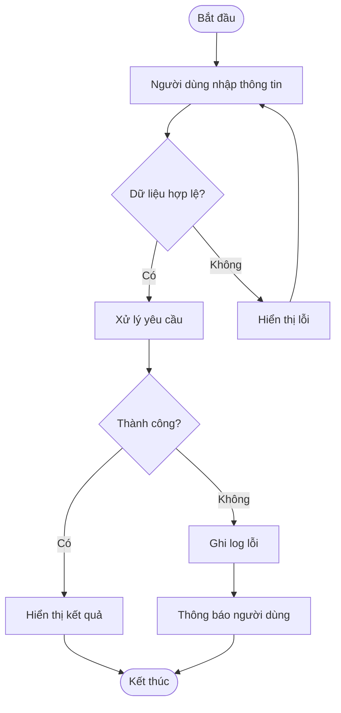
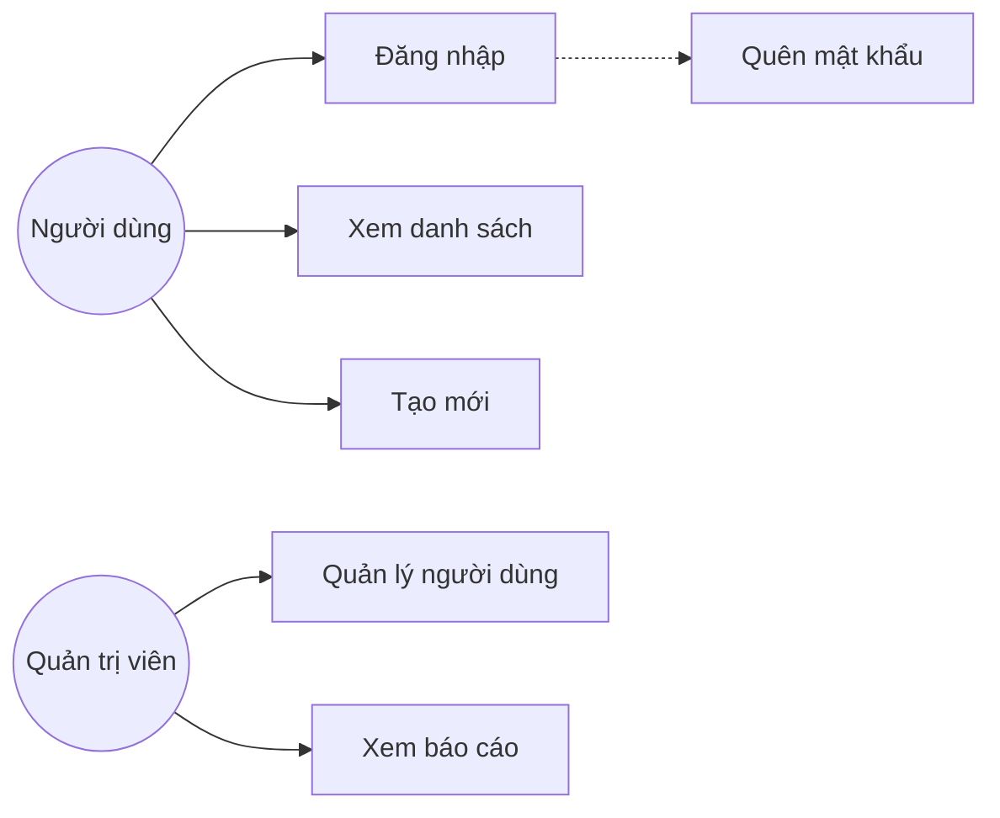
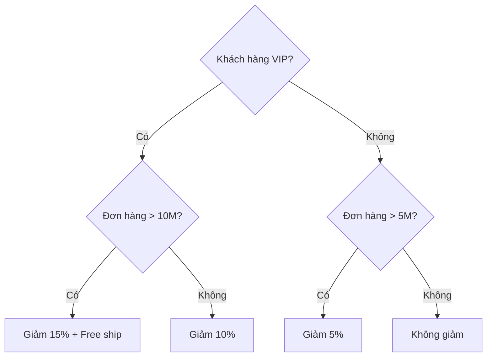
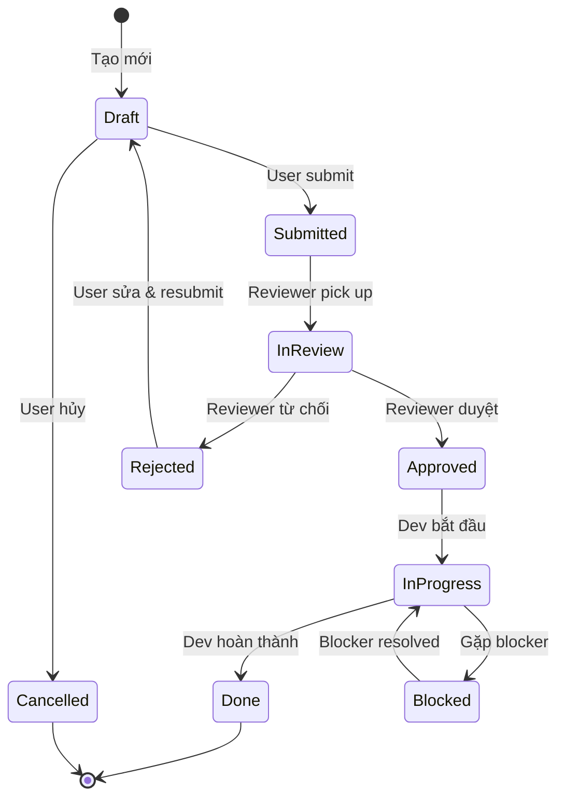
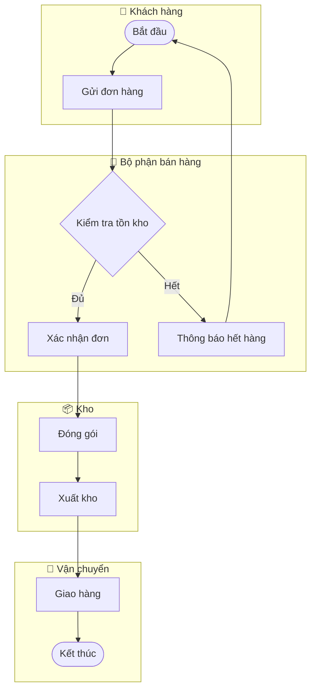
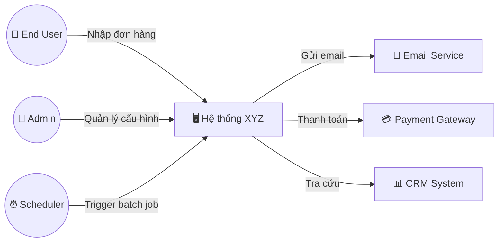
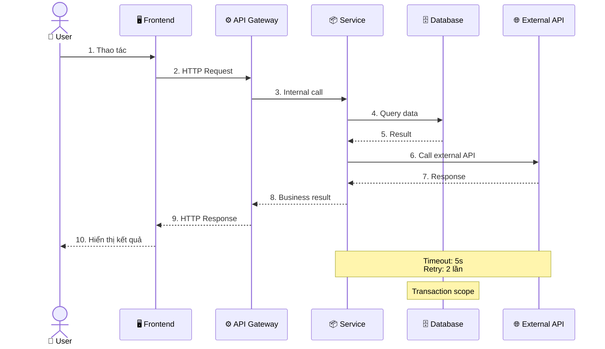
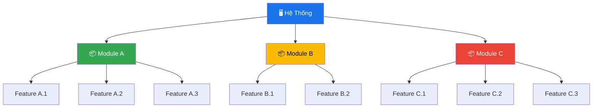

# Mẫu Diagram Mermaid (BA)

> Tham chiếu từ: `.agents/skills/ba/SKILL.md` — Sections 3, 7, 16, 17, 18, 21

---

## 1. Activity Diagram (Section 3)



---

## 2. Use Case Diagram (Section 2)



---

## 3. Flowchart — Quy Tắc Vẽ (Section 7)

**Quy tắc:**
- Prefer dùng `flowchart TD` (Từ trên xuống)
- Sử dụng hình thoi `{}` cho các điểm quyết định (Decision points / If-Else). Ví dụ: `A{Email hợp lệ?} -->|Có| B`
- Bắt buộc phải có text (label) trên các mũi tên rẽ nhánh
- Sử dụng hình viên thuốc `([ ])` cho điểm Bắt đầu và Kết thúc
- Trả về đoạn code Mermaid sạch, kèm theo 2-3 gạch đầu dòng giải thích tóm tắt luồng bên dưới

---

## 4. Decision Table & Decision Tree (Section 16)

### Decision Table Template
```markdown
## Business Rule: [Tên quy tắc]

| # | Điều kiện A | Điều kiện B | Điều kiện C | → Hành động |
|---|------------|------------|------------|------------|
| 1 | Có | Có | Có | Hành động X |
| 2 | Có | Có | Không | Hành động Y |
| 3 | Có | Không | * | Hành động Z |
| 4 | Không | * | * | Từ chối |

* = Không quan trọng (don't care)
```

### Decision Tree (Mermaid)


**Khi nào dùng:**
- **Decision Table:** Nhiều điều kiện kết hợp, tất cả conditions đều quan trọng ngang nhau
- **Decision Tree:** Logic có tính phân cấp, điều kiện trước quyết định điều kiện sau

**Self-check sau khi vẽ:**
- Tất cả combinations đã cover chưa? (2^n cho n conditions)
- Có rule nào mâu thuẫn không? (cùng input → khác output)
- Có case "else" / default chưa?

---

## 5. State Diagram (Section 17)

### Template Mermaid


### State Matrix (Output kèm theo)
```markdown
## State Matrix: [Tên đối tượng]

| State | Mô tả | Ai có quyền? | Transition đến | Trigger |
|-------|--------|-------------|---------------|---------|
| Draft | Bản nháp | Creator | Submitted, Cancelled | Submit / Cancel button |
| Submitted | Chờ review | System | InReview | Auto-assign reviewer |
```

**Self-check:**
- Có dead-end state nào không mong muốn không?
- Từ mọi state (trừ terminal), có path đến end state không?
- Concurrent states có cần không? (parallel region)

---

## 6. BPMN Process Modeling — Swimlane (Section 18)



**Quy tắc:**
- Mỗi subgraph = 1 department/role (swimlane)
- Flow phải chạy từ trái sang phải hoặc trên xuống dưới
- Mọi decision point phải có label trên mũi tên
- Ghi rõ exception flows (timeout, error, escalation)

---

## 7. Context Diagram (Section 21)



---

## 8. Sequence Diagram (BABOK Technique #42)

> Sử dụng khi cần mô tả tương tác giữa các thành phần theo thứ tự thời gian.



**Quy tắc:**
- Mỗi message có **số thứ tự** rõ ràng
- Ghi chú **timeout**, **retry**, **transaction scope** khi có external call
- Luồng `-->>` (dashed) cho response, `->>`(solid) cho request

---

## 9. Functional Decomposition Diagram (BABOK Technique #22)

> Sử dụng khi cần phân rã hệ thống lớn thành sub-functions.



**Quy tắc:**
- Tối đa **3-4 cấp** (sâu hơn → quá chi tiết)
- Mỗi **leaf node** = 1 potential User Story hoặc Use Case
- Dùng **màu** để phân biệt modules

