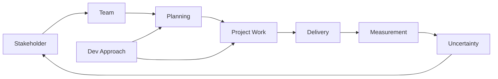

# PMBOK® 7th Edition — 8 Performance Domains

> Reference file cho PM role. Lazy load khi cần.
> Nguồn: [PMBOK® Guide 7th Edition](https://www.pmi.org/pmbok-guide-standards)

## 8 Domains

| # | Domain | Mô Tả | Agent Coverage |
|---|--------|-------|----------------|
| 1 | **Stakeholder** | Engage stakeholders proactively, manage expectations | pm-rules.md §7, `/pm stakeholder` |
| 2 | **Team** | Build high-performing team, servant leadership | pm.md Mindset #7 |
| 3 | **Development Approach & Life Cycle** | Choose predictive/agile/hybrid | pm-rules.md §10 |
| 4 | **Planning** | Plan iteratively, adapt as needed | `/pm kickoff`, WBS |
| 5 | **Project Work** | Manage project processes, enable knowledge sharing | `/pm sprint`, `/pm status` |
| 6 | **Delivery** | Deliver value incrementally or at milestones | `/pm e2e`, quality gates |
| 7 | **Measurement** | Track progress, earned value, velocity | `/pm status`, pm-rules.md §4 |
| 8 | **Uncertainty** | Navigate risks, ambiguity, complexity | pm-rules.md §2, Mindset #11 |

## Interactions Between Domains

## Cross-References
- Principles: `references/pmbok-principles.md`
- Rules: `.agents/rules/pm-rules.md`
