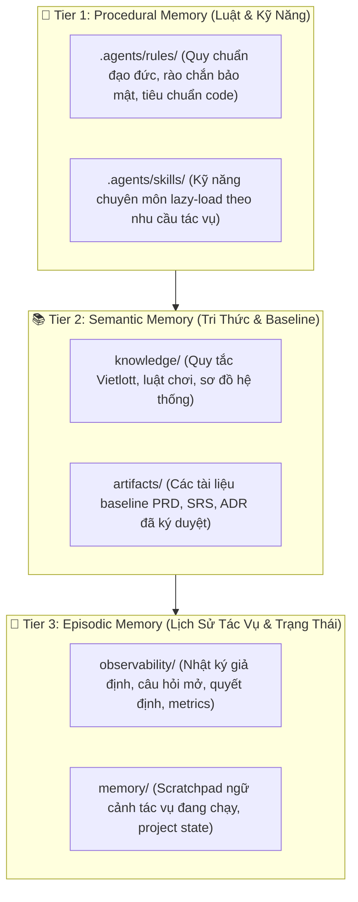

# Multi-Agent Harness Engineering Architecture — Vietlott SMS

> **Phiên bản:** v3.0 | **Ngày ban hành:** 2026-10-05  
> **Mục tiêu:** Xây dựng hệ điều hành toàn diện (Agentic Harness OS) bao bọc LLM, điều phối luồng làm việc tự trị của 7 vai trò kỹ thuật phần mềm, tích hợp cơ chế bảo vệ ranh giới con người và kiểm soát chất lượng qua Quality Gates.

---

## 1. Tổng Quan Kiến Trúc 20 Thành Phần (20-Node Architecture Topology)

Kiến trúc phân rã dự án thành **20 thành phần chuẩn mực** thuộc 5 tầng chức năng:

```text
multi-agent-engineering/
│
├── [TẦNG ĐIỀU PHỐI & NHẬN DIỆN]
│   ├── AGENTS.md               # Master rules & entry point (Bản đồ harness <= 120 dòng)
│   ├── ARCHITECTURE.md         # Bản thiết kế kiến trúc toàn hệ thống (File này)
│   ├── README.md               # Hướng dẫn sử dụng & vận hành dự án
│   ├── .agents/                # Unified Hub: Single Source of Truth duy nhất
│   │   ├── personas/           # 8 Personas (PM, PO, BA, DA, DEV, QA, Designer, Governance)
│   │   ├── definitions/        # Schemas, Role Matrix, Handoff Contracts & harness-map.json
│   │   ├── skills/             # 26 skill — BẢN GỐC DUY NHẤT (IDE auto-discovery)
│   │   ├── rules/              # 15 rule — BẢN GỐC DUY NHẤT (IDE auto-load)
│   │   └── hooks.json          # Cấu hình hook DUY NHẤT được IDE nạp (PostToolUse + PreInvocation)
│   └── hooks/                  # Script hook: agent_gate_hook.py (tự động) + *.ps1 (chạy tay)
│
├── [TẦNG NĂNG LỰC & QUY TRÌNH]
│   └── workflows/              # 6 Value Streams (Luồng giá trị xuyên suốt)
│       ├── product-discovery/  # Khám phá nhu cầu, nghiên cứu thị trường, PRD
│       ├── requirement/        # Thu thập, mô hình hóa, BRD, SRS, CR, Impact
│       ├── feature-development/# Thiết kế kỹ thuật, lập trình, review, refactor
│       ├── bug-fix/            # Quản lý defect, triage, test plan, regression
│       ├── data-analysis/      # Trích xuất dữ liệu, variance analysis, báo cáo
│       └── release/            # Release readiness, sign-off, triển khai
│
├── [TẦNG RÀO CHẮN & TRI THỨC]
│   ├── knowledge/              # Tri thức tĩnh và ngữ cảnh nghiệp vụ cốt lõi (≤ 15 KB/file)
│   │   ├── product/            # Tổng quan Vietlott SMS, kênh bán, đối tác Fintech
│   │   ├── domain/             # Luật chơi, chu kỳ quay thưởng, viễn thông
│   │   ├── business-rules/     # Ma trận quy tắc nghiệp vụ đã xác thực
│   │   ├── glossary/           # Bảng thuật ngữ chuẩn (TKDT, HMDT, VAN, eKYC...)
│   │   ├── architecture/       # Sơ đồ kiến trúc, tích hợp hệ thống, APK analysis
│   │   └── standards/          # Design tokens, nguồn tài liệu tin cậy
│   │
│   └── references/             # Khung tham chiếu chuẩn quốc tế (BABOK, CPOA, ISTQB)
│
├── [TẦNG SẢN PHẨM & KẾ HOẠCH]
│   ├── artifacts/              # Kết quả bàn giao chính thức (Baseline & Deliverables)
│   │   ├── product/            # PRD, roadmap, feature specs
│   │   ├── requirements/       # BRD, SRS, Use Cases, User Stories
│   │   ├── analysis/           # Gap analysis, reconciliation reports, meeting notes
│   │   ├── technical/          # ADRs, UI specs, API connection guides
│   │   ├── testing/            # Test plans, test cases, execution reports
│   │   └── decisions/          # Architecture & Business Decision Records
│   │
│   ├── plans/                  # Quản lý kế hoạch và nợ kỹ thuật
│   │   ├── active/             # Sprints và kế hoạch đang chạy
│   │   ├── completed/          # Lưu trữ cột mốc đã hoàn thành
│   │   └── tech-debt/          # Sổ đăng ký nợ kỹ thuật (Tech Debt Register)
│   │
│   └── templates/              # Biểu mẫu chuẩn (Golden Templates) cho mọi deliverable
│
└── [TẦNG THỰC THI, KIỂM CHỨNG & QUAN SÁT]
    ├── validators/             # Scripts tự động cưỡng chế tiêu chuẩn (Code & Regex)
    ├── tools/                  # Công cụ tích hợp ngoại vi (Jira, Telegram notify, Confluence)
    ├── scripts/                # Utility scripts (chuyển đổi văn bản, phân tích APK, test)
    ├── memory/                 # Bộ nhớ ngữ cảnh tác vụ (Scratchpad, Project state)
    ├── evaluations/            # Eval 4 suite: python evaluations/run_evals.py (harness | validators | behavior | golden)
    │   ├── agents/ | skills/ | workflows/ | regression/ | golden/
    └── observability/          # Hệ thống giám sát, nhật ký giả định, câu hỏi mở, bế tắc, metrics
        ├── assumptions-log.md
        ├── open-questions.md
        ├── decisions-log.md
        ├── critique-conflicts/
        ├── gate-reports/
        └── metrics/
```

---

## 2. Bản Đồ Ánh Xạ 7 AI Harnesses (Harness Component Mapping — DEC-008)

Toàn bộ hệ thống vận hành theo khung **7 AI Harnesses** chuẩn mực, kết nối logic các thư mục tài sản:

| # | AI Harness | Khung cũ | Thư mục đảm trách | Vai trò & Minh chứng kiểm tra |
|---|---|---|---|---|
| **1** | **Context Harness** | Context | `knowledge/`, `references/`, `templates/`, `memory/`, `artifacts/` | Cung cấp tri thức chuẩn, no-drift, kiểm soát context budget (file ≤ 15 KB). Minh chứng: `AGENTS.md`, `.agents/rules/context-budget.md`. |
| **2** | **Tool Harness** | Tools | `tools/`, `scripts/`, `.agents/skills/` | Kết nối công cụ, scripts, MCP servers theo nguyên tắc quyền tối thiểu (Least Privilege). Minh chứng: `tools/tool-registry.md`. |
| **3** | **Orchestration Harness** | Loop | `workflows/`, `.agents/personas/`, `.agents/definitions/`, `plans/` | Điều phối workflow 6 Value Streams, định tuyến handoff giữa các vai trò và vòng lặp 6 bước. Minh chứng: `.agents/definitions/handoff-contracts.md`. |
| **4** | **Evaluation Harness** | Verification | `evaluations/`, `validators/` | Đo lường chất lượng: gate trực tuyến và suite hồi quy 4 tầng ngoại tuyến. Minh chứng: `evaluations/run_evals.py`, `evaluations/golden/`. |
| **5** | **Security Harness** | Guardrails (1) | `validators/`, `.agents/rules/` | Phòng chống lộ PII (NĐ 13), lộ token/secrets và prompt injection từ dữ liệu ngoài. Minh chứng: `validators/pii_scanner.py`, `validators/secret_scanner.py`, `.agents/rules/security-checklist.md`. |
| **6** | **Governance Harness** | Guardrails (2) | `.agents/rules/`, `.agents/definitions/`, `observability/` | Ranh giới Human-in-the-Loop, ma trận phân quyền, quản trị Hard Stop và audit trail. Minh chứng: `.agents/rules/boundaries.md`, `observability/decisions-log.md`. |
| **7** | **AgentOps Harness** | Obs + Feedback | `observability/`, `hooks/`, `memory/` | Giám sát vận hành tự động, tổng hợp gate report theo tuần và vòng lặp cải tiến. Minh chứng: `hooks/agent_gate_hook.py`, `validators/ops_metrics.py`. |

---

## 3. Kiến Trúc Bộ Nhớ 3 Phân Tầng (3-Tier Persistent Memory Taxonomy)

Để loại bỏ hiện tượng quên ngữ cảnh hoặc tạo ảo giác (Hallucination), hệ thống áp dụng chiến lược phân tầng bộ nhớ:



---

## 4. Vòng Lặp 6 Bước (Loop Engineering) & Giao Thức Xử Lý Bế Tắc

Mọi tác vụ phân tích và tạo deliverable bắt buộc phải trải qua 6 bước tuần tự:

```text
[1. FRAME] ──> [2. RESEARCH] ──> [3. ANALYZE] ──> [4. DRAFT] ──> [5. CRITIQUE] ──> [6. FINALIZE]
                                                                        │
                                                                   Fail Gate?
                                                                        │
                                                    ┌───────────────────┴───────────────────┐
                                                    ▼                                       ▼
                                           (Vòng sửa <= 2)                        (Vòng sửa > 2)
                                                    │                                       │
                                                    ▼                                       ▼
                                          [Tự Sửa Chữa (Reflect)]                 🛑 HARD STOP
                                                    │                             Lập biên bản bất đồng
                                                    └─> Quay lại bước 4           (critique-conflicts/)
                                                                                  Báo cáo Human phân xử
```

---

## 5. Mặt Phẳng Kiểm Soát Chất Lượng (Quality Gate Plane)

Hệ thống cưỡng chế kiểm tra chất lượng đa tầng trước khi một artifact được công nhận:
1. **Automated Validators:** Script Python kiểm tra từ mơ hồ (`ambiguity_scanner.py`), tính truy vết (`traceability_checker.py`), cấu trúc (`doc_structure_validator.py`), PII (`pii_scanner.py`), secrets/credentials (`secret_scanner.py`), và toàn vẹn hệ thống (`harness_integrity_checker.py`). Hook `hooks/agent_gate_hook.py` tự chạy 4 validator (PII, Secret, Từ cấm, Mơ hồ) trên `artifacts/**/*.md` sau mỗi lần ghi file.
2. **Role Checklists:** Mỗi vai trò có checklist riêng biệt với phân loại rõ rệt giữa điều kiện chặn (**Blocking**) và khuyến nghị (**Important**).
3. **Cross-Role Adversarial Review:** Phản biện chéo đối kháng có chủ đích:
   - QA thách thức BA về tính kiểm thử được và kịch bản lỗi.
   - DEV phản biện BA về tính khả thi kỹ thuật và độ trễ hệ thống.
   - DA kiểm tra PO về bằng chứng số liệu và giả thuyết sản phẩm.
   - Governance giám sát ranh giới con người, bảo mật PII và secret.
4. **Hard Stop & Escalation:** Mọi quyết định phạm vi/baseline cần Human phê duyệt trực tiếp trong phiên làm việc. `validators/gate_runner.py` gửi cảnh báo escalation qua Telegram notify khi vượt quá 2 vòng sửa.
