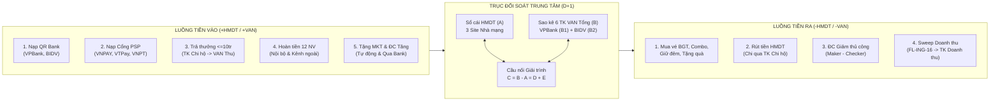

# PHÂN TÍCH CẤU TRÚC BÀI TRÌNH BÀY & KHUNG KIỂM SOÁT DÒNG TIỀN ĐỐI SOÁT TÀI KHOẢN HMDT — VAN TỔNG

| Phiên bản | Ngày lập | Tác giả | Trạng thái | Mục đích sử dụng |
|:---:|:---:|:---:|:---:|---|
| 1.0 | 2026-11-03 | BA Agent | `Draft` | Chuẩn bị họp xác nhận nghiệp vụ với Team VHNV & Team Kế toán (Thứ Sáu, 06/11/2026) trước khi viết SRS chi tiết |

- **Mã tài liệu:** `BA-PREP-RECON-HMDT-V1.0`
- **Nguồn đối chiếu:**
  - Giao diện Prototype HTML do BA phụ trách cung cấp (`Đối Soát Tài Khoản HMDT & Kiểm Soát Dòng Tiền VAN Tổng | Vietlott SMS Admin`).
  - Báo cáo phân tích nền tảng: [phan-tich-chi-tiet-doi-soat-tai-khoan-du-thuong.md](file:///f:/VIETLOTT-SMS/artifacts/analysis/phan-tich-chi-tiet-doi-soat-tai-khoan-du-thuong.md) `[Nguồn: SRC-10, v2.0]`.
  - Tri thức đối soát hệ thống: [03-reconciliation-settlement.md](file:///f:/VIETLOTT-SMS/knowledge/product/fintech/03-reconciliation-settlement.md) `[Nguồn: SRC-07, KB-FINTECH-03]`, Quy tắc Đối soát (Mục 4) tại [business-rules.md](file:///f:/VIETLOTT-SMS/knowledge/business-rules/business-rules.md), Yêu cầu `FR-01`..`FR-06` tại [SRS_He_Sinh_Thai_Thanh_Toan_Fintech_v1.0.md](file:///f:/VIETLOTT-SMS/artifacts/requirements/SRS_He_Sinh_Thai_Thanh_Toan_Fintech_v1.0.md).

---

## 1. ĐÁNH GIÁ CẤU TRÚC BÀI TRÌNH BÀY (PROTOTYPE HTML 3 THẺ) & KỊCH BẢN DẪN DẮT

### 1.1. Giải phẫu bố cục 3 Thẻ hiện tại trên Prototype `ctinadmin`

Bản HTML Prototype được thiết kế theo cấu trúc **Drill-Down 3 tầng từ Tổng thể xuống Chi tiết** (Top-Down Architecture) đặt trực tiếp trong khung quản trị `ctinadmin` (Menu số 14: `Đối soát tài khoản HMDT`):

| Tầng hiển thị | Khối giao diện trên HTML | Đối tượng quan tâm chính | Câu hỏi nghiệp vụ cốt lõi mà Thẻ trả lời |
|:---:|---|---|---|
| **Tầng 1 (Vĩ mô)** | **Thẻ 1 (`#cardSummary`):** Cân đối số dư VAN Tổng & HMDT + Cầu nối `FL-ING-17` `[⚠️ THUẬT NGỮ MỚI — cần bổ sung glossary]` | Kế toán trưởng, Quản lý VHNV | *"Tổng tiền mặt tại 6 tài khoản VAN Tổng (3 Site × 2 Ngân hàng VPBank, BIDV) có bảo chứng >= 100% số dư HMDT của người chơi không? Phần chênh lệch hiện tại gồm bao nhiêu tiền trung gian chờ kết chuyển và bao nhiêu tiền lỗi thực sự?"* |
| **Tầng 2 (Trung mô)** | **Thẻ 2 (`#cardCashflow`):** Tổng hợp Luồng tiền Vào (5 nhóm - 21 NV) & Luồng tiền Ra (5 nhóm - 7 NV gồm `FL-ING-16` `[⚠️ THUẬT NGỮ MỚI — cần bổ sung glossary]`) | Kế toán tổng hợp, Chuyên viên đối soát | *"Biến động tăng/giảm trong kỳ đến từ nhóm nghiệp vụ nào? Nghiệp vụ nào làm đổi số dư HMDT nhưng KHÔNG đổi số dư VAN Tổng tại thời điểm phát sinh?"* |
| **Tầng 3 (Vi mô)** | **Thẻ 3 (`#cardTransactions`) & Modal 4 mắt:** Tra soát cặp giao dịch chi tiết theo 10 tab nghiệp vụ & đẩy lệnh `Maker - Checker` | Chuyên viên VHNV, Kế toán viên thanh toán | *"14 giao dịch lệch cụ thể là của thuê bao nào, lệch ở nguồn nào (Core SMS, BGT, Cổng PSP hay Sao kê Bank) và xử lý bằng thao tác nghiệp vụ gì?"* |

### 1.2. Ba điểm cộng lớn và Bốn điểm khuyết cần điều chỉnh trước khi trình bày Thứ Sáu

**Ba điểm cộng lớn của cấu trúc hiện tại:**
1. **Hội tụ ngôn ngữ giữa 2 phòng ban:** Team Kế toán nhìn thấy phương trình cân đối Đầu kỳ - Phát sinh - Cuối kỳ và cầu nối giải trình chênh lệch ở Thẻ 1, Thẻ 2; Team VHNV nhìn thấy danh sách 28 kịch bản nghiệp vụ vận hành hàng ngày và luồng duyệt lệnh 4 mắt ở Thẻ 2, Thẻ 3.
2. **Thiết kế sẵn 2 kỳ dữ liệu đối lập (`K20261031` Đã khóa sổ vs `K20261101` Đang đối soát):** Cho phép trình diễn trực quan sự chuyển hóa từ trạng thái đang lệch tạm thời (`C = +2.370.500.000 đ`) về trạng thái cân bằng tuyệt đối sau khóa sổ (`C = 0 đ`, `VAN Tổng = HMDT = 144.000.000.000 đ`).
3. **Khớp toán học nội tại ở chế độ Toàn hệ thống (`Site = Tất cả`, `Bank = Tất cả`):** Số dư Đầu kỳ (`144,00 tỷ`) + Vào (`12,85 tỷ` HMDT | `11,6205 tỷ` Bank) - Ra (`10,60 tỷ` HMDT | `7,00 tỷ` Bank) = Cuối kỳ (`146,25 tỷ` HMDT | `148,6205 tỷ` Bank); độ lệch `C = +2,3705 tỷ = D (+2,355 tỷ) + E (+15,5 triệu)`.

**Bốn điểm khuyết (cả về mạch dẫn dắt lẫn lỗi logic trên file HTML) cần xử lý trước giờ họp:**
1. **Thiếu "Phần 0 — Sơ đồ Tài khoản Vật lý & Luồng Chảy Tiền Thực" trước khi vào Thẻ 1:** So với bản phân tích v2.0 trước đây chỉ có VPBank `[Nguồn: SRC-10]`, bản trình bày mới mở rộng lên **2 ngân hàng (`VPBank` + `BIDV`)**, **3 cổng trung gian (`VNPAY`, `Viettel Pay`, `VNPT Money`)**, **TK Chi Hộ** và **TK Doanh thu**. Nếu chiếu thẳng bảng số liệu Thẻ 1 mà không có 5 phút đầu chốt sơ đồ tài khoản vật lý, Kế toán và VHNV sẽ đặt câu hỏi cắt ngang liên tục về đường đi của tiền giữa các tài khoản.
2. **Lỗi hiển thị khi bấm bộ lọc trên Live Demo HTML:**
   - **Ô tìm kiếm đầu trang (`#globalQuickSearch`):** Đang gán cứng chuỗi SĐT `083****556` không tồn tại trong danh sách 20 giao dịch mẫu. Khi mở file thì bảng vẫn hiện, nhưng chỉ cần gõ hoặc xóa 1 ký tự vào ô này trong lúc thuyết trình, Thẻ 3 lập tức lọc theo chuỗi đó và trả về bảng trống.
   - **Bộ lọc `Site Nhà mạng` ở Thẻ 2 và Cầu nối Thẻ 1:** Hàm `getSiteRatio()` đang nhân tỷ lệ nội suy (`hmdt_site / total_hmdt`), khiến khi chọn riêng `Mobifone` hoặc `Vinaphone`, các dòng cầu nối xuất hiện số lẻ tới hàng đơn vị đồng (ví dụ `...026 đ`, vô lý với mệnh giá vé bội số `10.000 đ`) và tổng `D + E` không khớp với `C` trên bảng Thẻ 1.
   - **Bộ lọc `Ngân hàng VAN` ở Thẻ 1:** Khi lọc riêng `VPBank`, code lấy `VAN VPBank (96,41 tỷ) - Tổng HMDT 3 nhà mạng (146,25 tỷ) = -49,84 tỷ` và bật cảnh báo đỏ `VAN Tổng < HMDT (65.92%)`. Về bản chất nghiệp vụ, số dư HMDT của người chơi dùng chung (không tách ví HMDT theo ngân hàng nạp), nên **không được phép lấy 1 ngân hàng đơn lẻ trừ tổng HMDT**.
3. **Vi phạm che dấu PII theo Nghị định 13/2023/NĐ-CP:** File HTML đang hiển thị công khai 18 SĐT định danh đầy đủ 10 số và số VAN con chứa nguyên SĐT tại ô tìm kiếm và bảng Thẻ 3 (cần chuyển sang dạng che `098****567` khi chiếu demo và xác nhận quy tắc phân quyền xem SĐT gốc trên Admin).
4. **Phân loại mã sai lệch ở Thẻ 3 chưa tách bạch bản chất:** Mã `CODE_02` đang dùng chung cho 3 hiện tượng khác hẳn nhau: `TX02` (SMS tăng HMDT nhưng Bank không có tiền — rủi ro gian lận), `TX06` (Thưởng <= 10 triệu đã cộng HMDT nhưng lệnh trích nội bộ từ TK Chi hộ sang VAN Thu bị timeout), và `TX16` (Rút tiền đã trừ HMDT nhưng chưa có báo Nợ TK Chi hộ). Ngoài ra đang thiếu hẳn **`Mã 04` (Tiền vào VAN Tổng nhưng sai mã VAN con / TKDT đã hủy — Suspense Queue)**.

### 1.3. Đề xuất Kịch bản Trình bày 60 phút cho buổi họp Thứ Sáu (06/11/2026)

Để buổi họp đi đúng trọng tâm **"Chốt khung kiểm soát dòng tiền & Xác nhận quy tắc trước khi viết SRS"**, đề xuất trình bày theo **5 bước (Đảo thứ tự Demo kỳ khóa sổ trước)**:

1. **Phút 00–10 | Bước 1 — Chốt Kiến trúc Tài khoản & Nguyên tắc Bảo chứng (Context):** Trình bày sơ đồ 6 TK VAN Tổng Thu (`3 Site × 2 Bank`), TK Chi hộ, TK Doanh thu và 3 cổng PSP. Chốt nguyên tắc bất biến: HMDT là tiền ký quỹ người chơi (`TK 3388`), chỉ kết chuyển Doanh thu (`TK 511`) khi BGT xuất vé hợp lệ `[Nguồn: SRC-10, mục 1.1]`.
2. **Phút 10–20 | Bước 2 — Demo Kỳ Đã Khóa Sổ `31/10/2026` trước, Kỳ Đang Đối Soát `01/11/2026` sau (Thẻ 1):** Mở kỳ `31/10/2026` để Kế toán xác nhận trạng thái đích (`VAN Tổng = HMDT`, `D = 0`, `E = 0`). Sau đó chuyển sang kỳ `01/11/2026` để giải thích công thức cầu nối `C = B - A = D + E` và phương trình Roll-forward `FL-ING-17`. *(Lưu ý: Giữ cố định bộ lọc `Site = Tất cả` và `Ngân hàng = Tất cả` khi demo)*.
3. **Phút 20–35 | Bước 3 — Rà soát 28 Nghiệp vụ Luồng Vào / Ra & Điểm So Khớp (Thẻ 2):** Đi qua 5 nhóm Vào (21 NV) và 5 nhóm Ra (7 NV), tập trung vào các dòng có **độ lệch thời điểm tự nhiên** (`Bank = 0` khi `HMDT != 0` hoặc chờ `T+n`).
4. **Phút 35–45 | Bước 4 — Cảnh báo Rủi ro Dòng tiền (8 Warnings) & Xử lý Lệch 4 mắt (Thẻ 3):** Trình bày các điểm cảnh báo dòng tiền (bên dưới) và mở Modal 3 cột trên Thẻ 3 để VHNV xác nhận luồng xử lý `Maker -> Checker`.
5. **Phút 45–60 | Bước 5 — Chốt Quyết định Nghiệp vụ (7 Câu hỏi Hard-Stop):** Ghi biên bản xác nhận từng mục giữa Kế toán và VHNV làm căn cứ khóa phạm vi viết SRS.

---

## 2. KHUNG DỰ KIẾN KIỂM SOÁT DÒNG TIỀN (CASHFLOW CONTROL FRAMEWORK)

Khung kiểm soát dòng tiền dự kiến vận hành dựa trên **3 Phương trình Cân đối Kế toán** và **Chu trình Khóa sổ 4 Chốt chặn**:

### 2.1. Ba phương trình kiểm soát toán học trên hệ thống

1. **Phương trình Cân đối Tĩnh tại thời điểm cắt phiên (Balance Sheet Identity):**
   $$C = B - A = (B_{\text{VPBank}} + B_{\text{BIDV}}) - A_{\text{HMDT}} = D + E$$
   - $A$: Tổng số dư HMDT của toàn bộ TKDT trên 3 Site (`Viettel`, `Mobifone`, `Vinaphone`).
   - $B$: Tổng số dư thực tế trên sao kê 6 tài khoản VAN Tổng Chuyên Thu tại `VPBank` ($B_1$) và `BIDV` ($B_2$).
   - $D$: Tổng các khoản chênh lệch thời điểm đã định danh chờ kết chuyển/quyết toán.
   - $E = C - D$: Sai lệch đối soát ròng bắt buộc tra soát và xử lý về `0 VNĐ` trước khi đóng kỳ.

2. **Phương trình Cấu thành Khoản Trung Gian Chờ Kết Chuyển ($D$):**
   $$D = (+D_{\text{DoanhThuChờSweep}}) + (+D_{\text{RútTiềnChờHoànỨng}}) + (+D_{\text{ĐCGiảmChờTấtToán}}) - (D_{\text{PSP\_ChờVề\_T+n}}) - (D_{\text{HoànĐơnKênhNgoàiChờBù}}) - (D_{\text{MKT\_TựĐộngChờBùQuỹ}})$$
   - Các hạng mục mang dấu **$(+)$**: HMDT đã giảm nhưng tiền mặt vẫn nằm trong VAN Tổng (làm $B > A$).
   - Các hạng mục mang dấu **$(-)$**: HMDT đã tăng cho người chơi nhưng tiền mặt chưa chảy vào VAN Tổng (làm $B < A$).

3. **Phương trình Cân đối Động Đầu kỳ → Cuối kỳ (`FL-ING-17` Roll-forward):**
   $$\text{Dư Cuối Kỳ}_{\text{HMDT}} = \text{Dư Đầu Kỳ}_{\text{HMDT}} + \sum_{i=1}^{21} \text{Vào}_i^{\text{HMDT}} - \sum_{j=1}^{6} \text{Ra}_j^{\text{HMDT}}$$
   $$\text{Dư Cuối Kỳ}_{\text{VAN}} = \text{Dư Đầu Kỳ}_{\text{VAN}} + \sum \text{Ghi Có Sao Kê VAN} - \sum \text{Ghi Nợ Kết Chuyển VAN (FL-ING-16 & Hoàn ứng)}$$

---

## 3. MA TRẬN 10 ĐIỂM CẦN SO KHỚP TRỌNG TÂM (MATCHING MATRIX)

Bảng dưới đây tổng hợp đầy đủ các điểm cần so khớp cho toàn bộ 28 dòng nghiệp vụ trong bài trình bày để xác nhận với Team VHNV và Team Kế toán:

| Mã điểm khớp | Nhóm nghiệp vụ (Theo Thẻ 2) | Nguồn dữ liệu bắt buộc so khớp (2 bên / 3 bên) | Khóa so khớp (Matching Keys) | Quy tắc khớp Giá trị & Thời điểm |
|:---:|---|---|---|---|
| **MP-01** | **Vào #01, #02:** Nạp QR qua `VPBank`, `BIDV` | **2 nguồn:** (1) Log tăng HMDT Core SMS $\leftrightarrow$ (2) Sao kê Ghi Có VAN Tổng `VPBank` / `BIDV` | `Số bút toán Bank (FT/Ref)` + `Số TK VAN con` + `MSISDN` | Khớp 1-1 (`100%` mệnh giá, phí nạp = `0 đ`). Cắt phiên `23:59:59` ngày `T`, đối soát `D+1` `[Nguồn: SRC-10, mục 3.1]`. |
| **MP-02** | **Vào #03, #04, #05:** Nạp qua cổng `VNPAY`, `Viettel Pay`, `VNPT Money` | **3 nguồn:** (1) Log tăng HMDT $\leftrightarrow$ (2) File đối soát giao dịch Cổng PSP (`T+1`) $\leftrightarrow$ (3) Sao kê lệnh quyết toán tổng của PSP về `VAN Tổng VPBank` (`T+n`) | Khớp lẻ: `TransID_SMS` + `Partner_Ref`. Khớp tổng lô: `Settlement_Batch_ID` | **Khớp 2 bước:** Bước 1 (`D+1`) khớp giao dịch lẻ giữa SMS và PSP; Bước 2 (`T+n`) khớp tổng tiền PSP chuyển về `VAN Tổng VPBank` trừ đi khoản chờ về kỳ trước. |
| **MP-03** | **Vào #06:** Nhận giải thưởng `<= 10.000.000 VNĐ` vào HMDT | **4 điểm kiểm tra:** (1) File vé trúng thưởng `BGT` $\leftrightarrow$ (2) Bút toán cộng HMDT $\leftrightarrow$ (3) Sao kê Ghi Nợ `TK Chi Hộ` $\leftrightarrow$ (4) Sao kê Ghi Có `VAN Tổng Thu` | `Ticket_Serial_BGT` + `Draw_ID` + `Payout_Order_ID` | Giải `<= 10 triệu` miễn thuế TNCN (`100%` giá trị giải) `[Nguồn: SRC-10, mục 6.1]`. Tiền phải trích thực tế từ `TK Chi Hộ` sang `VAN Tổng Thu` để bảo chứng cho HMDT tăng. |
| **MP-04** | **Vào #07, #11, #14, #16:** Hoàn tiền không thu phí của đơn gốc mua bằng **HMDT** (Vé lỗi, Combo lỗi xuất vé, Quà từ chối/hết hạn, Giữ đêm 06h00 lỗi) | **2 nguồn nội bộ:** (1) Bút toán nhả Block / cộng hoàn HMDT $\leftrightarrow$ (2) Log trạng thái đơn lỗi từ `BGT` (`TIMEOUT` / `REJECTED`) hoặc trạng thái Quà (`EXPIRED` / `DECLINED`) | `Order_ID` + `Ticket_Req_ID` + `Gift_ID` | Hoàn `100%` mệnh giá gốc. Sao kê Bank = `0 đ` (vì tiền gốc chưa từng rời khỏi `VAN Tổng`). Phải loại trừ khỏi tổng Doanh thu được phép Sweep. |
| **MP-05** | **Vào #08, #09, #10, #15, #17, #18:** Hoàn tiền không thu phí vào **HMDT** của đơn gốc mua từ **Kênh khác HMDT** | **3 nguồn:** (1) Bút toán cộng hoàn HMDT $\leftrightarrow$ (2) Log thu tiền thành công tại Kênh TT ngoài + Log lỗi in vé `BGT` $\leftrightarrow$ (3) Sao kê lệnh chuyển tiền bù từ TK Kênh ngoài về `VAN Tổng Thu` | `External_Pay_Ref` + `Order_ID` + `Refund_Batch_ID` | Đơn gốc thu tiền ở kênh ngoài nhưng hoàn vào HMDT $\rightarrow$ Bắt buộc có bút toán chuyển tiền mặt tương ứng từ TK thu hộ kênh ngoài vào `VAN Tổng Thu` để không làm thâm hụt quỹ HMDT. |
| **MP-06** | **Vào #12, #13:** Khách chủ động hủy mua Combo (Kênh HMDT & Kênh ngoài) — Trừ phí `8%`, trần `10.000 VNĐ` | **3 nguồn:** (1) Bút toán cộng hoàn HMDT $\leftrightarrow$ (2) Danh sách kỳ vé Combo chưa xuất đã hủy (`CANCEL_BY_USER`) $\leftrightarrow$ (3) Bảng kê thu phí hủy dịch vụ (+ Lệnh bù tiền vào VAN Tổng nếu đơn gốc kênh ngoài `#13`) | `Combo_ID` + `Remaining_Draw_Count` + `Cancel_Actor` | Kiểm tra công thức: `Phí hủy = min(8% × Tổng giá trị vé chưa xuất, 10.000 VNĐ)`; `HMDT tăng = Giá trị vé chưa xuất - Phí hủy` `[Nguồn: SRC-10, mục 7.1]`. |
| **MP-07** | **Vào #19, #20:** Tặng tiền HMDT chiến dịch Marketing (Tự động không qua Bank `#19` & Thủ công qua Bank `#20`) | **2–3 nguồn:** (1) Log cộng HMDT theo Campaign $\leftrightarrow$ (2) Báo cáo nghiệm thu ngân sách chiến dịch MKT $\leftrightarrow$ (3) Sao kê UNC trích quỹ MKT nạp vào `VAN Tổng Thu` | `Campaign_ID` + `Promo_Trans_ID` + `UNC_MKT_Ref` | Với `#20` khớp trực tiếp sao kê Bank trong kỳ. Với `#19` (tự động không qua Bank), bắt buộc theo dõi công nợ phải thu nội bộ và khớp UNC bù quỹ MKT vào `VAN Tổng`. |
| **MP-08** | **Vào #21 & Ra #06:** Điều chỉnh tăng / giảm HMDT thủ công (Hủy TK cũ chuyển sang TK mới cùng Site, thu hồi nạp trùng) | **3 nguồn:** (1) Log điều chỉnh tăng/giảm HMDT $\leftrightarrow$ (2) Hồ sơ phê duyệt 4 mắt (`Maker - Checker`) kèm biên bản/chứng từ $\leftrightarrow$ (3) Sao kê chuyên thu (nếu có dòng tiền ngoài) | `Adjustment_Ticket_ID` + `Old_MSISDN` + `New_MSISDN` | Nếu chuyển số dư do hủy TK cũ - mở TK mới cùng Site: Tổng `ĐC Tăng (#21)` phải khớp đối ứng `1-1` với `ĐC Giảm (#06)` (tác động ròng lên VAN Tổng = `0 đ`). |
| **MP-09** | **Ra #01, #02, #03, #04 & `FL-ING-16`:** Mua vé thường, Mua đa kỳ (Combo), Giữ vé qua đêm, Tặng quà & Kết chuyển Doanh thu | **3 nguồn:** (1) Tổng giảm HMDT mua vé $\leftrightarrow$ (2) Báo cáo vé in hợp lệ từ `Core BGT` (có Serial vé) $\leftrightarrow$ (3) Sao kê Ghi Nợ `VAN Tổng` & Ghi Có `TK Doanh Thu` (`FL-ING-16`) | `BGT_Serial` + `Order_ID` + `Sweep_UNC_Ref` | Chỉ kết chuyển phần vé **đã in thành công trên BGT** (trừ đi hoàn tiền nội bộ). Các đơn Giữ đêm chờ 06h00 in, kỳ Combo chưa quay, Quà chưa nhận phải tách riêng làm số dư tạm giữ. |
| **MP-10** | **Ra #05:** Rút tiền khỏi HMDT về STK Ngân hàng chính chủ | **4 nguồn:** (1) Lệnh trừ HMDT $\leftrightarrow$ (2) Sao kê Ghi Nợ `TK Chi Hộ` $\leftrightarrow$ (3) Trạng thái giải ngân `NAPAS 247` $\leftrightarrow$ (4) Lệnh hoàn ứng từ `VAN Tổng` sang `TK Chi Hộ` | `Withdraw_ID` + `Bank_Disb_Ref` + `NAPAS_Trace` | Khớp từng giao dịch rút thành công/thất bại và kiểm soát chênh lệch phí chuyển tiền (`0,015%`, tối thiểu `2.200 VNĐ` đã gồm VAT). |

---

## 4. TÁM CẢNH BÁO ĐỎ VỀ MẶT DÒNG TIỀN (CASHFLOW WARNINGS — DEVIL'S ADVOCATE)

> [!CAUTION]
> **CẢNH BÁO TRỌNG YẾU TRƯỚC KHI CHỐT NGHIỆP VỤ THỨ SÁU:** Dưới góc nhìn phản biện độc lập của BA (Devil's Advocate), bản dự thảo kiểm soát dòng tiền hiện tại đang tiềm ẩn **8 rủi ro đứt gãy cân đối hoặc thất thoát quỹ bảo chứng** nếu không khóa quy tắc với Team Kế toán và Team VHNV ngay trong buổi họp ngày 06/11/2026.

### 4.1. `CFW-01` — Bẫy "Tỷ lệ bảo chứng giả tạo > 100%" (False Solvency) dẫn tới Sweep quá tay gây Âm Quỹ HMDT

- **Hiện tượng trên bài trình bày:** Tại Thẻ 1 kỳ `01/11/2026`, hệ thống đang hiển thị nhãn xanh `Tỷ lệ bảo chứng VAN Tổng / HMDT: 101.62%` (`148,6205 tỷ / 146,25 tỷ`).
- **Rủi ro thực tế:** Trong `148,6205 tỷ` nằm ở VAN Tổng có **`2,164 tỷ`** là tiền bán vé phải trả về TK Doanh thu và **`1,020 tỷ`** là tiền khách rút phải hoàn ứng cho TK Chi Hộ (tổng nghĩa vụ phải rút khỏi VAN Tổng = **`3,184 tỷ`**). Trong khi đó, có **`859 triệu`** tiền cộng HMDT chưa về VAN Tổng (`600 triệu` từ VNPAY/VTPay/VNPT Money + `174 triệu` hoàn đơn kênh ngoài + `85 triệu` MKT tự động). Nếu Kế toán nhìn tỷ lệ `101,62%` và thực hiện lệnh Sweep đủ `2,164 tỷ` + hoàn ứng `1,020 tỷ` ngay trong ngày khi `859 triệu` kia chưa về, số dư VAN Tổng lập tức tụt xuống **`145,4365 tỷ < 146,25 tỷ` HMDT** (thâm hụt **`-813,5 triệu VNĐ`** tiền ký quỹ của người chơi!).
- **Đề xuất chốt quy tắc:** Bổ sung chỉ số **Bảo chứng Khả dụng Ròng (Net Solvency)** và đặt công thức chặn trần lệnh Sweep `FL-ING-16`:
  $$\text{Số Tiền Tối Đa Được Phép Sweep/Hoàn Ứng Khỏi VAN Tổng} \le \max\left(0,\ B_{\text{VAN Tổng}} - A_{\text{HMDT}}\right)$$

### 4.2. `CFW-02` — "Tiền mồ côi" trong VAN Tổng do Phí hủy Combo `8%` (Trần `10.000 VNĐ`) không khớp Doanh thu BGT

- **Bản chất dòng tiền:** Ở kịch bản `Vào #12` (ví dụ `TX09`), khách mua gói Combo `100.000 đ` bằng HMDT (`HMDT -100.000 đ`), sau đó chủ động hủy nên HMDT chỉ hoàn lại `+92.000 đ`. Khoản phí hủy `8.000 đ` nằm lại trong `VAN Tổng`.
- **Rủi ro thực tế:** Vì kỳ vé đó đã bị hủy không in trên `Core BGT`, báo cáo doanh thu vé `BGT_TICKET` ghi nhận `0 đ`. Nếu lệnh kết chuyển doanh thu `FL-ING-16` chỉ căn cứ vào `BGT_TICKET` thì `8.000 đ` phí hủy sẽ **bị kẹt vĩnh viễn trong VAN Tổng** làm `VAN Tổng > HMDT` lũy kế qua từng tháng; ngược lại nếu gom chung vào tiền vé chuyển trả Vietlott/BGT thì sẽ lệch đối soát công nợ với BGT!
- **Đề xuất chốt quy tắc:** Tách dòng kết chuyển riêng cho **Thu nhập Phí Hủy Combo (`8%`, max `10.000 đ`)** từ `VAN Tổng` về TK Doanh thu phí dịch vụ của CTIN; đồng thời bắt buộc phân tách cờ `CANCEL_BY_USER` (thu phí `8%`) và `CANCEL_BY_SYSTEM` (miễn phí `0 đ`) `[Nguồn: SRC-10, mục 10.2]`.

### 4.3. `CFW-03` — Rủi ro Thâm hụt Phí MDR Cổng Thanh toán (`VNPAY`, `Viettel Pay`, `VNPT Money`) & Đổ gộp khác Site

- **Rủi ro 1 (Net vs Gross Settlement):** Khi khách nạp `1.000.000 đ` qua `VNPAY` (`Vào #03`), HMDT tăng đủ `+1.000.000 đ`. Nếu kỳ `T+n` đối tác `VNPAY` thanh toán theo cơ chế **Net** (khấu trừ phí MDR ngay trên số tiền chuyển về `VAN Tổng VPBank`), tài khoản `VAN Tổng` sẽ bị thiếu hụt đúng bằng tổng phí MDR!
- **Rủi ro 2 (Lệch Site Nhà mạng):** Trên Thẻ 2, cả 3 cổng `VNPAY`, `Viettel Pay`, `VNPT Money` đều ghi chú chuyển về `VPBank`. Nếu thuê bao `Mobifone` hoặc `Vinaphone` nạp tiền qua `VNPAY`, đối tác chuyển 1 lệnh tổng (Lump-sum) về 1 tài khoản nhận hay chuyển tách riêng thành 3 lệnh vào 3 `VAN Tổng Thu` của 3 Site? Nếu chuyển gộp 1 cục sẽ gây lệch số dư `VAN Tổng` giữa các Site trên Thẻ 1.

### 4.4. `CFW-04` — Lệch Phí Chuyển khoản Rút tiền HMDT (`0,015%`, tối thiểu `2.200 VNĐ` gồm VAT)

- **Hiện tượng trên bài trình bày:** Tại dòng `Ra #05`, cột HMDT giảm `1.020.000.000 đ` nhưng cột ghi chú Bank ghi `GIẢM tại TK Chi Hộ: 1.017.500.000 đ (Phí 0,015% min 2.200đ)`, lệch `2.500.000 đ` (trùng với giá trị 1 giao dịch lỗi `TX16 = 2.500.000 đ`, gây nhập nhằng giữa **lệch do lỗi chưa chi** và **lệch do phí rút tiền**!).
- **Rủi ro thực tế:** Cần làm rõ cấu trúc thu phí rút tiền `[⚠️ KHÔNG CÓ NGUỒN — cần stakeholder xác nhận]`:
  - Nếu **Khách hàng chịu phí** (trừ trong số tiền rút: HMDT giảm `1.000.000 đ`, chuyển cho khách `997.800 đ`, Ngân hàng thu phí lệnh chi `2.200 đ` tại TK Chi Hộ): Tổng tiền thực trừ tại TK Chi Hộ (Gốc chuyển khách + Phí Bank thu) vẫn là `1.000.000 đ`! (Nếu thu của khách cao hơn phí Bank thu thì phần dư phí nằm ở đâu?).
  - Nếu **CTIN chịu phí** (`HMDT -1.000.000 đ`, khách nhận đủ `1.000.000 đ`, TK Chi Hộ bị trừ `1.002.200 đ`): Khi hoàn ứng từ `VAN Tổng` sang `TK Chi Hộ` **chỉ được chuyển tối đa `1.000.000 đ`**, phần phí `2.200 đ` phải lấy từ quỹ chi phí vận hành của CTIN, tuyệt đối không lấy từ `VAN Tổng` (sẽ làm hụt tiền ký quỹ của người chơi khác).

### 4.5. `CFW-05` — Nghịch lý Khóa sổ `23:59:59` của Đơn Giữ vé qua đêm (`Ra #03`), Combo đa kỳ (`Ra #02`) và Tặng quà (`Ra #04`)

- **Rủi ro thực tế:** Trong kỳ đã khóa sổ `31/10/2026` (`K20261031`), bài trình bày đang minh họa `Chênh lệch (VAN Tổng - HMDT) = 0 đ` sau khi Sweep toàn bộ tiền vé. Tuy nhiên, với các đơn **Giữ vé qua đêm đặt từ `22:00` đến `23:59` ngày `31/10`** (`Ra #03`), tại thời điểm `23:59` ngày `31/10` hệ thống `BGT` đã đóng ca, **vé chưa được in** (phải chờ `06:00` sáng `01/11` mới gửi BGT in vé). Tương tự với các kỳ chưa quay của gói `Mua vé nhiều kỳ` (`Ra #02`) và `Tặng quà` người nhận chưa mở (`Ra #04`).
- **Hệ quả kế toán:** Theo nguyên tắc ghi nhận doanh thu tại [phan-tich-chi-tiet-doi-soat-tai-khoan-du-thuong.md](file:///f:/VIETLOTT-SMS/artifacts/analysis/phan-tich-chi-tiet-doi-soat-tai-khoan-du-thuong.md#L34) `[Nguồn: SRC-10]`, các khoản chưa in vé BGT này **chưa phải là Doanh thu bán vé ngày `T`** và khách/hệ thống vẫn có thể hủy/hoàn tiền vào sáng hôm sau!
- **Đề xuất chốt quy tắc:** Xác nhận rõ cột `Tổng Số Dư HMDT (A)` trên Thẻ 1:
  - **Phương án A:** $A = \text{HMDT Khả dụng} + \text{HMDT Đang Tạm Giữ (Giữ đêm, Combo chưa xuất, Quà chưa nhận)}$ $\rightarrow$ Khi đó chỉ khi BGT in vé mới trừ khỏi $A$ và mới đưa vào lệnh Sweep `FL-ING-16` (giúp cuối kỳ khóa sổ $B = A$ thật sự!).
  - **Phương án B:** $A = \text{Chỉ HMDT Khả dụng}$ $\rightarrow$ Khi đó ngay cả khi đã khóa sổ cuối ngày, $B - A$ **bắt buộc phải dương ($> 0$)** đúng bằng số dư các đơn treo qua ngày chưa xuất vé BGT (không được Sweep khoản này!).

### 4.6. `CFW-06` — Rủi ro Trục lợi Rút tiền mặt (Cash-out / AML) từ Hoàn tiền Kênh ngoài & Tiền tặng Marketing

> [!WARNING]
> **RỦI RO GIAN LẬN TÀI CHÍNH & RỬA TIỀN (AML):** Bài trình bày có tới **7 kịch bản hoàn tiền từ Kênh thanh toán ngoài về HMDT** (`Vào #08, #09, #10, #13, #15, #17, #18`) và **2 kịch bản tặng tiền Marketing vào HMDT** (`Vào #19, #20`). Nếu tiền này cộng thẳng vào cùng 1 giỏ số dư HMDT có thể rút ra tài khoản ngân hàng (`Ra #05`), kẻ gian có thể dùng thẻ tín dụng / ví trả sau mua gói Combo lớn ở kênh ngoài, bấm hủy ngay (chỉ chịu trần phí `10.000 VNĐ`), nhận tiền về HMDT rồi rút tiền mặt ra ngân hàng `[Nguồn: SRC-10, mục 10.1]`; hoặc rút luôn tiền khuyến mãi MKT trước cả khi quỹ MKT kịp nạp tiền bảo chứng vào `VAN Tổng`!

### 4.7. `CFW-07` — Rủi ro Lệch Thanh khoản Cục bộ giữa `VPBank` và `BIDV` (và giữa 3 Site)

- Bài trình bày bổ sung thêm `VAN Tổng BIDV` song song với `VPBank`. Khi khách hàng nạp tiền phân bổ cả ở `VPBank` và `BIDV`, nhưng lệnh kết chuyển Doanh thu (`FL-ING-16`) và lệnh Hoàn ứng `TK Chi Hộ` rút tiền chỉ trích từ 1 ngân hàng hoặc trích không đúng tỷ lệ phát sinh, số dư 1 ngân hàng sẽ cạn trong khi ngân hàng kia dư thừa. Cần quy tắc phân bổ số tiền Sweep theo từng ngân hàng (`VPBank` vs `BIDV`) trên từng Site.

### 4.8. `CFW-08` — Thiếu Dòng Hạch toán Giao dịch Treo Không Định Danh (`Mã 04 - Suspense`) & Lãi Tiền gửi Ngân hàng

- Trên thực tế sao kê `VAN Tổng` tại `VPBank` và `BIDV` luôn phát sinh 2 khoản làm tăng số dư Ngân hàng ($B$) nhưng không có giao dịch tương ứng trên HMDT ($A$):
  1. Khách chuyển khoản thường liên ngân hàng vào TK Mẹ hoặc gõ sai số VAN con / chuyển vào VAN của TKDT đã đóng (`Mã 04 - Suspense`) `[Nguồn: SRC-10, mục 8]`.
  2. Ngân hàng trả **lãi tiền gửi không kỳ hạn** hàng tháng (hoặc thu phí quản lý tài khoản nếu có) trực tiếp vào `VAN Tổng`.
- Hiện tại trong 21 dòng Luồng tiền Vào và bảng Cầu nối trên Thẻ 1 chưa có dòng chứa 2 khoản này $\rightarrow$ Nếu phát sinh ngoài thực tế, chỉ số `Lệch Cần Xử Lý (E)` sẽ bị báo đỏ liên tục dù không phải lỗi hệ thống SMS!

---

## 5. DANH MỤC CÂU HỎI CẦN XÁC NHẬN VỚI TEAM KẾ TOÁN & TEAM VHNV (THỨ SÁU, 06/11/2026)

Để chuyển hóa kết quả buổi họp Thứ Sáu thành tài liệu SRS chi tiết mà không phải sửa lại cấu trúc DB/API, BA cần chốt **7 quyết định nghiệp vụ (Hard-Stop Confirmation)** dưới đây:

| Mã câu hỏi | Nội dung cần xác nhận dứt điểm tại cuộc họp | Bộ phận chốt | Phương án đề xuất của BA để lấy ý kiến |
|:---:|---|:---:|---|
| **Q-019** | **Định nghĩa Số dư HMDT ($A$) & Quy tắc cắt phiên đơn qua ngày:** Cột `Tổng Số Dư HMDT (A)` trên Thẻ 1 gồm chỉ `Available Balance` hay gồm cả `Hold/Locked Balance`? Tiền của đơn Giữ vé qua đêm (`22h00–24h00`), kỳ Combo chưa quay và Quà chưa mở có bị chặn không cho đưa vào lệnh Sweep Doanh thu ngày `T` không? | Kế toán + VHNV | Chỉ Sweep sang TK Doanh thu phần vé **đã có Serial hợp lệ từ BGT** trong kỳ; phần chưa xuất vé BGT phải giữ nguyên tại `VAN Tổng` để bảo chứng hoàn/hủy. |
| **Q-020** | **Cơ chế quyết toán 3 Cổng PSP (`VNPAY`, `Viettel Pay`, `VNPT Money`):** Các cổng chuyển tiền về `VAN Tổng` theo **Gross (100%)** hay **Net (đã trừ phí MDR)**? Dòng tiền từ 3 cổng đổ tách riêng vào từng `VAN Tổng` của 3 Site hay đổ gộp vào 1 tài khoản `VPBank` duy nhất? Chu kỳ `T+n` chính xác của từng cổng là bao lâu? | Kế toán | Nếu PSP trả Net, bắt buộc bổ sung dòng *"Phí MDR chờ CTIN bù"* vào Cầu nối `D`. Nếu đổ gộp 1 TK, cần quy trình Kế toán phân bổ về 3 `VAN Tổng` theo Site. |
| **Q-021** | **Hạch toán Phí hủy Combo `8%` (max `10.000 đ`) & Phí Rút tiền (`0,015%`, min `2.200 đ`):** (1) Khoản phí hủy `8%` giữ lại trong `VAN Tổng` được Sweep về tài khoản doanh thu phí nào, theo chu kỳ ngày hay tháng? (2) Phí rút tiền do Khách hàng chịu hay CTIN chịu, và công thức số tiền hoàn ứng từ `VAN Tổng` sang `TK Chi Hộ` tính theo số tiền trừ HMDT hay số tiền thực chi tại Chi hộ? | Kế toán | (1) Tách riêng chỉ tiêu *"Phí hủy Combo chờ kết chuyển"* khỏi doanh thu vé BGT. (2) Chốt rõ công thức hoàn ứng Chi hộ không vượt quá số tiền gốc trừ trên HMDT. |
| **Q-022** | **Kiểm soát Rút tiền từ nguồn Hoàn kênh ngoài & Tiền tặng MKT:** Tiền hoàn về HMDT từ đơn mua kênh ngoài (`7 kịch bản Vào #08..#18`) và tiền tặng chiến dịch MKT (`Vào #19, #20`) có được phép rút ra STK ngân hàng (`Ra #05`) không? Chu kỳ trích quỹ bù tiền từ TK Kênh ngoài và Quỹ MKT vào `VAN Tổng` là `D+1` hay cuối tháng? | VHNV + Kế toán | Đề xuất tách hạn mức `Chỉ dùng mua vé (Non-withdrawable)` cho tiền tặng MKT và tiền hoàn từ kênh thanh toán ngoài để triệt tiêu rủi ro trục lợi rút tiền mặt. |
| **Q-023** | **Phạm vi Giải thưởng trả vào HMDT (`Vào #06`):** Ngưỡng trả thưởng vào HMDT có đóng cứng `<= 10.000.000 VNĐ` cho cả 3 Site không, hay cấu hình động theo kênh có thể `> 10.000.000 VNĐ` (phát sinh khấu trừ `10%` thuế TNCN phần vượt `10 triệu`)? Quy trình trích tiền từ `TK Chi Hộ` sang `VAN Tổng Thu` chạy tự động theo lô hay Kế toán lập UNC thủ công? | VHNV + Kế toán | Xác nhận ngưỡng tối đa cộng HMDT theo cấu hình hạn mức trả thưởng hiện hành; nếu có trường hợp `> 10 triệu` phải bổ sung cột `Thuế TNCN khấu trừ` trên Thẻ 2 và Thẻ 3. |
| **Q-024** | **Xử lý Giao dịch Không định danh (`Mã 04`) & Lãi tiền gửi trên `VAN Tổng`:** Khi sao kê `VPBank`/`BIDV` phát sinh tiền chuyển nhầm không map được VAN con hoặc tiền lãi không kỳ hạn ngân hàng trả vào `VAN Tổng`, Kế toán muốn hiển thị thành 1 nhóm riêng trên Thẻ 2 hay đưa vào Cầu nối `D` ở Thẻ 1? | Kế toán | Bổ sung nhóm *"Khoản ghi Có Ngân hàng chờ tra soát / Lãi TK (`Mã 04`)"* để công thức `Dư Đầu + Vào - Ra = Dư Cuối` trên Sao kê Bank luôn khớp `100%`. |
| **Q-025** | **Phân quyền Xử lý Sai lệch 4 mắt (`Maker - Checker`), SLA & Che PII trên Web Admin:** Với 6 nhóm hành động trên Thẻ 3 (`Lập lệnh Nạp bù`, `Phong tỏa & Tra soát`, `Điều chỉnh lệch`, `Đẩy lại lệnh trích`, `Mở khóa Unlock`, `Chi lại / Hoàn HMDT`), vai trò nào làm `Maker` (VHNV hay Kế toán viên), vai trò nào làm `Checker`? Quy định ẩn SĐT (`098****567`) áp dụng cho những nhóm quyền nào theo Nghị định 13/2023/NĐ-CP? | VHNV + Kế toán | Lập ma trận phân quyền `CRUD / Maker / Checker` tách biệt theo từng mã sai lệch (`Mã 01`..`Mã 07`) trước khi viết Use Case chi tiết trong SRS. |
