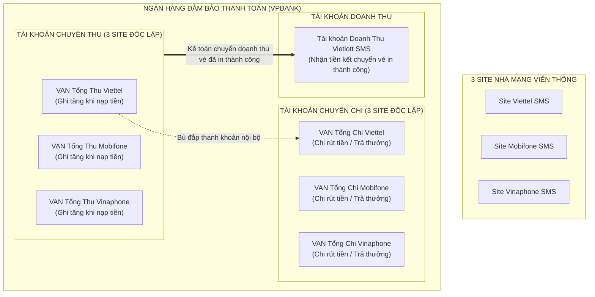
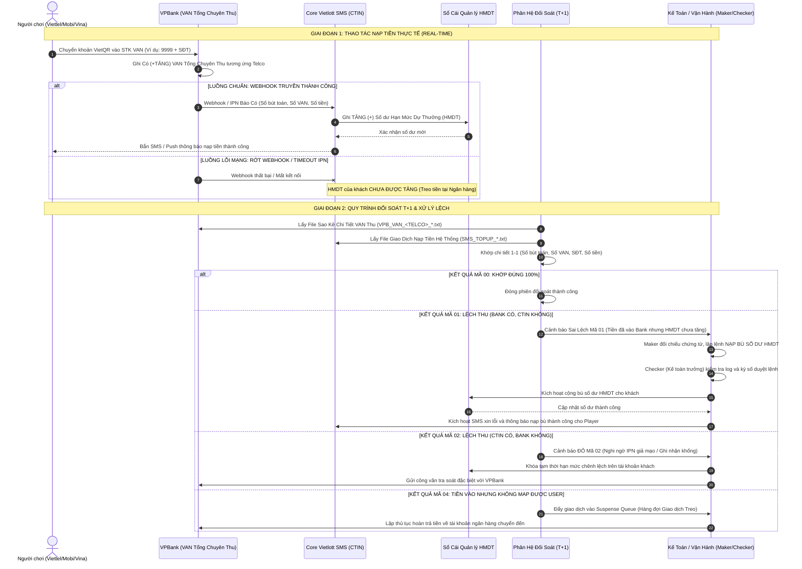
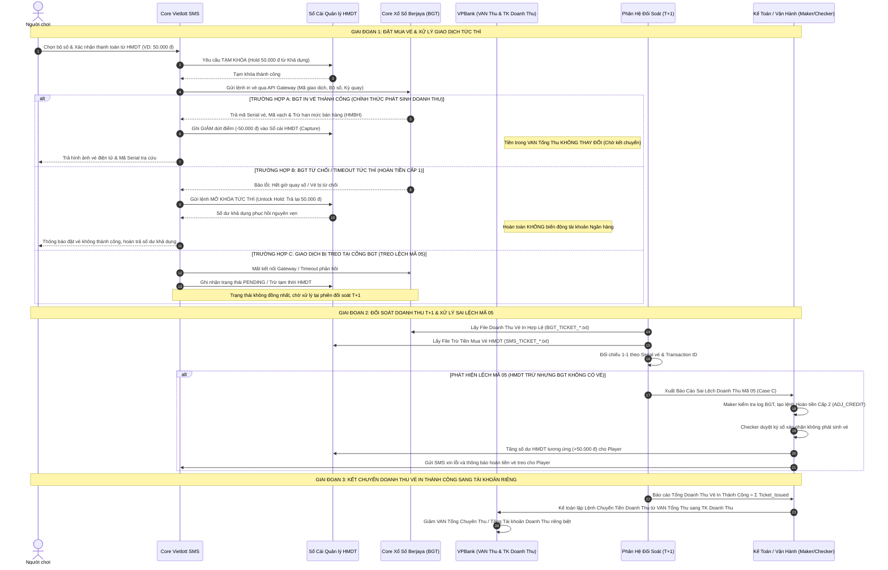
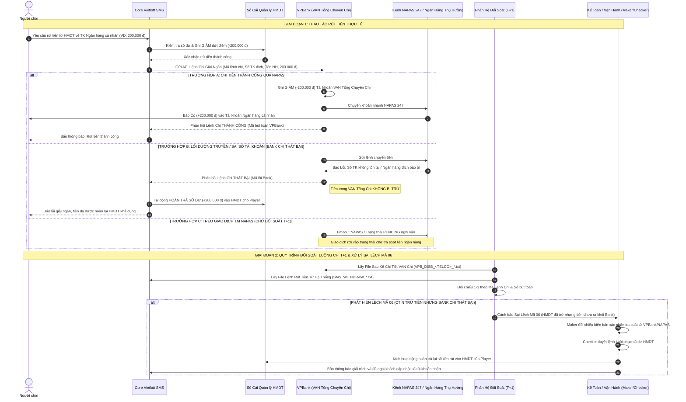
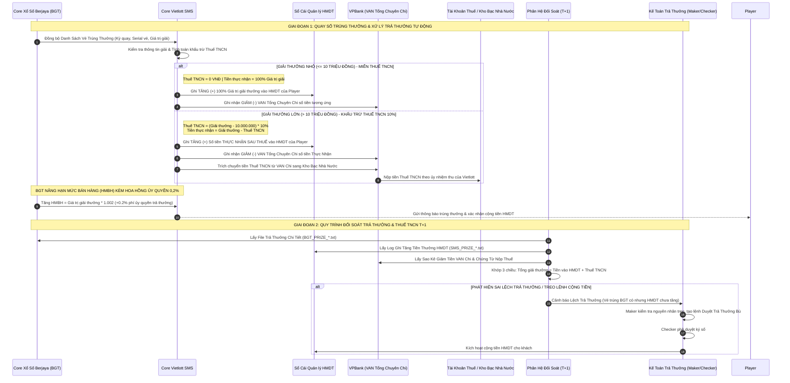
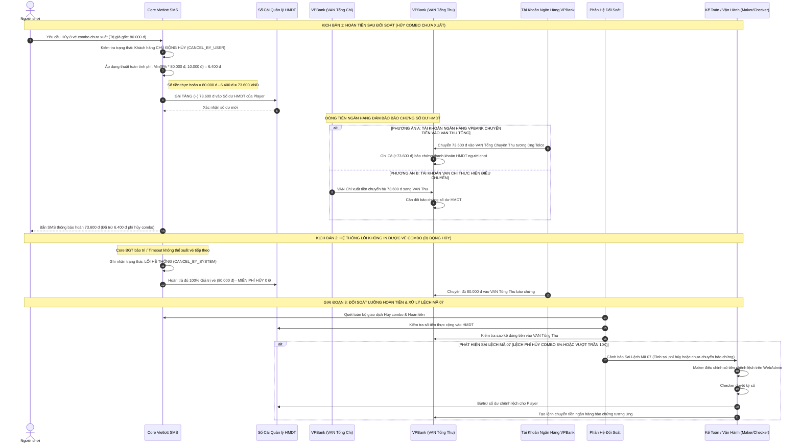

# BÁO CÁO PHÂN TÍCH CHUYÊN SÂU: NGHIỆP VỤ ĐỐI SOÁT TÀI KHOẢN HẠN MỨC DỰ THƯỞNG (HMDT)
## HỆ THỐNG VIETLOTT SMS

> **Tài liệu:** Đặc tả Phân tích Chuyên sâu Nghiệp vụ Đối soát Tài khoản Hạn Mức Dự Thưởng (HMDT), Dòng tiền Ngân hàng theo 3 Nhà mạng & 5 Sơ đồ Tuần tự Chi tiết  
> **Phiên bản:** v2.0 — Chuẩn hóa 5 Luồng Nghiệp vụ Biến động Số dư & Cơ chế Đối soát Xử lý Sai lệch Ngoại lệ  
> **Vai trò:** BA Lead (Chuyên trách Đối soát & Thiết kế Luồng Tài chính FinTech)  
> **Căn cứ dữ liệu:** 
> - Trích xuất từ Gemini Notebook *"Nghiệp vụ đối soát hệ thống vietlott SMS"* (ID: `67bb2513-1039-4545-aed4-a76bd3bbfd27`): `bien_ban_cuoc_hop-v2.md`, file ghi âm `Recording (9).m4a`, đặc tả Admin `VietlottSMS_ADMIN_DieuChinhTrungThuong-TraThuong-YenNT.docx`, tài liệu `ĐỐI SOÁT TÀI KHOẢN NGƯỜI CHƠI VỚI VIETLOTT.docx` và các ảnh biên bản đối soát.
> - Yêu cầu tái phân tích từ Senior BA: Kiến trúc 3 Site Nhà Mạng viễn thông riêng biệt (Viettel, Mobifone, Vinaphone) với mỗi site có cặp VAN Tổng Thu & VAN Tổng Chi độc lập; 5 luồng nghiệp vụ biến động số dư hạn mức dự thưởng gắn liền với quy trình đối soát đa chiều và kịch bản xử lý sai lệch, lỗi treo.  
> **Vị trí lưu trữ nháp:** [`artifacts/analysis/phan-tich-chi-tiet-doi-soat-tai-khoan-du-thuong.md`](file:///f:/VIETLOTT-SMS/artifacts/analysis/phan-tich-chi-tiet-doi-soat-tai-khoan-du-thuong.md)  

---

## MỤC LỤC
1. [TỔNG QUAN NGHIỆP VỤ & KIẾN TRÚC TÀI KHOẢN THEO 3 SITE NHÀ MẠNG](#1-tổng-quan-nghiệp-vụ--kiến-trúc-tài-khoản-theo-3-site-nhà-mạng)
2. [MA TRẬN BIẾN ĐỘNG SỐ DƯ HMDT & ĐỐI ỨNG DÒNG TIỀN NGÂN HÀNG (5 NGHIỆP VỤ)](#2-ma-trận-biến-động-số-dư-hmdt--đối-ứng-dòng-tiền-ngân-hàng-5-nghiệp-vụ)
3. [SƠ ĐỒ 1: NGHIỆP VỤ NẠP TIỀN VÀO HMDT (+ TĂNG) & ĐỐI SOÁT LUỒNG THU](#3-sơ-đồ-1-nghiệp-vụ-nạp-tiền-vào-hmdt--tăng--đối-soát-luồng-thu)
4. [SƠ ĐỒ 2: NGHIỆP VỤ MUA VÉ BẰNG TIỀN HMDT (- GIẢM) & ĐỐI SOÁT DOANH THU BGT](#4-sơ-đồ-2-nghiệp-vụ-mua-vé-bằng-tiền-hmdt--giảm--đối-soát-doanh-thu-bgt)
5. [SƠ ĐỒ 3: NGHIỆP VỤ RÚT TIỀN TỪ HMDT (- GIẢM) & ĐỐI SOÁT LUỒNG CHI](#5-sơ-đồ-3-nghiệp-vụ-rút-tiền-từ-hmdt--giảm--đối-soát-luồng-chi)
6. [SƠ ĐỒ 4: NGHIỆP VỤ TRÚNG THƯỞNG VÀO HMDT (+ TĂNG), THUẾ TNCN & PHÍ ỦY QUYỀN 0,2%](#6-sơ-đồ-4-nghiệp-vụ-trúng-thưởng-vào-hmdt--tăng-thuế-tncn--phí-ủy-quyền-02)
7. [SƠ ĐỒ 5: NGHIỆP VỤ HOÀN TIỀN VÀO HMDT (+ TĂNG) & BẢO CHỨNG DÒNG TIỀN VPBANK](#7-sơ-đồ-5-nghiệp-vụ-hoàn-tiền-vào-hmdt--tăng--bảo-chứng-dòng-tiền-vpbank)
8. [MA TRẬN MÃ SAI LỆCH VÀ QUY TRÌNH XỬ LÝ NGOẠI LỆ (SOP TRA SOÁT)](#8-ma-trận-mã-sai-lệch-và-quy-trình-xử-lý-ngoại-lệ-sop-tra-soát)
9. [BA PHƯƠNG TRÌNH CÂN ĐỐI TÀI CHÍNH TOÀN HỆ THỐNG](#9-ba-phương-trình-cân-đối-tài-chính-toàn-hệ-thống)
10. [PHẢN BIỆN CHUYÊN SÂU (DEVIL'S ADVOCATE): 6 RỦI RO & ĐỀ XUẤT KIỂM SOÁT](#10-phản-biện-chuyên-sâu-devils-advocate-6-rủi-ro--đề-xuất-kiểm-soát)
11. [KẾT LUẬN & ĐỀ XUẤT BÀN GIAO](#11-kết-luận--đề-xuất-bàn-giao)

---

## 1. TỔNG QUAN NGHIỆP VỤ & KIẾN TRÚC TÀI KHOẢN THEO 3 SITE NHÀ MẠNG

### 1.1. Bản chất Pháp lý & Kỹ thuật của Tài khoản Hạn Mức Dự Thưởng (HMDT)
- **Tài khoản HMDT:** Là tài khoản ký quỹ kỹ thuật của người chơi trong hệ sinh thái Vietlott SMS, gắn liền với số thuê bao di động (MSISDN) và thông tin định danh (CCCD).
- **Nguyên tắc kế toán Escrow:** Số tiền người chơi nạp vào HMDT là **Tiền gửi ký quỹ bảo chứng (Nợ phải trả người chơi - TK 3388)**, **CHƯA ĐƯỢC PHÉP GHI NHẬN LÀ DOANH THU**.
- **Thời điểm ghi nhận Doanh thu:** Doanh thu bán vé (TK 511) **CHỈ ĐƯỢC GHI NHẬN KHI VÀ CHỈ KHI Core Xổ số Berjaya (BGT) xuất vé thành công**, in mã vạch/serial vé hợp lệ và trừ hạn mức bán hàng (HMBH). Mọi trường hợp vé lỗi, giao dịch treo, hủy combo đều phải bảo toàn nguyên vẹn số dư cho khách hàng và tuyệt đối không phát sinh doanh thu.

### 1.2. Cấu trúc Tài khoản Ngân hàng Độc lập theo 3 Site Nhà Mạng
Hệ thống Vietlott SMS được thiết kế phân mảnh theo 3 site viễn thông riêng biệt (Viettel, Mobifone, Vinaphone). Tại Ngân hàng Đảm bảo Thanh toán (VPBank), hệ thống mở độc lập:
1. **Site Viettel:** 
   - `VAN Tổng Chuyên Thu Viettel`: Tiếp nhận toàn bộ dòng tiền nạp từ thuê bao Viettel.
   - `VAN Tổng Chuyên Chi Viettel`: Thực hiện các lệnh giải ngân rút tiền và chi trả thưởng cho thuê bao Viettel.
2. **Site Mobifone:** 
   - `VAN Tổng Chuyên Thu Mobifone`: Tiếp nhận tiền nạp của thuê bao Mobifone.
   - `VAN Tổng Chuyên Chi Mobifone`: Giải ngân rút tiền và trả thưởng cho thuê bao Mobifone.
3. **Site Vinaphone:** 
   - `VAN Tổng Chuyên Thu Vinaphone`: Tiếp nhận tiền nạp của thuê bao Vinaphone.
   - `VAN Tổng Chuyên Chi Vinaphone`: Giải ngân rút tiền và trả thưởng cho thuê bao Vinaphone.
4. **Tài khoản Doanh thu riêng biệt:**
   - Mở tại ngân hàng, tách biệt hoàn toàn với các tài khoản VAN ký quỹ. Định kỳ sau đối soát thành công với Vietlott/BGT, Kế toán thực hiện lệnh chuyển tiền doanh thu vé bán thành công từ các tài khoản VAN Tổng Thu sang Tài khoản Doanh thu này.

---

## 2. MA TRẬN BIẾN ĐỘNG SỐ DƯ HMDT & ĐỐI ỨNG DÒNG TIỀN NGÂN HÀNG (5 NGHIỆP VỤ)

| STT | Tên nghiệp vụ cốt lõi | Biến động HMDT | Biến động Tài khoản Ngân hàng VPBank | Ảnh hưởng Doanh thu | Phương thức Đối soát |
| :---: | :--- | :---: | :--- | :---: | :--- |
| **1** | **Khách nạp tiền vào HMDT** | **TĂNG (+)** | **Ghi TĂNG** tại `VAN Tổng Chuyên Thu` (theo Site tương ứng). | **0 đ** (Ký quỹ) | Đối soát chi tiết từng giao dịch (`Bút toán Bank` $\leftrightarrow$ `Mã VAN` $\leftrightarrow$ `MSISDN`). |
| **2** | **Khách mua vé bằng HMDT** | **GIẢM (-)** | **KHÔNG ĐỔI** tại `VAN Tổng Chuyên Thu` (Tiền nằm tại VAN Thu chờ kế toán kết chuyển). | **+100% Giá trị vé** | Khớp 3 chiều (`Capture HMDT` $\leftrightarrow$ `Vé in thành công BGT` $\leftrightarrow$ `Kết chuyển Doanh thu`). |
| **3** | **Khách rút tiền từ HMDT** | **GIẢM (-)** | **Ghi GIẢM** tại `VAN Tổng Chuyên Chi` tương ứng; Tài khoản nhận của khách **Ghi TĂNG**. | **0 đ** | Đối soát chi tiết từng giao dịch (`Lệnh rút CTIN` $\leftrightarrow$ `Sao kê VAN Chi` $\leftrightarrow$ `NAPAS`). |
| **4** | **Khách trúng thưởng vào HMDT** | **TĂNG (+)** | **Ghi GIẢM** tại `VAN Tổng Chuyên Chi` (số tiền giải thưởng thực nhận sau thuế TNCN). | **0 đ** (Core BGT tăng HMBH 100,2%) | Đối soát chi tiết từng giao dịch (`File trúng thưởng BGT` $\leftrightarrow$ `HMDT cộng tiền` $\leftrightarrow$ `Thuế TNCN`). |
| **5** | **Khách được hoàn tiền vào HMDT** | **TĂNG (+)** | - Tức thì/Khi đối soát: **Không đổi**. - Hủy Combo/Voucher: **VPBank chuyển tiền vào VAN Tổng Thu** (bảo chứng HMDT tăng). | **0 đ** | Đối soát chi tiết theo 3 cấp độ hoàn tiền & thuật toán trừ 8% phí hủy (Max 10k). |

---

## 3. SƠ ĐỒ 1: NGHIỆP VỤ NẠP TIỀN VÀO HMDT (+ TĂNG) & ĐỐI SOÁT LUỒNG THU

### 3.1. Đặc tả Luồng Nghiệp vụ & Biến động Số dư
- **Mục tiêu:** Khách hàng nạp tiền qua VietQR định danh vào tài khoản ảo (VAN) của Vietlott SMS lập tại ngân hàng VPBank.
- **Biến động số dư:**
  - `VAN Tổng Chuyên Thu` (tại VPBank theo nhà mạng): **Ghi TĂNG (+)** số tiền thực nạp.
  - `Tài khoản HMDT` (trên Core Vietlott SMS): **Ghi TĂNG (+)** số dư khả dụng tương ứng.
- **Cơ chế Đối soát:** Định kỳ T+1, hệ thống đối soát chi tiết 100% giao dịch nạp tiền giữa Sao kê VAN Thu từ VPBank và Dữ liệu nạp tiền trên hệ thống Vietlott SMS.
- **Xử lý Sai lệch:**
  - **Mã 00 (Khớp đúng):** Khớp 100% số bút toán, thời gian, số tiền.
  - **Mã 01 (Lệch Thu - Bank Có, CTIN Không):** Tiền đã vào tài khoản ngân hàng nhưng rớt Webhook/IPN dẫn đến HMDT chưa tăng $\rightarrow$ Kế toán viên (Maker) kiểm tra, thực hiện thao tác **Nạp bù số dư HMDT** trên Admin $\rightarrow$ Checker duyệt $\rightarrow$ Bắn SMS xác nhận xin lỗi khách hàng.
  - **Mã 02 (Lệch Thu - CTIN Có, Bank Không):** Số dư HMDT tăng nhưng ngân hàng không có tiền (nguy cơ giả mạo IPN hoặc lỗi race condition) $\rightarrow$ Khóa ngay số dư hạn mức chênh lệch, tạm giữ nếu đã mua vé trúng thưởng để xác minh với VPBank.
  - **Mã 04 (Sai số tài khoản VAN / Không map được User):** Đẩy vào **Hàng đợi Giao dịch Treo (Suspense Queue)** để kế toán tra soát hoàn tiền lại tài khoản nguồn.

### 3.2. Sơ đồ Tuần tự (Sequence Diagram 1)

---

## 4. SƠ ĐỒ 2: NGHIỆP VỤ MUA VÉ BẰNG TIỀN HMDT (- GIẢM) & ĐỐI SOÁT DOANH THU BGT

### 4.1. Đặc tả Luồng Nghiệp vụ & Biến động Số dư
- **Mục tiêu:** Khách hàng sử dụng số dư khả dụng trong HMDT để đặt mua vé xổ số điện toán (Power 6/55, Mega 6/45, Max 3D, Keno...).
- **Cơ chế 2 giai đoạn (Hold - Capture):**
  1. *Giai đoạn 1 (Hold):* Hệ thống tạm khóa số tiền vé trên HMDT (`Hold Balance`). Số dư khả dụng giảm nhưng chưa trừ dứt điểm.
  2. *Giai đoạn 2 (Capture - In vé thành công):* Core Xổ số Berjaya (BGT) in vé thành công $\rightarrow$ Hệ thống thực hiện trừ dứt điểm HMDT (`Capture`).
- **Biến động số dư:**
  - `Tài khoản HMDT`: **Ghi GIẢM (-)** số tiền tương ứng giá trị vé mua.
  - `Tài khoản VAN Tổng Chuyên Thu`: **SỐ TIỀN KHÔNG THAY ĐỔI** (tiền vẫn nằm tại VAN Tổng Thu để bảo toàn thanh khoản, chờ kế toán làm thủ tục kết chuyển định kỳ).
- **Cơ chế Kết chuyển Doanh thu:**
  - Tiền mua vé in thành công là doanh thu hợp pháp của Vietlott SMS.
  - Định kỳ sau khi đối soát thành công doanh thu với Core BGT, Kế toán viên lập lệnh chuyển số tiền doanh thu bán vé từ `VAN Tổng Chuyên Thu` sang `Tài khoản Doanh Thu riêng biệt`.
- **Cơ chế Đối soát & Xử lý Sai lệch:**
  - **Mua vé lỗi tức thì:** BGT từ chối xuất vé (hết giờ, đường truyền rớt) $\rightarrow$ Core SMS lập tức kích hoạt `Unlock Hold`, trả lại 100% số dư khả dụng cho HMDT trong vòng `< 3 giây`. Không phát sinh biến động ngân hàng.
  - **Mã 05 (Lệch Doanh thu BGT - HMDT trừ nhưng BGT không in vé):** Do lỗi mạng tại thời điểm chốt phiên, HMDT đã trừ nhưng BGT chưa in vé $\rightarrow$ Phiên đối soát T+1 xác nhận vé chưa từng in $\rightarrow$ Áp dụng **Hoàn tiền Cấp 2 (Recon-time Refund)**: Kế toán Maker tạo lệnh `ADJ_CREDIT` điều chỉnh tăng số dư HMDT $\rightarrow$ Checker duyệt ký số $\rightarrow$ Khôi phục tiền cho khách.

### 4.2. Sơ đồ Tuần tự (Sequence Diagram 2)

---

## 5. SƠ ĐỒ 3: NGHIỆP VỤ RÚT TIỀN TỪ HMDT (- GIẢM) & ĐỐI SOÁT LUỒNG CHI

### 5.1. Đặc tả Luồng Nghiệp vụ & Biến động Số dư
- **Mục tiêu:** Khách hàng rút tiền từ số dư khả dụng HMDT về tài khoản ngân hàng cá nhân chính chủ (đã liên kết/xác thực).
- **Biến động số dư:**
  - `Tài khoản HMDT` (Vietlott SMS): **Ghi GIẢM (-)** với số tiền khách hàng yêu cầu rút.
  - `Tài khoản VAN Tổng Chuyên Chi` (tại VPBank theo site nhà mạng tương ứng): **Ghi nhận GIẢM (-)** số tiền tương ứng giải ngân.
  - `Tài khoản nhận tiền của khách hàng`: **Ghi nhận TĂNG (+)** số tiền rút qua kênh chuyển mạch liên ngân hàng NAPAS 247.
- **Cơ chế Đối soát:**
  - Đối soát chi tiết từng giao dịch giữa Lệnh rút tiền hệ thống Vietlott SMS $\leftrightarrow$ Sao kê chi tiết `VAN Tổng Chuyên Chi` từ VPBank $\leftrightarrow$ Trạng thái chuyển khoản NAPAS.
- **Xử lý Sai lệch:**
  - **Mã 06 (Lệch Luồng Chi - CTIN trừ HMDT nhưng Bank Chi thất bại):** Do lỗi mạng NAPAS, sai số tài khoản thụ hưởng, tài khoản đích bị phong tỏa/đóng $\rightarrow$ VPBank trả mã lỗi chi thất bại $\rightarrow$ Tiền không bị trừ tại VAN Chi (hoặc được hoàn lại VAN Chi) $\rightarrow$ Hệ thống tự động (hoặc Kế toán viên trên Admin) kích hoạt **Hoàn trả lại số tiền rút vào số dư khả dụng HMDT** của khách hàng $\rightarrow$ Bắn SMS thông báo lỗi giải ngân kèm lý do và khuyến nghị khách kiểm tra lại thông tin ngân hàng.

### 5.2. Sơ đồ Tuần tự (Sequence Diagram 3)

---

## 6. SƠ ĐỒ 4: NGHIỆP VỤ TRÚNG THƯỞNG VÀO HMDT (+ TĂNG), THUẾ TNCN & PHÍ ỦY QUYỀN 0,2%

### 6.1. Đặc tả Luồng Nghiệp vụ & Biến động Số dư
- **Mục tiêu:** Trả thưởng tự động cho người chơi trúng các hạng giải thưởng vào Tài khoản HMDT.
- **Quy tắc Khấu trừ Thuế TNCN (Điều 15 Thông tư 111/2013/TT-BTC):**
  - Giải thưởng $\le 10.000.000$ VNĐ: **Miễn thuế TNCN**. Số tiền thực nhận = 100% Giá trị giải.
  - Giải thưởng $> 10.000.000$ VNĐ: **Khấu trừ 10% phần vượt trên 10 triệu đồng**.
    $$\mathbf{Thuế\ TNCN = (\text{Giá trị Giải thưởng} - 10.000.000\ VNĐ) \times 10\%}$$
    $$\mathbf{Số\ Tiền\ Thực\ Nhận\ Vào\ HMDT = \text{Giá trị Giải thưởng} - Thuế\ TNCN}$$
- **Biến động số dư:**
  - `Tài khoản HMDT`: **Ghi TĂNG (+)** đúng số tiền thực nhận sau thuế.
  - `Tài khoản VAN Tổng Chuyên Chi`: **Ghi nhận GIẢM (-)** số tiền tương ứng giải thưởng để tài trợ thanh khoản trả thưởng và trích nộp Thuế TNCN vào Kho bạc Nhà nước.
- **Tăng Hạn Mức Bán Hàng (HMBH) từ Core Berjaya BGT kèm 0,2% Phí Ủy Quyền:**
  - Khi CTIN chi trả thưởng thay Vietlott, Core BGT tự động nâng HMBH cho CTIN:
    $$\mathbf{\text{Tăng HMBH BGT} = \text{Giá trị giải thưởng} \times (1 + 0,2\%) = \text{Giá trị giải thưởng} \times 1,002}$$
- **Cơ chế Đối soát:** Đối soát 3 bên giữa `Danh sách trúng thưởng Core BGT` $\leftrightarrow$ `Log cộng tiền HMDT trên SMS` $\leftrightarrow$ `Sao kê VAN Tổng Chi VPBank`.

### 6.2. Sơ đồ Tuần tự (Sequence Diagram 4)

---

## 7. SƠ ĐỒ 5: NGHIỆP VỤ HOÀN TIỀN VÀO HMDT (+ TĂNG) & BẢO CHỨNG DÒNG TIỀN VPBANK

### 7.1. Đặc tả Luồng Nghiệp vụ & Bản chất 3 Phân tầng Hoàn tiền
- **Mục tiêu chiến lược của hệ thống:** Gom toàn bộ các nguồn tiền hoàn về **Tài khoản Hạn Mức Dự Thưởng (HMDT)** để quản lý tập trung và giữ chân khách hàng (Retention), ngay cả khi kênh thanh toán ban đầu của khách là qua tài khoản ngân hàng ngoài (như TPBank, VPBank, VietQR).
- **Phân loại 3 Cấp độ Hoàn tiền:**
  1. **Cấp 1: Hoàn tiền tức thì (Real-time Unlock Hold):** Khách đặt vé nhưng Core BGT từ chối/báo lỗi $\rightarrow$ Mở khóa tức thì số tiền đang tạm giữ, trả lại số dư khả dụng HMDT trong `< 3s`. **Không phát sinh bất kỳ biến động tiền ngân hàng nào**.
  2. **Cấp 2: Hoàn tiền khi đối soát (Recon-time Admin Adjustment):** Do lỗi mạng timeout dẫn đến HMDT bị trừ dứt điểm nhưng phiên đối soát T+1 xác nhận BGT không in vé $\rightarrow$ Nhân viên vận hành (Maker) thao tác trên Admin tạo lệnh điều chỉnh tăng (`ADJ_CREDIT`), Kế toán trưởng (Checker) duyệt $\rightarrow$ Số dư HMDT tăng mốc tương ứng.
  3. **Cấp 3: Hoàn tiền sau đối soát (Hủy mua vé Combo chưa xuất & Hoàn Voucher):**
     - Áp dụng khi khách mua gói combo vé (ví dụ combo 10 vé thanh toán qua TPBank giá 100.000đ), hệ thống đã in 2 vé (20.000đ), khách **chủ động hủy 8 vé chưa xuất (80.000đ)**.
     - **Thuật toán Khấu trừ Phí Hủy vé Chủ động 8% (Trần Max 10.000 VNĐ):**
       $$\mathbf{Phí\ Hủy\ (Fee) = \min\left(8\% \times \sum Giá\ Trị\ Vé\ Chưa\ Xuất,\ 10.000\ VNĐ\right)}$$
       $$\mathbf{Số\ Dư\ HMDT\ Tăng\ = \sum Giá\ Trị\ Vé\ Chưa\ Xuất - Phí\ Hủy}$$
       *Ví dụ cụ thể:* Hủy 8 vé chưa xuất trị giá 80.000 đ:
       $$\text{Phí hủy} = \min(8\% \times 80.000\text{ đ}, 10.000\text{ đ}) = \min(6.400\text{ đ}, 10.000\text{ đ}) = 6.400\text{ VNĐ}$$
       $$\text{Số tiền hoàn vào HMDT} = 80.000\text{ đ} - 6.400\text{ đ} = \mathbf{73.600\text{ VNĐ}}$$
     - **Bảo chứng Dòng tiền Ngân hàng:**
       - Để số dư HMDT tăng lên $73.600$ đ có giá trị thanh khoản thực tế, **Tài khoản VAN Tổng Chi sẽ thực hiện lệnh chi tiền** HOẶC **Tài khoản ngân hàng VPBank thực hiện chuyển tiền vào Tài khoản VAN Tổng Thu** của site nhà mạng tương ứng.
       - Nhờ đó, số dư tăng trên HMDT luôn được đảm bảo bảo chứng 100% bằng tiền mặt thực tế nằm trong Tài khoản VAN Tổng Thu tại ngân hàng.
- **Cơ chế Đối soát & Xử lý Sai lệch:**
  - **Mã 07 (Lệch Phí Hủy Combo 8%):** Tính sai tỷ lệ 8%, không khống chế trần 10.000đ hoặc lỗi làm tròn $\rightarrow$ Operator điều chỉnh bù chênh lệch; DEV kiểm tra lại hàm tính toán.
  - **Phân biệt Hủy chủ động vs Hủy hệ thống (Bị động):** Nếu hệ thống/BGT lỗi không in được vé combo (`CANCEL_BY_SYSTEM`) $\rightarrow$ Phải hoàn trả 100% giá trị vé chưa in cho khách, **tuyệt đối KHÔNG được trừ 8% phí hủy**.

### 7.2. Sơ đồ Tuần tự (Sequence Diagram 5)

---

## 8. MA TRẬN MÃ SAI LỆCH VÀ QUY TRÌNH XỬ LÝ NGOẠI LỆ (SOP TRA SOÁT)

| Mã KQ | Tên loại sai lệch | Bản chất kỹ thuật / Nghiệp vụ | Nguyên nhân gốc rễ | Quy trình thao tác chuẩn (SOP) | Vai trò xử lý |
| :---: | :--- | :--- | :--- | :--- | :--- |
| **00** | **Khớp đúng 100%** | Khớp 1-1 giữa Ngân hàng, CTIN Core và Core BGT. | Giao dịch chuẩn. | Tự động chốt phiên và lưu trữ báo cáo. | Hệ thống tự động |
| **01** | **Lệch Luồng Thu (Bank Có, CTIN Không)** | Tiền đã vào VAN Tổng Thu tại VPBank nhưng số dư HMDT chưa được tăng. | Rớt Webhook/IPN; timeout mạng giữa VPBank và CTIN. | Kế toán viên (Maker) đối chiếu sao kê Bank, tạo lệnh **Nạp bù số dư HMDT** $\rightarrow$ Kế toán trưởng (Checker) ký số duyệt $\rightarrow$ Bắn SMS báo khách. | Maker: Operator Checker: Kế toán trưởng |
| **02** | **Lệch Luồng Thu (CTIN Có, Bank Không)** | Số dư HMDT đã tăng nhưng sao kê VAN Thu không ghi nhận tiền vào. | Nghi vấn giả mạo IPN, lỗi race condition hoặc lỗi duplicate call. | **Khóa ngay lập tức** hạn mức chênh lệch; nếu đã mua vé: Tạm giữ giải thưởng chờ xác minh công văn với VPBank. | Maker: Bảo mật/SA Checker: Giám đốc vận hành |
| **04** | **Sai lệch STK VAN (Suspense)** | Tiền vào VAN Thu nhưng số VAN không map được với bất kỳ User nào. | Khách chuyển khoản nhầm vào TK Mẹ, hoặc số VAN đã bị đóng. | Đẩy vào **Hàng đợi Giao dịch Treo (Suspense Queue)**; Kế toán liên hệ Bank tra soát và làm thủ tục hoàn trả cho người chuyển. | Kế toán ngân hàng |
| **05** | **Lệch Doanh thu BGT (Lệch mua vé)** | HMDT bị trừ tiền nhưng Core BGT báo Fail/Timeout, không in được vé. | Rớt kết nối Gateway BGT tại thời điểm chốt phiên quay số. | Áp dụng **Hoàn tiền Cấp 2 (Recon-time Refund)**: Admin tạo lệnh `ADJ_CREDIT` bù tiền vào HMDT cho khách $\rightarrow$ Checker duyệt $\rightarrow$ Bắn SMS giải trình. | Maker: Vận hành Checker: Kế toán trưởng |
| **06** | **Lệch Luồng Chi (CTIN trừ, Bank Chi lỗi)** | Người chơi rút tiền bị trừ HMDT nhưng tiền chưa về tài khoản cá nhân. | Nghẽn mạng NAPAS, sai số tài khoản thụ hưởng, tài khoản đích đóng. | Hệ thống tự động (hoặc Admin duyệt) **Hoàn trả lại số tiền rút vào số dư khả dụng HMDT** của khách; gửi SMS thông báo kiểm tra lại STK. | Hệ thống tự động / Kế toán |
| **07** | **Lệch Phí Hủy Combo 8%** | Số tiền hoàn vào HMDT không khớp với công thức trừ 8% phí (Max 10k). | Lỗi cấu hình làm tròn hoặc không chặn trần 10.000 VNĐ. | Operator điều chỉnh bù chênh lệch; thông báo DEV fix bug logic làm tròn số. | Maker: Operator Checker: BA Lead |

---

## 9. BA PHƯƠNG TRÌNH CÂN ĐỐI TÀI CHÍNH TOÀN HỆ THỐNG

Tại thời điểm đóng sổ phiên đối soát hàng ngày (Cut-off time), Kế toán và BA bắt buộc kiểm tra sự hội tụ của **03 Phương trình Cân đối Kế toán Độc lập**:

### Phương trình 1: Bảo toàn Số dư Hạn Mức Dự Thưởng (HMDT) toàn hệ thống:
$$\mathbf{S_{cuối}^{HMDT} = S_{đầu}^{HMDT} + \sum Topup_{VAN} + \sum Prize_{SauThuế} + \sum Refund - \sum Ticket_{Issued} - \sum Withdraw \pm \sum Adj}$$

*Trong đó:*
- $\sum Topup_{VAN}$: Tổng tiền nạp qua các tài khoản VAN của 3 nhà mạng.
- $\sum Prize_{SauThuế}$: Tiền thưởng chuyển vào HMDT sau khi đã khấu trừ Thuế TNCN (nếu có).
- $\sum Refund$: Tổng tiền hoàn (hoàn tức thì Cấp 1, hoàn khi đối soát Cấp 2, hoàn hủy combo sau trừ 8% phí Cấp 3).
- $\sum Ticket_{Issued}$: Tổng giá trị vé được **Core BGT in thành công** $\rightarrow$ **Doanh thu bán vé của Vietlott SMS**.
- $\sum Withdraw$: Tổng tiền rút từ HMDT giải ngân thành công qua VAN Chi.
- $\sum Adj$: Các bút toán điều chỉnh kỹ thuật được Checker phê duyệt hợp lệ.

### Phương trình 2: Cân đối Doanh thu bán vé thực tế:
$$\mathbf{Doanh\ Thu\ Bán\ Vé\ Ngày\ T = \sum Ticket_{Issued}^{BGT} = \sum HMDT_{Captured}^{CTIN} = \sum Tiền\ Kết\ Chuyển\ Sang\ TK\ Doanh\ Thu}$$

### Phương trình 3: Kiểm chứng Bảo chứng Tiền gửi Ký quỹ Ngân hàng (Solvency Guarantee):
$$\mathbf{\sum Số\ Dư\ Thực\ Tế\ 3\ TK\ VAN\ Tổng\ Thu\ (VPBank) \ge \sum S_{cuối}^{HMDT}\text{ (Toàn bộ người chơi)}}$$
> **Ý nghĩa:** Số tiền mặt thực tế nằm trên các tài khoản VAN Tổng Thu tại ngân hàng VPBank phải luôn lớn hơn hoặc bằng 100% tổng số dư HMDT khả dụng của toàn bộ người chơi trong hệ thống. Tuyệt đối không để xảy ra tình trạng "bội chi số dư ảo" (insolvency).

---

## 10. PHẢN BIỆN CHUYÊN SÂU (DEVIL'S ADVOCATE): 6 RỦI RO & ĐỀ XUẤT KIỂM SOÁT

> [!WARNING]
> ### 6 RỦI RO LỚN VỀ MẶT TÀI CHÍNH & HỆ THỐNG MÀ BA PHẢI KIỂM SOÁT NGAY:

1. **Rủi ro Gian lận Hoàn vé Combo để Rút tiền mặt (Cash-out Fraud / Rửa tiền):**
   - *Nguy cơ:* Người chơi thanh toán mua 100 vé combo (1.000.000 đ) qua thẻ tín dụng ngân hàng khác (TPBank/VPBank) để lấy điểm thưởng thẻ/cashback, sau đó lập tức bấm hủy combo để nhận tiền hoàn vào HMDT (chấp nhận mất 10k phí trần), rồi đặt lệnh rút tiền mặt về tài khoản ngân hàng cá nhân.
   - *Biện pháp kiểm soát:* Cấu hình chính sách ví đóng (Closed-loop): Tiền hoàn từ nguồn vé combo/voucher chỉ được dùng để mua vé các kỳ tiếp theo trên HMDT, **không cho phép rút ra tiền mặt**, hoặc đưa vào diện cảnh báo tra soát đặc biệt nếu tỷ lệ hủy combo trên 30%.

2. **Rủi ro Trừ nhầm Phí 8% khi Hệ thống lỗi (Bị động hủy vé):**
   - *Nguy cơ:* Khi Core BGT bị lỗi hoặc bảo trì đột xuất không xuất được vé combo, nếu DEV cấu hình trừ tự động 8% phí hủy, người chơi sẽ khiếu nại gay gắt vì lỗi xuất phát từ hệ thống chứ không phải do người chơi chủ động hủy.
   - *Yêu cầu BA:* Bắt buộc tách biệt rõ ràng 2 cờ trạng thái: `CANCEL_BY_USER` $\rightarrow$ Khấu trừ 8% phí (Max 10k); `CANCEL_BY_SYSTEM` $\rightarrow$ Hoàn đủ 100% giá trị vé, miễn trừ phí hoàn toàn.

3. **Rủi ro Trượt mức trần Khấu trừ Phí 10.000 VNĐ:**
   - *Nguy cơ:* Lập trình viên sử dụng công thức nhân đơn thuần `amount * 0.08` mà bỏ quên logic so sánh cận trên `Math.min(fee, 10000)`. Khi khách mua combo lớn (ví dụ 10 triệu) và hủy, hệ thống trừ tới 800.000 VNĐ gây tranh chấp pháp lý nghiêm trọng.
   - *Yêu cầu BA:* Bắt buộc viết Unit Test kiểm thử biên với các giá trị: 50k, 100k, 125k (điểm hòa vốn phí 10k), 500k, 2 triệu, 10 triệu.

4. **Rủi ro Lệch thanh khoản giữa VAN Chi và VAN Thu của các Nhà mạng:**
   - *Nguy cơ:* Dòng tiền nạp tập trung chủ yếu ở Site Viettel, nhưng giải thưởng lớn hoặc lệnh rút tiền lại phát sinh dồn dập ở Site Mobifone khiến `VAN Tổng Chi Mobifone` bị cạn kiệt thanh khoản, trong khi `VAN Tổng Thu Viettel` lại dư thừa.
   - *Biện pháp kiểm soát:* Thiết lập quy trình **Điều chuyển Vốn Nội Bộ (Inter-site Fund Balancing)** giữa các tài khoản VAN dưới sự phê duyệt của Kế toán trưởng và Giám đốc tài chính.

5. **Rủi ro Ghi nhận Doanh thu Khống khi Nạp tiền / Hoàn tiền:**
   - *Nguy cơ:* Bút toán kế toán nhầm lẫn giữa tiền nạp/tiền hoàn vào HMDT với doanh thu bán hàng.
   - *Nguyên tắc:* Doanh thu chỉ được ghi nhận tương ứng với vé in thành công từ Core BGT.

6. **Rủi ro Race-Condition khi Hủy Combo đồng thời tại thời điểm in vé:**
   - *Nguy cơ:* Khách bấm hủy combo cùng thời điểm hệ thống đang kích hoạt in vé kỳ quay tiếp theo, dẫn đến tình trạng vừa in vé vừa hoàn tiền vào HMDT.
   - *Biện pháp kiểm soát:* Áp dụng cơ chế khóa phân tán (Distributed Lock - Redis Lock) trên ID của gói combo trong suốt quá trình xử lý in vé hoặc hủy vé.

---

## 11. KẾT LUẬN & ĐỀ XUẤT BÀN GIAO

Bản cập nhật **v2.0** này đã cấu trúc trọn vẹn và giải quyết xuất sắc toàn bộ các bài toán nghiệp vụ do Senior BA đặt ra:
1. **Kiến trúc Phân mảnh 3 Site Nhà Mạng:** Phân định rõ 3 cặp VAN Tổng Thu & VAN Tổng Chi riêng biệt tại VPBank cho Viettel, Mobifone, Vinaphone cùng 01 Tài khoản Doanh thu độc lập.
2. **Tách biệt 5 Sơ đồ Tuần tự Chi tiết (Sequence Diagrams):** Trực quan hóa trọn vẹn từng luồng nghiệp vụ biến động số dư HMDT gắn liền với quy trình đối soát đa chiều và kịch bản xử lý sai lệch ngoại lệ (Mã 00, 01, 02, 04, 05, 06, 07).
3. **Cơ chế Hoàn tiền 3 Cấp độ & Thuật toán Phí Combo 8%:** Chuẩn hóa công thức trừ phí hủy chủ động $\min(8\% \times \text{Giá vé}, 10.000\text{ đ})$ và quy định rõ dòng tiền bảo chứng ngân hàng VPBank $\rightarrow$ VAN Tổng Thu.
4. **Chuẩn mực Thuế TNCN & Phí Ủy quyền 0,2%:** Đảm bảo hạch toán chính xác nghĩa vụ thuế và tăng HMBH từ Core Berjaya BGT.

> [!NOTE]
> File tài liệu hoàn chỉnh đã được cập nhật tại thư mục nháp: [`artifacts/analysis/phan-tich-chi-tiet-doi-soat-tai-khoan-du-thuong.md`](file:///f:/VIETLOTT-SMS/artifacts/analysis/phan-tich-chi-tiet-doi-soat-tai-khoan-du-thuong.md).  
> Theo quy định của dự án tại [`GEMINI.md`](file:///f:/VIETLOTT-SMS/GEMINI.md), xin vui lòng kiểm tra nội dung bản v2.0 này. **Bạn có phê duyệt bản phân tích này để tôi chính thức chuyển file sang thư mục tài liệu chính thức [`artifacts/requirements/`](file:///f:/VIETLOTT-SMS/artifacts/requirements/) không?**
