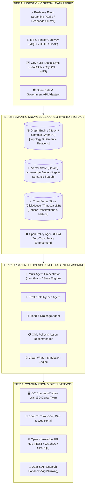
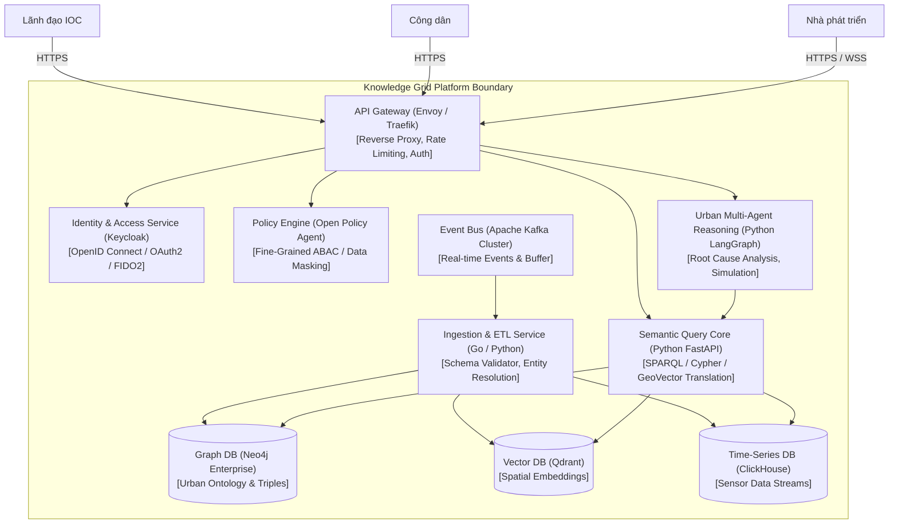

# [🏛️ ROLE: SA] Kiến Trúc Hệ Thống Tổng Thể & Hồ Sơ Quyết Định Kiến Trúc (Architecture Blueprint & ADRs)

> **Dự án:** Kiến Trúc Đô Thị Tri Thức (Urban Knowledge Grid - UKG)  
> **Phiên bản:** v1.0.0 (Draft)  
> **Benchmark:** TOGAF 10 + AWS Well-Architected Framework + C4 Model  
> **Trạng thái:** `artifacts/requirements/` (Chờ Review & Phê duyệt)  

---

## 1. Phân Tích 5 Chiều Kiến Trúc Bắt Buộc (5-Dimension Trade-off Analysis)

Trước khi lựa chọn công nghệ và mô hình phân bổ, Solution Architect tiến hành đánh giá 5 chiều:

```
                     SCALE (100k msg/s, 100M triples)
                                 /\
                                /  \
                               /    \
       TIME (MVP trong 6 tháng)/______\ COST (Tối ưu hạ tầng On-Prem + Cloud)
                              /\      /\
                             /  \    /  \
                            /____\  /____\
                RISK (Chủ quyền dữ liệu)  TEAM (Team 10-15 Engineers)
```

| Chiều phân tích | Bối cảnh & Thách thức | Quyết định Kiến trúc & Đánh đổi (Trade-off) |
|---|---|---|
| **1. SCALE (Quy mô & Tải)** | - 50.000 cảm biến IoT gửi dữ liệu liên tục.<br>- Đồ thị tri thức đạt 100 triệu bộ ba (Triples) trong 2 năm.<br>- Truy vấn GeoSPARQL & Vector đồng thời. | **Chọn Kiến trúc Phân tầng Hybrid Polyglot:**<br>- Lưu đồ thị quan hệ bằng Graph Database (Neo4j / Apache Jena).<br>- Lưu dữ liệu chuỗi thời gian (IoT Time-series) bằng ClickHouse / TimescaleDB.<br>- Lưu vector embedding bằng Qdrant.<br>*Trade-off:* Tăng độ phức tạp của đồng bộ dữ liệu nhưng đảm bảo tốc độ truy vấn P95 < 200ms. |
| **2. COST (Chi phí đầu tư & Vận hành)** | - Ngân sách đầu tư công cần tối ưu hóa TCO.<br>- Tránh bị khóa chặt vào một nhà cung cấp đám mây ngoại (Vendor Lock-in). | **Mô hình Hạ tầng Lai (Hybrid Sovereign Cloud):**<br>- Sử dụng Kubernetes (K3s/RKE2) trên Data Center nội địa (Chính quyền số).<br>- Sử dụng các công cụ mã nguồn mở cấp doanh nghiệp (CNCF-graduated: Kafka, Postgres, Envoy). |
| **3. TEAM (Năng lực Đội ngũ)** | - Đội ngũ kỹ sư Việt Nam am hiểu Python, Go, TypeScript, Docker.<br>- Chưa có nhiều chuyên gia sâu về RDF/SPARQL thuần túy. | **Lớp Trừu Tượng Ngữ Nghĩa (Semantic Abstraction Layer):**<br>- Cung cấp Python SDK và REST/GraphQL Gateway bọc ngoài các truy vấn SPARQL/Cypher phức tạp, giúp các lập trình viên ứng dụng khai thác dễ dàng mà không cần học sâu lý thuyết Semantic Web. |
| **4. TIME (Tiến độ giao hàng)** | - Yêu cầu bàn giao Horizon 1 MVP trong 6 tháng. | **Tái sử dụng các Frameworks và Chuẩn mở có sẵn:**<br>- Kế thừa Schema SAREF4CITY và CityGML thay vì thiết kế Ontology từ con số 0.<br>- Sử dụng Fastify / FastAPI và Open Policy Agent (OPA) đóng gói sẵn. |
| **5. RISK (An toàn & Rủi ro)** | - Dữ liệu nhạy cảm của các sở ngành (an ninh, dân cư) không được phép chia sẻ thô.<br>- Rủi ro rò rỉ dữ liệu vị trí công dân. | **Zero-Trust Data Mesh & Federated Policy:**<br>- Dữ liệu định danh được ẩn danh hóa (Spatial K-Anonymity) ngay tại Gateway biên.<br>- Kiểm soát chính sách truy cập phân tán qua OPA Engine (Attribute-Based Access Control). |

---

## 2. Kiến Trúc 4 Tầng Tổng Thể (4-Tier Enterprise Blueprint)



---

## 3. Mô Hình C4 Model — Mức Container (C4 Container Diagram)



---

## 4. Hồ Sơ Quyết Định Kiến Trúc (Architecture Decision Records - ADRs)

### ADR-001: Lựa Chọn Lưu Trữ Đồ Thị Tri Thức Đa Tầng (Hybrid Graph-Vector Storage)
- **Trạng thái:** `APPROVED`
- **Bối cảnh:** Hệ thống cần vừa quản lý quan hệ ngữ nghĩa topo đô thị phức tạp (Graph Traversal), vừa tìm kiếm câu hỏi tự nhiên mờ (Vector Embedding), vừa lưu trữ hàng tỷ mẫu quan trắc cảm biến theo thời gian (Time-series).
- **Quyết định:** Sử dụng mô hình **Polyglot Persistence**:
  1. **Neo4j Enterprise:** Lưu trữ mạng lưới thực thể, quan hệ ngữ nghĩa, cấu trúc không gian và ràng buộc Ontology.
  2. **Qdrant:** Lưu trữ vector embedding văn bản quy hoạch, phản ánh công dân và tri thức tài liệu đô thị.
  3. **ClickHouse:** Lưu trữ dữ liệu cảm biến chuỗi thời gian để phục vụ tổng hợp phân tích nhanh.
- **Hệ quả (Consequences):**
  - *Tích cực:* Đạt hiệu năng tối ưu cho từng loại dữ liệu chuyên biệt; không bị nghẽn Graph DB do lưu dữ liệu thô.
  - *Tiêu cực:* Cần duy trì cơ chế đồng bộ nhất quán cuối cùng (Eventual Consistency) qua Kafka Event Ingestion.

---

### ADR-002: Xương Sống Truyền Tin Thời Gian Thực (Event-Driven Backbone)
- **Trạng thái:** `APPROVED`
- **Bối cảnh:** Hàng chục ngàn cảm biến IoT và hệ thống camera AI gửi dữ liệu với tần suất cao, cần bộ đệm chịu lỗi và hỗ trợ xử lý luồng (Stream Processing).
- **Quyết định:** Triển khai **Apache Kafka (hoặc Redpanda)** làm trục xương sống Event-Driven Ingestion.
  - Phân vùng (Partitions) theo mã vùng hành chính `administrative_zone_id` và loại dữ liệu `sensor_type`.
  - Thiết lập cơ chế Idempotency Producer (`enable.idempotence=true`) để chống trùng dữ liệu.
- **Hệ quả:** Đảm bảo độ trễ thấp (< 10ms), khả năng mở rộng tuyến tính và chống mất dữ liệu khi hệ thống phía sau bảo trì.

---

### ADR-003: Kiến Trúc Phân Tích Đa Tác Tử (Multi-Agent Reasoning with Human-in-the-Loop)
- **Trạng thái:** `APPROVED`
- **Bối cảnh:** Cần tự động hóa phân tích nguyên nhân sự cố liên ngành mà không làm mất kiểm soát an toàn vận hành đô thị.
- **Quyết định:** Sử dụng **LangGraph / Python State Machine** để điều phối các tác tử chuyên biệt:
  - *Traffic Agent:* Phân tích luồng xe và mật độ giao thông.
  - *Hydrology Agent:* Phân tích mực nước, triều cường và trạm bơm.
  - *Synthesizer Agent:* Tích hợp báo cáo nguyên nhân gốc và đề xuất giải pháp.
  - **Quy tắc An Toàn (Safety Gate):** Mọi hành động tác động vật lý (thay đổi đèn tín hiệu, xả đập, phát loa khẩn cấp) bắt buộc phải có **Human-in-the-Loop (HITL)** — chờ phê duyệt 2 cấp của Chỉ huy trưởng IOC.
- **Hệ quả:** Đảm bảo tính minh bạch, có thể giải thích được (Explainable AI) và an toàn tuyệt đối cho đô thị.

---

### ADR-004: Chủ Quyền Dữ Liệu & Kiểm Soát Chính Sách Không Tin Cậy (Zero-Trust Data Sovereignty with OPA)
- **Trạng thái:** `APPROVED`
- **Bối cảnh:** Dữ liệu từ các sở ngành có độ nhạy cảm khác nhau; cần chia sẻ liên thông nhưng tuân thủ nghiêm ngặt Nghị định 13/2023/NĐ-CP và bảo vệ quyền riêng tư công dân.
- **Quyết định:** 
  - Triển khai **Open Policy Agent (OPA)** làm Policy Decision Point (PDP) tập trung.
  - Áp dụng **Attribute-Based Access Control (ABAC)** dựa trên: Vai trò người dùng (`user.role`), Mục đích sử dụng (`request.purpose`), Phân loại bảo mật dữ liệu (`resource.classification`) và Ngữ cảnh không gian thời gian (`context.time_window`).
  - Áp dụng thuật toán **Spatial K-Anonymity & Coordinate Truncation** (Làm mờ tọa độ nhà riêng xuống cấp độ khu phố) khi cung cấp dữ liệu ra ngoài môi trường công cộng.
- **Hệ quả:** Ngăn chặn tuyệt đối việc khai thác trái phép dữ liệu cá nhân, đáp ứng toàn diện các tiêu chuẩn kiểm toán an ninh thông tin nhà nước.

---

## 5. Review & Verification (Kế Hoạch Kiểm Tra & Đánh Giá Lại)

- **Chu kỳ đánh giá:** Đánh giá lại định kỳ mỗi 6 tháng hoặc khi lưu lượng truy cập vượt 100,000 msg/s.
- **Tiêu chí rà soát:** Tính toàn vẹn của mô hình hybrid polyglot, độ trễ Kafka streaming P95 và độ chính xác phân tích của các Multi-Agent.

---
*Tài liệu Kiến trúc Hệ thống & ADRs được bảo chứng bởi Solution Architect Lead.*
