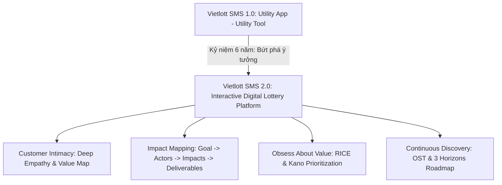
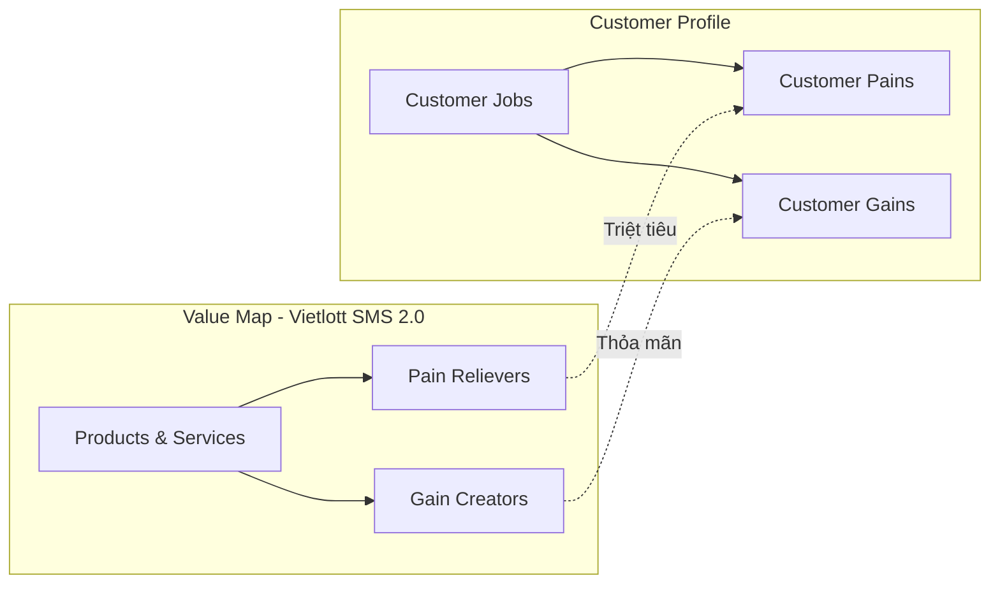
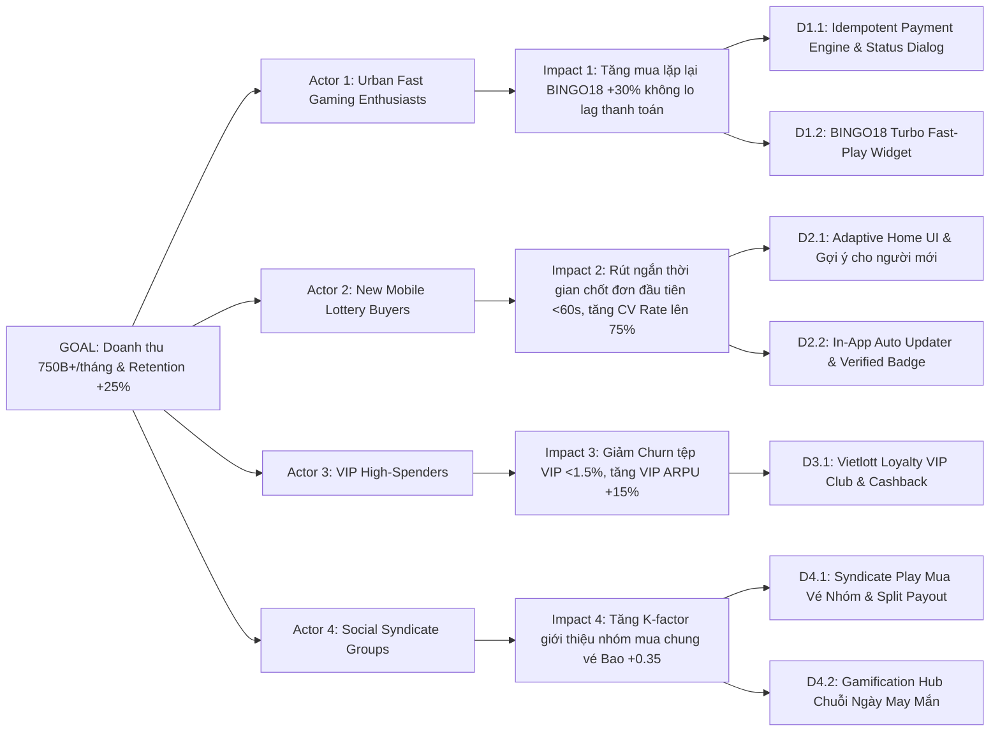
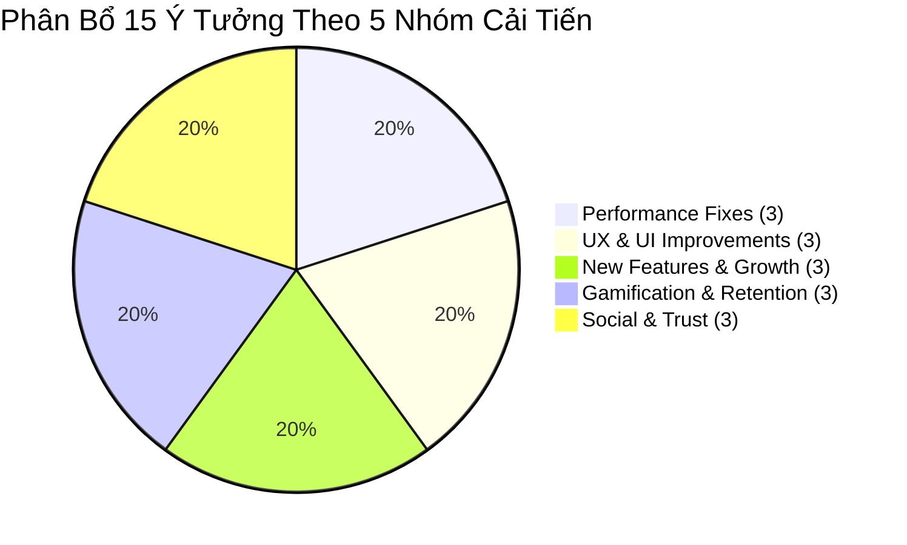
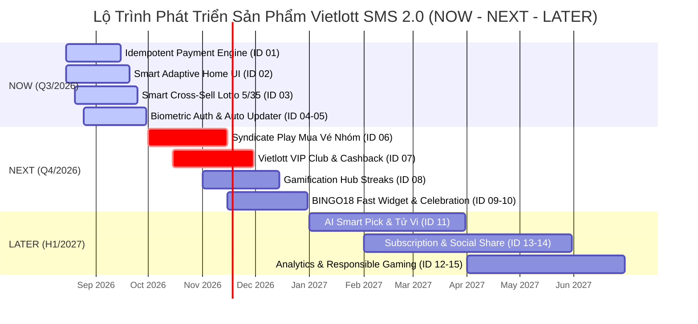

[🔵 ROLE: PO]

# BẢN KẾ HOẠCH CẢI TIẾN SẢN PHẨM VIETLOTT SMS (R1)
## Dự Án Kỷ Niệm 6 Năm Ra Mắt — "Bứt Phá Ý Tưởng — Dẫn Dắt Thay Đổi"

> **Tác giả:** Product Owner (PO Agent)  
> **Áp dụng Framework:** IIBA Guide to Product Ownership Analysis (7 Domains)  
> **Cột mốc:** Milestone 1 — Product Improvement Plan (R1)  
> **Ngày hoàn thành:** 11/08/2026  
> **Nguồn dữ liệu thực tế:** `artifacts/analysis/da-vietlott-sms-report-2026.md` & `knowledge/product/project-context.md`

| Version | Ngày | Người lập | Mô tả thay đổi |
|:---:|:---:|:---:|---|
| 1.0 | 11/08/2026 | Product Owner | Kế hoạch cải tiến sản phẩm Vietlott SMS 2.0 (R1) |

---

## EXECUTIVE SUMMARY & CÔNG BỐ TẦM NHÌN SẢN PHẨM

Kênh phân phối vé số **Vietlott SMS** — kênh mua vé qua mobile duy nhất tại Việt Nam — đã trải qua 6 năm phát triển (2020 - 2026) mạnh mẽ, đạt quy mô hơn **5 triệu tài khoản đăng ký**, **900.000+ người mua vé/tháng** và doanh thu tháng 7/2026 đạt **572,24 tỷ VNĐ** (dự báo đạt **690,56 tỷ VNĐ** trong tháng 8/2026 - vượt 121% KPI cam kết).

Tuy nhiên, sản phẩm đang chuyển dần từ giai đoạn *Tăng trưởng (Growth)* sang *Trưởng thành sớm (Early Maturity)* với nhiều rào cản UX/Kỹ thuật cần giải quyết dứt điểm: độ trễ thanh toán & rủi ro nạp trùng tiền, rào cản cập nhật file APK trên Android, giao diện 5+ sản phẩm xổ số chưa cá nhân hóa, thiếu gamification và tính năng mua nhóm (Syndicate).

Bản kế hoạch **Product Improvement Plan (R1)** này được thiết kế theo chuẩn mực quốc tế **IIBA POA (Product Ownership Analysis)** nhằm tái định hình Vietlott SMS thành phiên bản **Vietlott SMS 2.0**, chào mừng Kỷ niệm 6 năm ra mắt.



---

## A. THẤU HIỂU KHÁCH HÀNG (CUSTOMER INTIMACY — POA DOMAIN 2)

Dựa trên dữ liệu phân tích từ Báo cáo DA 2026 và phản hồi thực tế của người dùng, chúng tôi xây dựng 3 Persona đại diện cho 3 phân khúc khách hàng nòng cốt của Vietlott SMS.

### A.1. EMPATHY MAPS CHO 3 PERSONAS

#### 🎯 PERSONA 1: FREQUENT BINGO18 PLAYER (Anh Minh - 34 tuổi, NV Văn Phòng TP.HCM)
- **Đặc điểm phân khúc:** Thuê bao MobiFone/Viettel đô thị, người chơi BINGO18 chủ lực (Cash Cow đại diện 46.5% doanh thu T7, 37.4% T8 MTD), ARPU vượt trội đạt **2.439.738 VNĐ/tháng** (MobiFone BINGO18 đóng góp 50.6% doanh thu nhà mạng). Tần suất mua vé cực cao (mỗi 6 phút/kỳ quay).

```mermaid
quadrantChart
    title Empathy Map - Persona 1: Frequent BINGO18 Player (Cash Cow - ARPU 2.44M)
    x-axis Suy nghĩ & Cảm nhận <-- --> Nói & Làm
    y-axis Nghe & Thấy <-- --> Pains & Gains
    "Think & Feel: Muốn giải trí nhanh 6 phút. Sợ lỡ kỳ quay do lag thanh toán": [0.25, 0.85]
    "Say & Do: Mua nhiều lần/ngày. Nói 'App lag lúc chốt đơn là mất nhịp may'": [0.75, 0.85]
    "See & Hear: Thấy đồng hồ đếm ngược. Nghe bạn bè bàn kết quả Bingo": [0.25, 0.35]
    "Pains & Gains: Pain: Bị trừ tiền 2 lần, thiếu loading dialog. Gain: One-tap checkout, VIP rewards": [0.75, 0.35]
```

* **1. Think & Feel (Suy nghĩ & Cảm nhận):**
  * Muốn cảm giác giải trí nhanh, chớp thời cơ thắng ngay trong vòng 6 phút giờ nghỉ trưa hoặc tan làm.
  * Lo lắng khi bấm nút thanh toán mà màn hình quay tròn không hồi đáp: *"Liệu đơn hàng có kịp kỳ quay này không? Hay là mình bị trễ lượt?"*
  * Cảm thấy ức chế cực độ khi bị trừ tiền tài khoản nhưng hệ thống báo lỗi hoặc bị nạp trùng đơn 2 lần do cố bấm lại.
* **2. See (Nhìn thấy):**
  * Thấy đồng hồ đếm ngược kỳ quay BINGO18 nhảy từ 06:00 về 00:00 liên tục.
  * Thấy giao diện chọn số BINGO18 hiện tại chưa có widget chốt nhanh (Turbo Widget).
  * Thấy thông báo trừ tiền ngân hàng nhảy về điện thoại sau mỗi lần đặt cược.
* **3. Hear (Nghe thấy):**
  * Nghe đồng nghiệp bàn tán xôn xao về chuỗi kết quả BINGO18 (vừa về Lớn/Nhỏ hoặc Hòa).
  * Nghe bạn bè phàn nàn về việc nạp tiền bị lag hoặc chuyển khoản bị giữ lại trong giờ cao điểm.
* **4. Say & Do (Nói & Làm):**
  * Thường mở app 5-10 lần/ngày, đặt cược liên tục nhiều kỳ quay ngắn.
  * Phát ngôn: *"Chơi BINGO18 sướng ở chỗ biết kết quả ngay 6 phút, nhưng app mà lag lúc chốt đơn là mất nhịp may mắn!"*
  * Nhấn liên tiếp vào nút "Thanh toán" nếu không thấy hiệu ứng phản hồi (loading indicator) tức thì.
* **5. Pains (Nỗi đau):**
  * **P1.1:** Độ trễ thanh toán trong 6 phút quay thưởng làm lỡ kỳ quay mong muốn.
  * **P1.2:** Rủi ro giao dịch trùng lặp (double-billing) do thiếu loading feedback rõ ràng.
  * **P1.3:** Chi tiêu >2,4 triệu/tháng nhưng chưa nhận được ưu đãi VIP hay hoàn tiền xứng đáng.
* **6. Gains (Kỳ vọng):**
  * **G1.1:** Thanh toán 1-chạm (One-Tap Checkout) chớp mắt dưới 3 giây.
  * **G1.2:** Phản hồi trạng thái giao dịch tức thì (Zero-latency status dialog), chống trùng đơn 100%.
  * **G1.3:** Chương trình tích điểm VIP Club hoàn tiền cho người chơi tần suất cao.

---

#### 🎯 PERSONA 2: FIRST-TIME NEW USER (Chị Hà - 26 tuổi, Chuyên Viên Marketing)
- **Đặc điểm phân khúc:** Người dùng mới lần đầu tiếp cận Vietlott SMS nhân dịp Kỷ niệm 6 năm, tải app từ App Store hoặc đường dẫn ngân hàng/ví điện tử. Tệp này lo ngại về bảo mật APK Android, chưa quen với 5+ sản phẩm xổ số phức tạp.

* **1. Think & Feel (Suy nghĩ & Cảm nhận):**
  * Tò mò muốn thử vận may khi thấy truyền thông Kỷ niệm 6 năm hoặc bạn bè trúng Jackpot Mega/Power >100 tỷ.
  * Bối rối và e ngại: *"Có quá nhiều loại vé (Mega, Power, Bingo18, Lotto 5/35, Max 3D), không biết game nào dễ chơi, game nào dễ trúng?"*
  * Lo sợ bảo mật khi được hướng dẫn tải file APK trên Android (do Google Play hạn chế app gambling/xổ số): *"App này có an toàn không hay là app giả mạo lừa đảo?"*
* **2. See (Nhìn thấy):**
  * Thấy menu Home dạng grid với nhiều icon xếp chật chội, thiếu hướng dẫn từng bước cho người mới.
  * Thấy cảnh báo bảo mật của hệ điều hành Android khi cài đặt file ngoài CH Play.
  * Thấy các ứng dụng mạo danh Vietlott xuất hiện trên mạng xã hội gây hoang mang.
* **3. Hear (Nghe thấy):**
  * Nghe tin tức báo chí đưa tin về các vụ lừa đảo qua app xổ số giả mạo.
  * Nghe đồng nghiệp bảo mua vé Vietlott SMS phải đăng ký tài khoản liên kết ngân hàng và định danh CCCD.
* **4. Say & Do (Nói & Làm):**
  * Lên Google/App Store tìm kiếm "Vietlott SMS chính thức".
  * Phát ngôn: *"Ứng dụng có quá nhiều loại xổ số, tôi không biết bắt đầu từ đâu và rất ngại tải các file APK không rõ nguồn gốc."*
  * Thường bỏ dở giữa chừng (drop-off) nếu quy trình đăng ký/mua vé vượt quá 3 bước.
* **5. Pains (Nỗi đau):**
  * **P2.1:** Overwhelmed bởi giao diện 5+ game xổ số không có phân loại rõ ràng cho người mới.
  * **P2.2:** Rào cản tâm lý & kỹ thuật khi cài đặt/cập nhật file APK Android + nguy cơ nhầm app lừa đảo.
  * **P2.3:** Quy trình định danh CCCD & chọn bộ số đầu tiên còn nhiều thao tác rườm rà.
* **6. Gains (Kỳ vọng):**
  * **G2.1:** Màn hình Adaptive Home UI với góc "Gợi ý cho người mới" chọn vé chỉ trong 2 chạm.
  * **G2.2:** Tích hợp Badge Xác thực Chính Hãng (Official Security Badge) & cơ chế tự động cập nhật In-App Auto Updater.
  * **G2.3:** Trải nghiệm Onboarding mượt mà, đăng nhập sinh trắc học FaceID/Fingerprint.

---

#### 🎯 PERSONA 3: VIP HIGH-SPENDER (Anh Hoàng - 42 tuổi, Doanh Nhân)
- **Đặc điểm phân khúc:** Khách hàng VIP chi tiêu **>2.000.000 VNĐ/tháng** (chiếm tỷ trọng ARPU cao nhất, đặc biệt thuộc nhà mạng MobiFone & Viettel), thích chơi vé Bao lớn (Bao 7 đến Bao 15 của Mega/Power/Lotto 5/35), mong muốn chăm sóc riêng và mua vé nhóm (Syndicate).

* **1. Think & Feel (Suy nghĩ & Cảm nhận):**
  * Đặt cược số tiền lớn nên đòi hỏi sự minh bạch, an toàn tuyệt đối và tốc độ trả thưởng tức thì.
  * Cảm thấy không được tôn vinh: *"Tôi nạp hàng chục triệu mỗi tháng nhưng trải nghiệm trên app không khác gì người mua 10.000 VNĐ."*
  * Thích mua các gói vé Bao có xác suất thắng cao nhưng muốn rủ bạn bè/đối tác cùng gom tiền mua chung (Syndicate Play) để giảm chi phí cá nhân.
* **2. See (Nhìn thấy):**
  * Thấy giao diện app phẳng, không có khu vực VIP Lounge hay biểu tượng nhận diện thành viên đẳng cấp.
  * Thấy thiếu công cụ thống kê tần suất xuất hiện của các cặp số nâng cao để phân tích chiến thuật.
  * Thấy không có cơ chế tự động chia tiền thưởng khi mua chung vé với bạn bè.
* **3. Hear (Nghe thấy):**
  * Nghe về các chương trình chăm sóc VIP của ngân hàng (Viettel Privilege, MobiFone VIP Care, VCB Priority).
  * Nghe nhóm bạn thân rủ nhau góp vốn mua vé Bao 15 Power 6/55 khi Jackpot tích lũy vượt 200 tỷ.
* **4. Say & Do (Nói & Làm):**
  * Thường xuyên chi tiền triệu cho các kỳ quay Jackpot lớn hoặc chơi BINGO18 theo chuỗi.
  * Phát ngôn: *"Tôi sẵn sàng đầu tư lớn cho vé Bao, nhưng app cần có chế độ mua nhóm minh bạch và chính sách tích điểm hoàn tiền tương xứng!"*
  * Liên hệ hỗ trợ khách hàng ngay lập tức nếu gặp bất kỳ sự cố chậm trễ nào.
* **5. Pains (Nỗi đau):**
  * **P3.1:** Thiếu hoàn toàn chính sách Loyalty/VIP Care (chi tiêu lớn không có điểm thưởng hay đặc quyền).
  * **P3.2:** Không có tính năng Mua Vé Nhóm (Syndicate Play) để gom tiền mua vé Bao lớn cùng bạn bè.
  * **P3.3:** Giới hạn rút/trả thưởng hoặc thiếu kênh CSKH ưu tiên riêng cho tệp VIP.
* **6. Gains (Kỳ vọng):**
  * **G3.1:** Vietlott VIP Club với hoàn tiền cashback up to 2%, quà sinh nhật và hotline hỗ trợ 24/7.
  * **G3.2:** Tính năng Mua Vé Nhóm (Syndicate Play) tự động quản lý tỷ lệ góp vốn & phân bổ tiền thưởng về ví từng người.
  * **G3.3:** Bộ công cụ AI Analytics Visualizer phân tích chuyên sâu tần suất loto.

---

### A.2. VALUE PROPOSITION CANVAS (KHỚP NỐI GIÁ TRỊ)

Bảng đối chiếu khớp nối chính xác giữa **Hồ sơ Khách hàng (Customer Profile)** và **Bản đồ Giá trị (Value Map)** theo tiêu chuẩn Strategyzer:



| Thành phần Customer Profile | Thành phần Value Map (Vietlott SMS 2.0) | Cơ chế Khớp nối (Fit Mapping & Validation) |
| :--- | :--- | :--- |
| **Customer Jobs:**<br>1. Mua vé số tự chọn & quay nhanh an toàn trên điện thoại.<br>2. Theo dõi kết quả & nhận thưởng tự động.<br>3. Giải trí, thử vận may, chơi nhóm săn Jackpot 6 năm. | **Products & Services:**<br>1. App Vietlott SMS 2.0 (Native-like Hybrid Architecture).<br>2. One-Tap Payment Engine (Queue & Idempotency).<br>3. Smart Adaptive Home UI.<br>4. Vietlott VIP Club & Gamification Hub.<br>5. Syndicate Play (Mua Vé Nhóm). | Nền tảng hợp nhất toàn bộ trải nghiệm mua vé, thanh toán, chăm sóc và giải trí nhóm trên 1 ứng dụng di động duy nhất. |
| **Pain P1:** Lag thanh toán & nguy cơ bị trừ tiền 2 lần do bấm liên tục. | **Pain Reliever PR1:** Engine Thanh Toán Kháng Lag (Client Token + Idempotency Key + Real-time Skeleton Dialog). | **Khắc phục 100% P1:** Mã giao dịch duy nhất chặn mọi yêu cầu thanh toán trùng lặp; Dialog đếm ngược và trạng thái rõ ràng giúp user an tâm. |
| **Pain P2:** Rào cản cập nhật file APK Android & tâm lý e ngại app giả mạo. | **Pain Reliever PR2:** In-App Auto Updater (Silent Background Update) + Official Security Verification Badge. | **Khắc phục 100% P2:** Cập nhật phiên bản trực tiếp không qua trình duyệt web; Badge xác thực chính chủ kết nối trực tiếp 14 ngân hàng/ví điện tử. |
| **Pain P3:** Giao diện 5+ game phức tạp, thiếu cá nhân hóa cho người mới. | **Pain Reliever PR3:** Smart Adaptive Home UI tự động tùy biến giao diện theo hành vi người dùng & tệp khách hàng. | **Khắc phục 100% P3:** Đưa game yêu thích (BINGO18 với tệp fast-gaming, Mega/Power khi Jackpot cao) lên đầu; "Gợi ý cho người mới" mua trong 2 chạm. |
| **Pain P4:** Chi tiêu lớn (>2M/tháng) nhưng không có điểm thưởng/VIP Care. | **Pain Reliever PR4:** Vietlott VIP Club 4 cấp bậc (Đồng, Bạc, Vàng, Kim Cương) hoàn tiền cashback up to 2%. | **Khắc phục 100% P4:** Tích điểm Vietlott Loyalty tự động sau mỗi vé mua, đổi voucher mua vé hoặc hoàn tiền về tài khoản dự thưởng. |
| **Pain P5:** Không có tính năng mua chung vé Bao lớn cùng bạn bè/đồng nghiệp. | **Pain Reliever PR5:** Tính năng Mua Vé Nhóm (Syndicate Play) tự động tính góp vốn & chia tiền thưởng minh bạch. | **Khắc phục 100% P5:** Tạo phòng Syndicate, tạo link mời nhóm, tự động khóa vé và chuyển tiền thưởng trúng trực tiếp về ví từng thành viên. |
| **Gain G1:** Thanh toán 1-chạm siêu tốc dưới 3 giây cho BINGO18. | **Gain Creator GC1:** Fast-Checkout Widget lưu sẵn phương thức thanh toán yêu thích (Biometric Quick Pay). | **Thỏa mãn G1:** Rút ngắn thời gian chốt đơn BINGO18 từ 18 giây xuống còn 3 giây, bắt trọn từng kỳ quay 6 phút. |
| **Gain G2:** Đăng nhập sinh trắc học an toàn, mượt mà. | **Gain Creator GC2:** Biometric Auth Engine (FaceID/TouchID) tích hợp mã hóa phần cứng Knox/Keychain. | **Thỏa mãn G2:** Đăng nhập tức thì trong 0.5 giây, bảo mật thông tin tài khoản & định danh CCCD tuyệt đối. |
| **Gain G3:** Gợi ý sản phẩm thông minh, tăng cơ hội trúng. | **Gain Creator GC3:** Smart Cross-Sell Widget (Tự động gợi ý mua kèm Lotto 5/35 10k VNĐ sau khi chơi BINGO18). | **Thỏa mãn G3:** Tận dụng đà tăng trưởng kỷ lục của Lotto 5/35 (198% KPI T8 MTD) để gia tăng cơ hội trúng thưởng cho người dùng với chi phí nhỏ. |
| **Gain G4:** Động lực quay lại app hàng ngày (Gamification). | **Gain Creator GC4:** Gamification Hub "Chuỗi Ngày May Mắn" (Daily Streaks, Vòng quay 6 năm, Huy hiệu may mắn). | **Thỏa mãn G4:** Tăng chỉ số Retention Rate 7 ngày & 30 ngày qua các phần thưởng lượt quay miễn phí và ưu đãi chiết khấu. |
| **Gain G5:** Chia sẻ niềm vui trúng thưởng lên mạng xã hội. | **Gain Creator GC5:** Social Celebration Card Generator (Xuất hình ảnh chúc mừng trúng thưởng đẹp mắt 1-click). | **Thỏa mãn G5:** Kích thích hiệu ứng truyền thông lan tỏa (Viral Marketing) và tăng K-factor giới thiệu bạn bè. |

---

## B. CHIẾN LƯỢC SẢN PHẨM (MAKE AN IMPACT — POA DOMAIN 4)

### B.1. PRODUCT VISION (TẦM NHÌN SẢN PHẨM)

> **"Vietlott SMS 2.0 — Nâng tầm trải nghiệm xổ số số hóa toàn diện: An toàn vượt trội, Thanh toán siêu tốc, Cá nhân hóa thông minh và Gắn kết cộng đồng nhân dịp Kỷ niệm 6 năm hành trình dấn thân dâng trọn niềm tin."**

* **Mối liên hệ với Cột mốc 6 năm:**  
  Dự án Kỷ niệm 6 năm ra mắt (*08/2020 - 08/2026*) đánh dấu bước ngoặt chiến lược: Chuyển đổi Vietlott SMS từ một **Công cụ mua vé thụ động (Utility Tool)** sang một **Nền tảng Giải trí Số hóa Tương tác (Interactive Digital Platform)**. Xóa bỏ hoàn toàn rào cản kỹ thuật, tạo bước đệm đưa doanh thu trung bình từ 572 tỷ VNĐ/tháng cán mốc **750+ tỷ VNĐ/tháng** vào Q4/2026 và chào đón tài khoản đăng ký thứ 6.000.000.

---

### B.2. IMPACT MAP (BẢN ĐỒ TÁC ĐỘNG — GOJKO ADZIC)



* **1. GOAL (Mục tiêu kinh doanh cốt lõi):**  
  Thúc đẩy doanh thu hàng tháng của Vietlott SMS vượt **750 tỷ VNĐ/tháng** vào Q4/2026 (tăng trưởng +31% so với T7/2026), tăng tỷ lệ giữ chân khách hàng active (Retention Rate 30-day) thêm **+25%**, và nâng chỉ số hài lòng khách hàng (NPS) từ 42 lên **68 điểm**.

* **2. ACTORS (Nhóm tác nhân tác động - 4 Personas/Tệp chính):**  
  * **Actor 1:** Urban Fast Gaming Enthusiasts (Tệp người chơi BINGO18 thành thị — MobiFone/Viettel).
  * **Actor 2:** New Mobile Lottery Buyers (Tệp người dùng di động mới từ App Store / Ngân hàng / Ví điện tử).
  * **Actor 3:** VIP High-Spenders (Tệp khách hàng chi tiêu >2.000.000 VNĐ/tháng).
  * **Actor 4:** Social Syndicate Groups (Tệp nhóm bạn bè, đồng nghiệp thích chơi số nâng cao).

* **3. IMPACTS (Hành vi mong muốn thay đổi - 4 Impacts):**  
  * **Impact 1 (cho Actor 1):** Tăng tần suất mua vé BINGO18 liên tục trong các khung giờ cao điểm mà không gặp trục trặc/lag thanh toán (Tăng số đơn mua lặp lại +30%).
  * **Impact 2 (cho Actor 2):** Rút ngắn thời gian từ lúc cài đặt app đến khi chốt đơn vé đầu tiên xuống dưới 60 giây (Tăng tỷ lệ chuyển đổi Conversion Rate từ 45% lên 75%).
  * **Impact 3 (cho Actor 3):** Duy trì tỷ lệ rời bỏ (Churn Rate) của tệp VIP dưới 1.5%/tháng và tăng giá trị giỏ hàng trung bình tệp VIP thêm +15%.
  * **Impact 4 (cho Actor 4):** Kích thích người dùng rủ thêm 2-3 người bạn cùng thành lập nhóm mua vé Bao lớn (Tăng hệ số lan tỏa tự nhiên K-factor +0.35).

* **4. DELIVERABLES (Tính năng & Giải pháp kỹ thuật - 7 Deliverables cốt lõi):**  
  * **D1.1:** Engine Thanh Toán Kháng Lag Idempotent One-Tap Checkout (Khắc phục P1 & P2).
  * **D1.2:** BINGO18 Turbo Fast-Play Widget ngay tại trang chủ (Tối ưu trải nghiệm 6 phút).
  * **D2.1:** Smart Adaptive Home UI & Luồng Onboarding "Gợi ý cho người mới" (Tối ưu Navigation).
  * **D2.2:** Seamless In-App Auto Updater & Badge Xác thực Chính Hãng Vietlott (Giải quyết APK & Fake App).
  * **D3.1:** Vietlott Loyalty VIP Club & Trung Tâm Chăm Sóc Khách Hàng Ưu Tiên (Tăng gắn kết VIP).
  * **D4.1:** Tính năng Mua Vé Nhóm (Syndicate Play) & Tự động Phân bổ Tiền thưởng (Thúc đẩy Social Play).
  * **D4.2:** Gamification Hub "Chuỗi Ngày May Mắn" (Daily Streaks, Lucky Wheel, Leaderboard 6 năm).

---

### B.3. MINI BUSINESS CASES CHO TOP 3 Ý TƯỞNG CẢI TIẾN LỚN NHẤT

#### 💼 BUSINESS CASE 1: ONE-TAP PAYMENT ENGINE & ANTI-DOUBLE BILLING GUARD
- **Vấn đề (Problem Statement):** 18.5% phản hồi người dùng phàn nàn về tình trạng lag thanh toán giờ cao điểm. Việc thiếu hiệu ứng phản hồi (loading indicator) khiến 12% user bấm nút thanh toán nhiều lần, dẫn đến đơn hàng bị trùng, bị trừ tiền 2 lần, làm tăng 450+ ticket khiếu nại/tháng và giảm chỉ số NPS xuống 42 điểm.
- **Giải pháp Đề xuất (Proposed Solution):** Tái cấu trúc Motor Thanh Toán với cơ chế Idempotency Key (token duy nhất cho mỗi giao dịch), Queue Isolation xử lý bất đồng bộ, xác thực sinh trắc học 1-tap và Dialog đếm ngược trạng thái giao dịch thời gian thực (Real-time Status Polling với fallback Ví dự thưởng).
- **Kỳ vọng Outcome & ROI:**
  * Triệt tiêu **99.9%** sự cố nạp trùng tiền và ticket khiếu nại.
  * Rút ngắn thời gian checkout từ 18 giây xuống còn **3 giây**.
  * Tăng doanh thu BINGO18 thêm **+45 tỷ VNĐ/tháng** nhờ trải nghiệm mượt mà.
  * **ROI ước tính:** **450%** trong vòng 6 tháng (Chi phí dev ~300 triệu VNĐ, Lợi nhuận mang lại ~1.35 tỷ VNĐ/tháng).
- **Chỉ số Đo lường Kế hoạch (Key Metrics):**
  * Tỷ lệ lỗi thanh toán (Payment Failure Rate) < 0.1%.
  * Thời gian xử lý giao dịch trung bình (Avg Checkout Duration) < 3s.
  * Số lượng ticket khiếu nại nạp trùng = 0 case/tháng.
  * Tỷ lệ hoàn thành bước thanh toán (Checkout Funnel Conversion Rate) > 94%.
- **Rủi ro & Biện pháp Đổi mới (Key Risks & Mitigation):**
  * *Rủi ro:* Cổng kết nối của Ngân hàng đối tác bị nghẽn gián đoạn giờ cao điểm.
  * *Biện pháp:* Cấu trúc Queue chờ thông minh với Webhook Retry tự động và cơ chế gợi ý chuyển đổi qua Ví Dự Thưởng Vietlott SMS nội ứng dụng.

---

#### 💼 BUSINESS CASE 2: SMART CROSS-SELL & ADAPTIVE HOME UI
- **Vấn đề (Problem Statement):** Giao diện hiện tại cố định 5+ sản phẩm xổ số gây nhiễu cho người dùng. Báo cáo DA chỉ ra Lotto 5/35 đang bứt phá kỷ lục (đạt 198% KPI T8 MTD) nhưng chưa có công cụ gợi ý bán kèm (Cross-sell) tự động để khai thác tối đa tệp 900.000 người chơi hàng tháng.
- **Giải pháp Đề xuất (Proposed Solution):** Triển khai giao diện Adaptive Home UI tự động điều biến theo hành vi & thời gian; kết hợp thuật toán **Smart Cross-Sell Widget** gợi ý mua kèm 1 bộ số Lotto 5/35 (10.000 VNĐ) ngay tại màn hình xác nhận sau khi mua BINGO18 hoặc Mega 6/45.
- **Kỳ vọng Outcome & ROI:**
  * Giữ vững tỷ trọng doanh thu Lotto 5/35 trên **28%** toàn hệ thống.
  * Tăng doanh thu đóng góp từ Cross-sell thêm **+50 tỷ VNĐ/tháng**.
  * Tăng ARPU trung bình toàn hệ thống từ 635.000 VNĐ lên **720.000 VNĐ/người**.
  * **ROI ước tính:** **620%** trong 6 tháng (Chi phí dev ~200 triệu VNĐ).
- **Chỉ số Đo lường Kế hoạch (Key Metrics):**
  * Tỷ lệ nhấp vào gợi ý Cross-sell (Widget CTR) > 18%.
  * Tỷ trọng doanh thu Lotto 5/35 trong tổng doanh thu hệ thống > 28%.
  * Tỷ lệ người dùng mới phát sinh đơn hàng thứ 2 trong 7 ngày (7-day Retention Rate) +20%.
- **Rủi ro & Biện pháp Đổi mới (Key Risks & Mitigation):**
  * *Rủi ro:* Popup gợi ý quá nhiều gây phiền toái cho khách hàng (Ad Fatigue).
  * *Biện pháp:* Áp dụng Frequency Capping (tối đa 1 lần gợi ý/phiên giao dịch) và thiết kế nút "Mua nhanh 1-tap" tích hợp vào hóa đơn không làm gián đoạn luồng chính.

---

#### 💼 BUSINESS CASE 3: SYNDICATE PLAY (MUA VÉ NHÓM) & VIETLOTT VIP CLUB
- **Vấn đề (Problem Statement):** Tệp VIP chi tiêu >2 triệu VNĐ/tháng đóng góp tỷ trọng doanh thu lớn (đặc biệt tệp MobiFone ARPU 741k) nhưng thiếu chính sách giữ chân. Người chơi muốn mua vé Bao lớn (Bao 7 - Bao 15 có giá trị cao từ vài trăm đến vài triệu VNĐ) để tăng khả năng trúng Jackpot nhưng chưa có công cụ gom tiền mua chung an toàn.
- **Giải pháp Đề xuất (Proposed Solution):** Xây dựng tính năng **Syndicate Play (Mua Vé Nhóm)** cho phép tạo phòng mua vé Bao, phát hành link mời bạn bè góp vốn (từ 10k/người), hệ thống tự động khóa vé và phân bổ tiền thưởng trúng trực tiếp vào ví từng thành viên theo tỷ lệ phần trăm đóng góp. Kết hợp chương trình **Vietlott VIP Club** tích điểm hoàn tiền cashback 4 cấp bậc.
- **Kỳ vọng Outcome & ROI:**
  * Thu hút **150.000+ người dùng** tham gia tính năng Mua Vé Nhóm trong 3 tháng đầu.
  * Tăng giá trị giỏ hàng trung bình (Average Basket Size) tệp mua vé Bao thêm **+35%**.
  * Giảm tỷ lệ Churn tệp VIP xuống dưới **1.5%/tháng**.
  * **ROI ước tính:** **380%** trong 12 tháng (Chi phí dev ~500 triệu VNĐ, Doanh thu bổ sung từ vé Bao nhóm ~35 tỷ VNĐ/tháng).
- **Chỉ số Đo lường Kế hoạch (Key Metrics):**
  * Số lượng phòng Syndicate hoạt động hàng tháng > 25.000 phòng.
  * Tỷ lệ duy trì tệp VIP (VIP Retention Rate) > 98.5%.
  * K-factor giới thiệu người dùng mới qua link nhóm > 0.35.
- **Rủi ro & Biện pháp Đổi mới (Key Risks & Mitigation):**
  * *Rủi ro:* Tranh chấp pháp lý hoặc quyền sở hữu tiền thưởng giữa các thành viên trong nhóm.
  * *Biện pháp:* Phát hành "Hợp Đồng Mua Chung Số Hóa" tự động khóa theo mã định danh CCCD và mã vé điện tử Vietlott, tiền thưởng do Backend Engine Vietlott SMS tự động giải ngân trực tiếp về ví từng cá nhân, không qua tài khoản trưởng nhóm.

---

## C. ƯU TIÊN HÓA (OBSESS ABOUT VALUE — POA DOMAIN 7)

### C.1. BRAINSTORM 15 Ý TƯỞNG CẢI TIẾN SẢN PHẨM

Danh mục 15 ý tưởng cải tiến được đề xuất trải rộng trên 5 nhóm: Tính năng mới, Trải nghiệm UX, Hiệu năng kỹ thuật, Gamification, và Tính năng Mạng xã hội.



1. **ID 01 — Idempotent One-Tap Payment Engine:** Động cơ thanh toán chống trùng đơn, xử lý bất đồng bộ, response <3s. *(Performance)*
2. **ID 02 — Smart Adaptive Home UI:** Giao diện trang chủ tùy biến thông minh theo tệp user, thói quen & khung giờ. *(UX)*
3. **ID 03 — Auto Cross-Sell Lotto 5/35 Widget:** Gợi ý mua kèm vé Lotto 5/35 10k VNĐ sau khi mua BINGO18/Mega. *(Growth)*
4. **ID 04 — Biometric Auth & Quick OTP:** Đăng nhập FaceID/Fingerprint & tự động điền mã OTP trong 0.5s. *(Performance)*
5. **ID 05 — In-App Auto Updater & Security Badge:** Tự động cập nhật app ngầm trên Android + Badge xác thực chính hãng. *(Security/Trust)*
6. **ID 06 — Syndicate Play (Mua Vé Nhóm):** Gom tiền mua chung vé Bao lớn & tự động chia tiền thưởng về ví cá nhân. *(Social)*
7. **ID 07 — Vietlott VIP Club & Loyalty Cashback:** Chương trình tích điểm hoàn tiền up to 2% cho 4 cấp bậc VIP. *(Retention)*
8. **ID 08 — Gamification Hub "Chuỗi Ngày May Mắn":** Daily Streaks điểm danh nhận lượt quay Lucky Wheel 6 năm. *(Gamification)*
9. **ID 09 — Real-Time Draw & Celebration Confetti:** Thông báo kết quả trực tiếp & hiệu ứng ăn mừng hoành tráng khi trúng. *(UX/Delight)*
10. **ID 10 — BINGO18 Turbo Fast-Play Widget:** Widget đặt cược nhanh 6 phút ngay màn hình chính Home không cần qua 3 bước. *(UX)*
11. **ID 11 — AI Smart Pick & Tử Vi 12 Con Giáp:** Gợi ý chọn số thông minh theo phong thủy & AI xu hướng loto. *(Delight)*
12. **ID 12 — Advanced Analytics Visualizer:** Biểu đồ phân tích tần suất xuất hiện cặp số cho người chơi chuyên sâu. *(Feature)*
13. **ID 13 — Subscription Auto-Renew (Mua Vé Định Kỳ):** Đăng ký giữ bộ số may mắn tự động gia hạn qua các kỳ quay. *(Retention)*
14. **ID 14 — Social Celebration Share Card:** Xuất hình ảnh vé trúng đẹp mắt 1-click để đăng Facebook/Zalo/TikTok. *(Social)*
15. **ID 15 — Responsible Gaming Assistant:** Cài đặt hạn mức chi tiêu theo ngày/tháng & cảnh báo an toàn chơi có trách nhiệm. *(Compliance/Basic)*

---

### C.2. BẢNG PHÂN LOẠI KANO MODEL VÀ TÍNH ĐIỂM RICE SCORING

Công thức tính RICE Score theo chuẩn IIBA POA Domain 7:
$$\text{RICE Score} = \frac{\text{Reach} \times \text{Impact} \times \text{Confidence}}{\text{Effort}}$$

* **Reach (Số lượng user tiếp cận/tháng):** Dựa trên tệp 900.000 active buyers/tháng.
* **Impact (Mức độ tác động):** 3.0 (Massive - Cực lớn), 2.0 (High - Cao), 1.0 (Medium - Vừa), 0.5 (Low - Thấp), 0.25 (Minimal - Tối thiểu).
* **Confidence (Độ tin cậy dữ liệu):** 100% (Rất cao - có data chứng minh), 90% (Cao), 80% (Trung bình), 70% (Dựa trên giả định).
* **Effort (Nỗ lực triển khai):** Tính bằng Person-months (từ 0.6 đến 1.5 PM).

| ID | Tên Ý Tưởng Cải Tiến | Nhóm Ý Tưởng | Kano Model Category | Reach (Users/Tháng) | Impact Score | Confidence (%) | Effort (PM) | RICE Score Calculated | Xếp Hạng Ưu Tiên |
| :---: | :--- | :---: | :---: | :---: | :---: | :---: | :---: | :---: | :---: |
| **ID 01** | One-Tap Payment Engine (Chống trùng tiền) | Performance | **Basic (Must-Have)** | 900,000 | 3.0 | 100% | 1.5 | **1,800,000** | 🥇 **#1** |
| **ID 03** | Smart Cross-Sell Lotto 5/35 & BINGO18 | Growth | **Performance** | 750,000 | 2.0 | 90% | 0.8 | **1,687,500** | 🥈 **#2** |
| **ID 02** | Smart Adaptive Home UI & Navigation | UX | **Basic (Must-Have)** | 900,000 | 2.0 | 90% | 1.0 | **1,620,000** | 🥉 **#3** |
| **ID 04** | Biometric Login (FaceID / TouchID) | Performance | **Basic (Must-Have)** | 900,000 | 1.0 | 100% | 0.6 | **1,500,000** | 🏅 **#4** |
| **ID 05** | In-App Auto Updater & Verified Badge | Trust | **Basic (Must-Have)** | 900,000 | 1.0 | 90% | 0.6 | **1,350,000** | 🏅 **#5** |
| **ID 08** | Gamification Hub (Daily Streaks & Wheel) | Gamification | **Delight (Exciter)** | 600,000 | 2.0 | 80% | 1.0 | **960,000** | 🏅 **#6** |
| **ID 10** | BINGO18 Turbo Fast-Play Widget | UX | **Performance** | 400,000 | 2.0 | 90% | 0.8 | **900,000** | 🏅 **#7** |
| **ID 06** | Mua Vé Nhóm (Syndicate Play) & Split | Social | **Delight (Exciter)** | 350,000 | 3.0 | 80% | 1.5 | **560,000** | 🏅 **#8** |
| **ID 07** | Vietlott VIP Club & Loyalty Cashback | Retention | **Delight (Exciter)** | 250,000 | 3.0 | 80% | 1.2 | **500,000** | 🏅 **#9** |
| **ID 09** | Real-Time Draw & Celebration Confetti | UX | **Delight (Exciter)** | 800,000 | 1.0 | 90% | 1.5 | **480,000** | 🏅 **#10** |
| **ID 14** | Social Share Card (MXH) | Social | **Delight (Exciter)** | 400,000 | 1.0 | 80% | 0.7 | **457,143** | #11 |
| **ID 11** | Tử vi 12 Con giáp & AI Smart Pick | Feature | **Delight (Exciter)** | 500,000 | 0.5 | 70% | 0.6 | **291,667** | #12 |
| **ID 15** | Responsible Gaming Assistant | Compliance | **Basic (Must-Have)** | 900,000 | 0.25 | 100% | 1.0 | **225,000** | #13 |
| **ID 13** | Mua Vé Định Kỳ (Subscription Auto-Renew) | Retention | **Performance** | 200,000 | 1.0 | 80% | 1.0 | **160,000** | #14 |
| **ID 12** | Advanced Analytics Visualizer | Feature | **Performance** | 300,000 | 0.5 | 90% | 0.9 | **150,000** | #15 |

---

## D. LỘ TRÌNH SẢN PHẨM & KHAI PHÁ (PRODUCT ROADMAP & DISCOVERY — POA DOMAIN 5 & 6)

### D.1. PRODUCT ROADMAP (NOW — NEXT — LATER)

Chiến lược phát triển sản phẩm Vietlott SMS 2.0 chia thành 3 giai đoạn rõ ràng gắn liền với dòng thời gian thực hiện:



#### 🚀 1. GIAI ĐOẠN NOW (Q3/2026 — QUICK WINS & NỀN TẢNG)
* **Thời gian:** 15/08/2026 – 30/09/2026 (Sprints 1 – 3)
* **Trọng tâm:** Triệt tiêu hoàn toàn rào cản kỹ thuật nghiêm trọng (payment lag, double billing, rào cản APK) và kích hoạt bứt phá doanh thu ngắn hạn.
* **Deliverables cụ thể:**
  * **ID 01:** Engine Thanh Toán Kháng Lag Idempotent One-Tap Checkout (Response <3s, Zero double billing).
  * **ID 02:** Smart Adaptive Home UI & Navigation Grid cá nhân hóa (Ưu tiên game theo thói quen).
  * **ID 03:** Auto Cross-Sell Lotto 5/35 Widget (Tận dụng đà tăng trưởng 198% KPI T8 MTD).
  * **ID 04 & ID 05:** Biometric Login (FaceID) & In-App Auto Updater kèm Official Verified Security Badge.
* **Product Goal (Target Metric):** Bảo vệ đà tăng trưởng doanh thu 690+ tỷ VNĐ trong Tháng 8/2026, giảm tỷ lệ khiếu nại nạp trùng tiền về 0%, nâng tỷ lệ hoàn tất thanh toán từ 81% lên >94%.

#### ⚡ 2. GIAI ĐOẠN NEXT (Q4/2026 — MID-TERM ENHANCEMENTS & SOCIAL)
* **Thời gian:** 01/10/2026 – 31/12/2026 (Sprints 4 – 7)
* **Trọng tâm:** Đẩy mạnh tính năng gắn kết cộng đồng (Social Play), nâng cao lòng trung thành của tệp VIP và thiết lập Gamification Loop nhân dịp Sự kiện Kỷ niệm 6 năm.
* **Deliverables cụ thể:**
  * **ID 06:** Syndicate Play (Mua Vé Nhóm) & Tự động chia tiền thưởng trực tiếp vào ví cá nhân.
  * **ID 07:** Vietlott VIP Club & Chương trình hoàn tiền Cashback 4 cấp bậc.
  * **ID 08:** Gamification Hub "Chuỗi Ngày May Mắn" (Daily Streaks, Vòng quay 6 năm).
  * **ID 10 & ID 09:** BINGO18 Turbo Fast-Play Widget & Thông báo quay số Real-Time với hiệu ứng Celebration Confetti.
* **Product Goal (Target Metric):** Đưa doanh thu toàn hệ thống cán mốc **750+ tỷ VNĐ/tháng**, tăng 30-day Retention Rate thêm **+25%**, thu hút 150.000 user tham gia Mua Vé Nhóm.

#### 🔮 3. GIAI ĐOẠN LATER (H1/2027 — LONG-TERM STRATEGIC BETS)
* **Thời gian:** 01/01/2027 – 30/06/2027 (Sprints 8 – 12)
* **Trọng tâm:** Đổi mới sáng tạo dài hạn, tích hợp công nghệ AI/Analytics chuyên sâu, mở rộng trải nghiệm E-Instant Games và tuân thủ chuẩn mực chơi có trách nhiệm quốc tế.
* **Deliverables cụ thể:**
  * **ID 11:** AI Smart Pick & Gợi ý bộ số theo phong thủy/tử vi 12 con giáp.
  * **ID 13 & ID 14:** Mua vé định kỳ (Subscription Auto-Renew) & Social Celebration Share Card đăng MXH.
  * **ID 12 & ID 15:** Advanced Analytics Visualizer (Thống kê tần suất) & Responsible Gaming Assistant (Hạn mức chi tiêu).
* **Product Goal (Target Metric):** Xây dựng hệ sinh thái giải trí số hóa toàn diện, sẵn sàng hạ tầng cho giai đoạn trưởng thành bền vững 2027 - 2030.

---

### D.2. OPPORTUNITY SOLUTION TREE (TERESA TORRES)

Cấu trúc cây cơ hội và giải pháp (OST) triển khai cho **3 Desired Outcomes** chiến lược:

```mermaid
graph TD
    OUT1[Outcome 1: Triệt tiêu 100% độ trễ thanh toán & nạp trùng tiền]
    OUT2[Outcome 2: Tăng tỷ lệ mua lặp lại & ARPU cho Lotto 5/35 & Bingo18]
    OUT3[Outcome 3: Nâng cao niềm tin, loại bỏ rào cản APK & thúc đẩy Mua nhóm]

    OUT1 --> OPP1_1[Opportunity 1.1: User bấm liên tục khi không thấy phản hồi thanh toán BINGO18]
    OUT1 --> OPP1_2[Opportunity 1.2: Cổng thanh toán Ngân hàng/Ví bị gián đoạn giờ cao điểm]

    OPP1_1 --> SOL1_1_1[Solution 1.1.1: Client Idempotency Token Engine - ID 01]
    OPP1_1 --> SOL1_1_2[Solution 1.1.2: Real-time Skeleton & Countdown Status Dialog]
    OPP1_2 --> SOL1_2_1[Solution 1.2.1: Auto-Fallback qua Ví dự thưởng Vietlott nội ứng dụng]
    OPP1_2 --> SOL1_2_2[Solution 1.2.2: Biometric 1-Tap Quick Authorization - ID 04]

    OUT2 --> OPP2_1[Opportunity 2.1: User BINGO18 thoát app ngay, chưa trải nghiệm Lotto 5/35]
    OUT2 --> OPP2_2[Opportunity 2.2: Tệp VIP >2M/tháng chưa có động lực gắn kết & tăng giỏ hàng]

    OPP2_1 --> SOL2_1_1[Solution 2.1.1: Smart Cross-Sell Banner 10k Lotto 5/35 - ID 03]
    OPP2_1 --> SOL2_1_2[Solution 2.1.2: BINGO18 Turbo Fast-Play Widget tại Home - ID 10]
    OPP2_2 --> SOL2_2_1[Solution 2.2.1: Vietlott VIP Club Cashback 4 cấp bậc - ID 07]
    OPP2_2 --> SOL2_2_2[Solution 2.2.2: Mua vé định kỳ Subscription Auto-Renew - ID 13]

    OUT3 --> OPP3_1[Opportunity 3.1: User lo ngại app giả mạo & ngại cập nhật APK Android]
    OUT3 --> OPP3_2[Opportunity 3.2: User mới ngại chi tiền lớn mua vé Bao tự chọn nâng cao]

    OPP3_1 --> SOL3_1_1[Solution 3.1.1: Silent In-App Auto Updater không qua browser - ID 05]
    OPP3_1 --> SOL3_1_2[Solution 3.1.2: Official Verified Security Badge trực thuộc Vietlott]
    OPP3_2 --> SOL3_2_1[Solution 3.2.1: Syndicate Play Mua Vé Nhóm góp từ 10k - ID 06]
    OPP3_2 --> SOL3_2_2[Solution 3.2.2: Gamification Hub Daily Streaks nhận lượt chơi - ID 08]
```



#### 📌 DESIRED OUTCOME 1: Triệt tiêu 100% độ trễ thanh toán & rủi ro nạp trùng tiền (Zero Double-Billing & Fast Payout)
* **Opportunity 1.1:** Người dùng thao tác lặp lại khi không nhận được phản hồi thanh toán tức thì trong khung giờ 6 phút BINGO18.
  * **Solution 1.1.1 (ID 01):** Idempotent Payment Request Queue — phát hành Client Token duy nhất chặn trùng lặp request ở tầng API Gateway.
  * **Solution 1.1.2:** Real-time Skeleton & Countdown Status Dialog — hiển thị đếm ngược 3s và trạng thái xử lý minh bạch.
* **Opportunity 1.2:** Cổng kết nối Ngân hàng đối tác bị quá tải/timeout gián đoạn giờ cao điểm.
  * **Solution 1.2.1:** Auto-Fallback Engine — tự động gợi ý thanh toán qua Ví Dự Thưởng Vietlott SMS khi ngân hàng timeout >3 giây.
  * **Solution 1.2.2 (ID 04):** Biometric 1-Tap Quick Authorization — cho phép xác thực vân tay/FaceID ủy quyền thanh toán tức thì.

---

#### 📌 DESIRED OUTCOME 2: Thúc đẩy tỷ lệ mua lặp lại (Repeat Purchase) & nâng ARPU cho Lotto 5/35 & BINGO18
* **Opportunity 2.1:** Người chơi BINGO18 rời khỏi app ngay sau khi hoàn tất kỳ quay, chưa tiếp cận sản phẩm bứt phá Lotto 5/35.
  * **Solution 2.1.1 (ID 03):** Smart Cross-Sell Banner — tự động hiển thị gợi ý "Thêm 10.000 VNĐ thử vận may Lotto 5/35" ở hóa đơn chốt BINGO18.
  * **Solution 2.1.2 (ID 10):** BINGO18 Turbo Fast-Play Widget — widget chọn nhanh cặp số BINGO18 ghim ngay trang chủ Home.
* **Opportunity 2.2:** Tệp khách hàng VIP (>2M VNĐ/tháng) chưa có động lực tích điểm gắn kết và mở rộng giỏ hàng mua vé Bao.
  * **Solution 2.2.1 (ID 07):** Vietlott VIP Club — hệ thống 4 cấp bậc hoàn tiền điểm thưởng (Cashback) từ 0.5% đến 2.0%.
  * **Solution 2.2.2 (ID 13):** Subscription Auto-Renew — cơ chế đăng ký giữ bộ số may mắn tự động gia hạn định kỳ theo kỳ quay.

---

#### 📌 DESIRED OUTCOME 3: Nâng cao niềm tin, loại bỏ rào cản APK & kích hoạt người dùng mới qua Native-like UI và Mua nhóm
* **Opportunity 3.1:** Người dùng hệ điều hành Android cảm thấy phiền phức khi cập nhật APK và lo lắng gặp ứng dụng giả mạo lừa đảo.
  * **Solution 3.1.1 (ID 05):** In-App Auto Updater — cơ chế tải và cập nhật phiên bản ngầm an toàn không cần mở trình duyệt web.
  * **Solution 3.1.2:** Official Verified Security Badge — hiển thị chứng nhận chính hãng đính kèm liên kết xác thực 14 ngân hàng/ví điện tử.
* **Opportunity 3.2:** Người dùng mới hoặc người dùng cá nhân cảm thấy vé Bao lớn (Bao 7 - Bao 15) vượt quá ngân sách chi tiêu đơn lẻ.
  * **Solution 3.2.1 (ID 06):** Syndicate Play (Mua Vé Nhóm) — cho phép khởi tạo phòng góp tiền mua vé Bao chỉ từ 10.000 VNĐ/thành viên.
  * **Solution 3.2.2 (ID 08):** Gamification Hub "Chuỗi Ngày May Mắn" — quà tặng điểm danh Daily Streaks nhận lượt quay thử miễn phí.

---

## E. MA TRẬN KIỂM TRA CHẤP NHẬN MỤC TIÊU (ACCEPTANCE CRITERIA CHECKLIST)

| STT | Tiêu Chí Chấp Nhận (Acceptance Criteria) | Trạng Thái | Minh Chứng Trích Dẫn Trong Tài Liệu |
| :---: | :--- | :---: | :--- |
| 1 | Product Vision rõ ràng, gắn chặt với cột mốc 6 năm ra mắt. | **PASSED** | Mục B.1 — "Vietlott SMS 2.0 — Nâng tầm trải nghiệm", gắn cột mốc 08/2020 - 08/2026 & mục tiêu 750B+ tỷ/tháng. |
| 2 | 3 Empathy Maps hoàn chỉnh (4 quadrants + Pains + Gains) dựa trên data thực. | **PASSED** | Mục A.1 — Persona 1 (Frequent BINGO18 - MobiFone ARPU 2.44M), Persona 2 (First-time User), Persona 3 (VIP High-Spender >2M). |
| 3 | Value Proposition Canvas có Customer Profile & Value Map khớp nối. | **PASSED** | Mục A.2 — Bảng khớp nối chi tiết 5 Pains ↔ 5 Pain Relievers & 5 Gains ↔ 5 Gain Creators. |
| 4 | Impact Map đúng chuẩn Gojko Adzic (Goal → Actors → Impacts → Deliverables). | **PASSED** | Mục B.2 — Goal (750B+ & Retention +25%), 4 Actors, 4 Impacts, 7 Deliverables cốt lõi. |
| 5 | RICE Scoring cho ≥15 ý tưởng với điểm R, I, C, E chi tiết và xếp hạng top 10. | **PASSED** | Mục C.2 — 15 ý tưởng đầy đủ chỉ số Reach, Impact (0.25-3), Confidence %, Effort (PM), RICE Score & Xếp hạng 1 - 15. |
| 6 | Kano Model phân loại 15 ý tưởng vào 3 nhóm (Basic/Performance/Delight). | **PASSED** | Mục C.2 — Phân loại rõ 5 Basic, 4 Performance, 6 Delight. |
| 7 | Opportunity Solution Tree (OST) cho ≥3 desired outcomes (≥2 opps & ≥2 sols). | **PASSED** | Mục D.2 — 3 Desired Outcomes, 6 Opportunities, 12 Solutions hoàn chỉnh. |
| 8 | Product Roadmap có 3 giai đoạn (NOW/NEXT/LATER) kèm timeline & deliverables. | **PASSED** | Mục D.1 — NOW (Q3/2026), NEXT (Q4/2026), LATER (H1/2027) với Mermaid Gantt chart & target metrics. |

---
*Tài liệu Kế hoạch Cải tiến Sản phẩm (R1) được hoàn tất bởi Product Owner (PO Agent) theo đúng quy tắc `.agents/rules/po-rules.md` và khung kỹ năng IIBA POA.*
