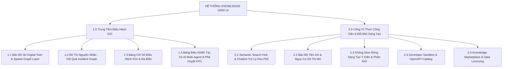
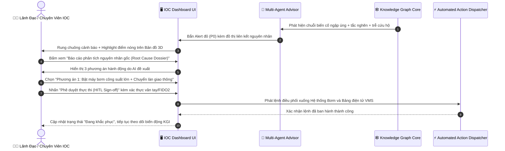

# [🎨 ROLE: DESIGNER] Kiến Trúc Thông Tin & Bản Vẽ Giao Diện — Đô Thị Tri Thức (UI/UX Blueprint)

> **Dự án:** Kiến Trúc Đô Thị Tri Thức (Urban Knowledge Grid - UKG)  
> **Phiên bản:** v1.0.0 (Draft)  
> **Tiêu chuẩn thiết kế:** Atomic Design + Design Tokens + WCAG 2.1 Level AA Accessibility  
> **Trạng thái:** `artifacts/requirements/` (Chờ Review & Phê duyệt)  

---

## 1. Hệ Thống Kiến Trúc Thông Tin (Information Architecture - IA)

Hệ thống Knowledge Grid phục vụ 2 nhóm giao diện cốt lõi:
1. **IOC Urban Command Center (Dành cho Lãnh đạo & Điều hành tác chiến):** Tối ưu hóa cho màn hình lớn ghép (Video Wall), hiển thị bản đồ 3D Digital Twin, luồng đồ thị liên ngành và bảng chỉ số thời gian thực.
2. **Citizen & Developer Knowledge Portal (Dành cho Công dân & Hệ sinh thái Quadruple Helix):** Tối ưu hóa trên Web Responsive & Mobile, hỗ trợ tìm kiếm ngữ nghĩa, tra cứu dịch vụ tri thức khu phố và khám phá API/Sandbox.

### 1.1. Sơ Đồ Cấu Trúc Thông Tin (Site Map Hierarchy)



---

## 2. Hệ Thống Design Tokens & Quy Chuẩn Giao Diện (Design System Tokens)

### 2.1. Bảng Màu Chuẩn (Color Palette & Semantic Tokens)

```css
:root {
  /* Surface & Background Tokens (IOC Command Dark Mode) */
  --ukg-bg-base: #0B0F19;           /* Nền chính siêu tối, giảm mỏi mắt cho phòng tác chiến */
  --ukg-bg-surface-1: #111827;       /* Card bề mặt cấp 1 */
  --ukg-bg-surface-2: #1F2937;       /* Card nổi bề mặt cấp 2 */
  --ukg-bg-overlay: rgba(15, 23, 42, 0.85); /* Lớp phủ mờ kính Acrylic (Glassmorphism) */

  /* Brand & Knowledge Core Accent */
  --ukg-primary-cyan: #06B6D4;      /* Màu xanh Cyan - Biểu tượng dòng chảy tri thức */
  --ukg-primary-glow: #22D3EE;      /* Neon highlight cho các nút mạng tri thức */
  --ukg-secondary-purple: #8B5CF6;  /* Màu tím Semantic AI */

  /* Semantic State Tokens */
  --ukg-status-normal: #10B981;     /* Xanh lá - An toàn / Hoạt động ổn định */
  --ukg-status-warning: #F59E0B;    /* Vàng hổ phách - Cảnh báo nguy cơ */
  --ukg-status-critical: #EF4444;   /* Đỏ tươi - Sự cố khẩn cấp P0 */
  --ukg-status-info: #3B82F6;       /* Xanh dương - Thông tin cập nhật */

  /* Typography Tokens */
  --ukg-font-sans: 'Inter', -apple-system, BlinkMacSystemFont, 'Segoe UI', Roboto, sans-serif;
  --ukg-font-mono: 'JetBrains Mono', 'Fira Code', monospace;
  --ukg-font-display: 'Plus Jakarta Sans', sans-serif;

  /* Elevation & Glow Shadows */
  --ukg-shadow-glow-cyan: 0 0 20px rgba(6, 182, 212, 0.35);
  --ukg-shadow-glow-critical: 0 0 25px rgba(239, 68, 68, 0.45);
  --ukg-shadow-card: 0 10px 15px -3px rgba(0, 0, 0, 0.5), 0 4px 6px -2px rgba(0, 0, 0, 0.4);
}
```

---

## 3. Bản Vẽ Wireframe & Bố Cục Giao Diện (UI Wireframes & Layout Specs)

### 3.1. Bố Cục Trung Tâm Điều Hành IOC (Intelligent Operations Center - 3D Knowledge Twin)

```
+----------------------------------------------------------------------------------------------------+
|  [🏛️ KNOWLEDGE GRID IOC]   [📍 TPHCM - TOÀN CẢNH]   | 🔴 2 SỰ CỐ P0   🟡 5 CẢNH BÁO   🟢 HỆ THỐNG 99.9%  |
+----------------------------------------------------------------------------------------------------+
| [NAV: 🗺️ Digital Twin | 🕸️ Knowledge Graph | 🤖 Multi-Agent Center | 📊 KGI Metrics | ⚙️ Cài đặt] |
+----------------------------------------------------------------------------------------------------+
| << CỘT TRÁI (320px) >>    | << KHU VỰC TRUNG TÂM (BẢN ĐỒ 3D + ĐỒ THỊ TRI THỨC) >> | << CỘT PHẢI (360px) >>   |
|---------------------------|-------------------------------------------------------|--------------------------|
| 📊 CHỈ SỐ NHANH THỜI GIAN | [🌐 3D Digital Twin Map Viewport]                    | 🤖 AI AGENT ADVISORY     |
| - Mật độ giao thông: 82%  |   (Lớp GIS: Cảm biến ngập + Lưu lượng + Xe buýt)       |--------------------------|
| - Mức ngập max: 42cm      |                                                       | ⚠️ CẢNH BÁO SỰ CỐ LIÊN   |
| - Chất lượng KK (AQI): 135|       [📍 Điểm Ngập: Nguyễn Hữu Cảnh (42cm)]          |   NGÀNH (P0):            |
|                           |                 |                                     | "Mưa lớn 85mm kết hợp    |
|---------------------------|                 v (Nguyên nhân)                       |  triều cường làm ngập sâu|
| 🕸️ LỚP THỰC THỂ ONTOLOGY |       [🚗 Tắc nghẽn: Nút giao Điện Biên Phủ]          |  gây tê liệt tuyến vành  |
| [x] Giao thông đô thị     |                 |                                     |  đai trung tâm."         |
| [x] Thoát nước & Thủy văn |                 v (Tác động)                          |                          |
| [x] Trạm Y tế & Khẩn cấp  |       [🏥 Trạm Cấp Cứu 115 - Chậm 18 phút]            | 📋 ĐỀ XUẤT ĐIỀU HÀNH:    |
| [ ] Mạng lưới điện lực    |                                                       | 1. Kích hoạt trạm bơm số3|
| [ ] Dân cư & Viễn thông   | ----------------------------------------------------- | 2. Đổi nhịp đèn tín hiệu |
|                           | [🔍 SEMANTIC SEARCH & GRAPH TRAVERSAL BAR]            |    tránh dồn xe vào ngập |
|---------------------------| "Tìm nguyên nhân gây trễ xe cấp cứu tại Quận Bình Thạnh"|                          |
| ⏱️ DÒNG THỜI GIAN (PLAY)   |-------------------------------------------------------| [✅ DUYỆT THỰC THI (HITL)]|
| [|<] [<<] [▶ PHÁT] [>>] [>|] | [⚙️ Lọc Bán Kính: 2km] [Độ Sâu Graph: 3 Hops] [Bộ Lọc]  | [❌ TỪ CHỐI] [📝 SỬA ĐỔI] |
+----------------------------------------------------------------------------------------------------+
| 📡 STATUS BAR: Nạp Stream: 28,450 msg/s | Kafka Lag: 0.02s | Neo4j Latency: 42ms | OPA Policy: ENFORCED    |
+----------------------------------------------------------------------------------------------------+
```

### 3.2. Bố Cục Cổng Dịch Vụ Tri Thức Công Dân & Đổi Mới Sáng Tạo (Citizen Knowledge Portal)

```
+----------------------------------------------------------------------------------------------------+
|  [🌐 ĐÔ THỊ TRI THỨC]     Tra cứu | Bản đồ cộng đồng | Đổi mới sáng tạo | Nhà phát triển | [👤 Tài khoản]  |
+----------------------------------------------------------------------------------------------------+
|                                                                                                    |
|            🌆 KHÁM PHÁ & KẾT NỐI TRI THỨC ĐÔ THỊ THÔNG MINH                                        |
|            Mọi dữ liệu không gian, môi trường, quy hoạch trong tầm tay bạn                        |
|                                                                                                    |
|    +------------------------------------------------------------------------------------------+    |
|    |  🔍 Nhập câu hỏi tự nhiên: "Khu vực tôi ở có nguy cơ ngập không nếu mưa 50mm chiều nay?" | 🎙️|    |
|    +------------------------------------------------------------------------------------------+    |
|                                                                                                    |
+----------------------------------------------------------------------------------------------------+
| 📌 TIỆN ÍCH DÀNH CHO BẠN           | 💡 DÀNH CHO NHÀ NGHIÊN CỨU & DOANH NGHIỆP                      |
|------------------------------------|---------------------------------------------------------------|
| 🌦️ Bản đồ nguy cơ ngập thời gian  | 📊 Open Data Knowledge Sandbox                                |
|    thực tích hợp camera trực tiếp. | - Tiếp cận > 500 tập dữ liệu mở đô thị đã gán nhãn ngữ nghĩa. |
|                                    | - Trực tiếp query SPARQL / GraphQL qua Developer Console.     |
| 🏥 Tìm trạm y tế và lộ trình an    |                                                               |
|    toàn nhất khi có triều cường.   | 🚀 Knowledge Marketplace & Hackathon                          |
|                                    | - Đăng ký ý tưởng giải pháp đô thị nhận tài trợ từ Thành phố. |
| 📝 Gửi phản ánh hiện trường kèm    | - Tích hợp API Knowledge Grid vào ứng dụng thương mại.        |
|    tọa độ và nhận cập nhật qua app.|                                                               |
+----------------------------------------------------------------------------------------------------+
```

---

## 4. Đặc Tả Luồng Trải Nghiệm Người Dùng (User Experience & Interaction Flow)

### 4.1. Luồng Tương Tác Xử Lý Sự Cố Khẩn Cấp Của Lãnh Đạo IOC (Incident Response Flow)



---

## 5. Tiêu Chuẩn Tiếp Cận & Khả Năng Khả Dụng (Accessibility & WCAG 2.1 AA Compliance)

```markdown
1. Độ tương phản màu sắc (Color Contrast Ratio):
   - Tỷ lệ tương phản văn bản chữ (Text Contrast) so với màu nền tối thiểu đạt 4.5:1 (Normal Text) và 3:1 (Large Text).
   - Tỷ lệ tương phản các nút điều khiển và biểu tượng trạng thái tối thiểu đạt 3:1 đối với màu nền xung quanh.

2. Hỗ trợ Phím Tắt Điều Khiển Nhanh (Keyboard Accessibility):
   - Phím `Tab` và `Shift + Tab` duyệt tuần tự qua các panel không bị bẫy phím (No Keyboard Trap).
   - Phím `/` để focus ngay vào thanh Tìm kiếm Tri thức Ngữ nghĩa.
   - Phím `Space` hoặc `Enter` để kích hoạt hoặc dừng dòng thời gian mô phỏng (Simulation Timeline).
   - Phím `Esc` để đóng nhanh các cửa sổ Modal chi tiết thực thể đồ thị.

3. Hỗ trợ Đọc Màn Hình (Screen Readers & ARIA Semantics):
   - Mọi thẻ hiển thị trực quan đồ thị đều có thuộc tính `aria-label` và `role="region"` rõ ràng.
   - Các thông báo khẩn cấp P0 sử dụng `aria-live="assertive"` để thông báo âm thanh tức thì cho người khiếm thị.
```

---
*Tài liệu Thiết kế UI/UX & Kiến trúc Thông tin được phê duyệt bởi Lead UX Designer.*
