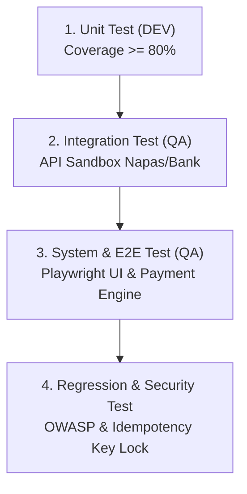

# Test Plan: Hệ Sinh Thái Thanh Toán & Tích Hợp Fintech Vietlott SMS

| Version | Ngày | Người thực hiện | Mô tả |
|:---:|:---:|:---:|---|
| 1.0 | 2026-10-08 | Quality Assurance (QA) | Kế hoạch kiểm thử baseline hệ sinh thái thanh toán Fintech |

> **Mã Test Plan:** `TP-FINTECH-001` | **Trạng thái:** `Approved`  
> **Tác giả:** Quality Assurance (QA Agent)  
> **Tài liệu căn cứ:** [SRS_He_Sinh_Thai_Thanh_Toan_Fintech_v1.0.md](file:///f:/VIETLOTT-SMS/artifacts/requirements/SRS_He_Sinh_Thai_Thanh_Toan_Fintech_v1.0.md) (FR-01 đến FR-17)

---

## 1. Mục Tiêu & Phạm Vi Kiểm Thử (Objectives & Scope)

### 1.1 In-Scope (Trong phạm vi)
- **Kiểm thử đối soát (Settlement & Reconciliation):** Đối chiếu file giao dịch T+1 từ đối tác VNPT Pay, Viettel Money, ZaloPay (FR-01, FR-02, FR-03).
- **Kiểm thử hoàn tiền & tra soát (Refund & Chargeback):** Hoàn tiền toàn phần, một phần và quy trình SLA xử lý tra soát (FR-04, FR-05, FR-06, FR-07).
- **Kiểm thử cổng thanh toán QR & P2P (Payment & Transfer):** Quét VietQR, khóa Idempotency Key chống trừ tiền 2 lần, chuyển tiền nguyên tử P2P (FR-08, FR-09, FR-10, FR-11).
- **Kiểm thử hóa đơn & chia tiền (Billing & Split Bill):** Lưu mã khách hàng tự động nhắc nợ và chia tiền theo nhóm (FR-12, FR-13).
- **Kiểm thử eKYC & Định danh (Identity Verification):** OCR CCCD, Liveness check, tích hợp điểm tín dụng CIC và Auto-debit (FR-14, FR-15, FR-16, FR-17).

### 1.2 Out-of-Scope (Ngoài phạm vi)
- Kiểm thử tải phần cứng vật lý tại Trung tâm dữ liệu của các Ngân hàng đối tác.
- Kiểm thử quy trình in vé vật lý tại quầy bán vé truyền thống.

---

## 2. Chiến Lược Kiểm Thử (Test Strategy & Levels)

- **Rủi ro chất lượng trọng yếu (Risk-Based Focus):**
  1. Trừ tiền tài khoản nhưng không phát hành được vé do rớt mạng SMS Gateway.
  2. Bấm nút thanh toán liên tục (Double Click) gây trừ tiền hai lần.
  3. Lệch số dư đối soát giữa tài khoản dự thưởng và ngân hàng trung gian.

---

## 3. Môi Trường & Dữ Liệu Kiểm Thử (Environment & Test Data)

- **Môi trường:** Staging / Sandbox giả lập kết nối Core Vietlott và Ngân hàng.
- **Tập dữ liệu test mẫu:**
  - Tài khoản A: Đã eKYC hợp lệ, số dư 500,000 VNĐ.
  - Tài khoản B: Chưa hoàn tất eKYC, chặn chức năng rút tiền/nhận thưởng giải lớn.
  - Tài khoản C: Số dư dưới 10,000 VNĐ (kiểm tra kịch bản thiếu số dư).

---

## 4. Tiêu Chí Nghiệm Thu (Entry & Exit Criteria)

- **Entry Criteria:** DEV bàn giao bản build kèm kết quả Unit Test Pass 100%, không còn lỗi linting.
- **Exit Criteria:** 100% test case mức Critical/High đạt trạng thái PASS, Zero lỗi bảo mật PII.
