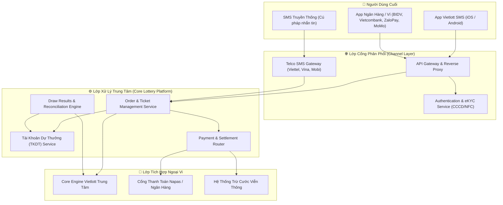

# Vietlott SMS — System Architecture & Integration Map

> **Kiến trúc tổng thể:** Mô hình phân tán tích hợp đa kênh (Omni-channel Lottery Distribution Engine)

---

## 1. Sơ Đồ Khối Kiến Trúc Hệ Thống (Context Diagram)

---

## 2. Các Luồng Dữ Liệu Trọng Yếu (Critical Data Flows)

1. **Luồng Mua Vé (Ticket Purchase Flow):**
   - Client gửi lệnh đặt vé -> API Gateway xác thực Token/Session -> Kiểm tra số dư TKDT hoặc gửi yêu cầu trừ tiền qua Bank -> Gọi Core Vietlott phát hành vé -> Nhận Ticket ID -> Sinh mã tin nhắn SMS xác nhận vé về máy người dùng.
2. **Luồng Đối Soát & Trả Thưởng (Reconciliation & Payout):**
   - Core Vietlott chốt kết quả kỳ quay -> Engine đối soát quét toàn bộ vé đã phát hành trong kỳ -> Lập danh sách vé trúng -> Tự động ghi có vào TKDT của khách hàng (với giải < 10 tỷ) -> Gửi thông báo OTT/SMS chúc mừng trúng thưởng.
