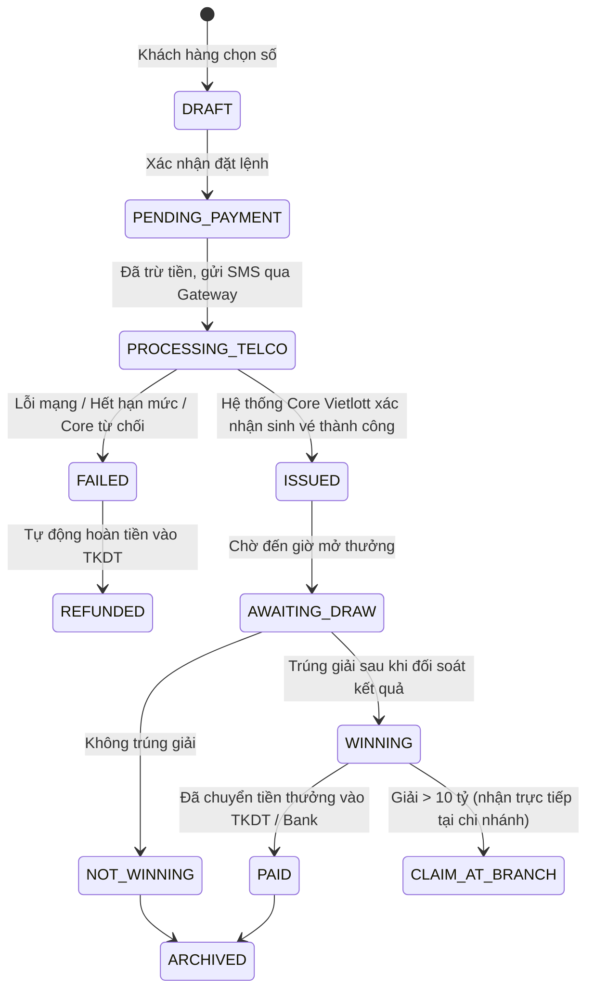

# Lottery Domain Primer — Kiến Thức Nghiệp Vụ Xổ Số Điện Toán

> **Mục tiêu:** Cung cấp tri thức nền tảng về thuật ngữ, quy tắc tính thưởng, chu kỳ quay số và cơ chế đối soát cho mọi vai trò trong hệ thống.

---

## 1. Cơ Chế Ma Trận & Tỷ Lệ Trả Thưởng

- **Tỷ lệ trả thưởng danh nghĩa:** Tối thiểu 55% trên tổng doanh thu bán vé thực tế thu được trong từng kỳ quay số mở thưởng (theo Thông tư 36/2019/TT-BTC).
- **Cơ chế tích lũy giải đặc biệt (Jackpot Rollover):**
  - Nếu trong kỳ quay không có người trúng Jackpot, toàn bộ giá trị giải Jackpot sẽ được cộng dồn (roll over) sang kỳ quay thưởng tiếp theo.
  - Khi Jackpot vượt mức cực lớn (VD: > 300 tỷ đối với Power 6/55), lượng giao dịch có thể tăng đột biến gấp 5-10 lần (Traffic Peak), đòi hỏi hệ thống phải chịu tải cao tại thời điểm sát giờ khóa sổ (17h30 - 17h45).

---

## 2. Chu Trình Vòng Đời Vé Xổ Số Điện Tử (Ticket Lifecycle)

---

## 3. Khung Giờ Hoạt Động & Quy Định Khóa Sổ (Cut-off Time)

- **Mega 6/45 & Power 6/55:** Khóa sổ nhận vé lúc **17h45** các ngày quay thưởng. Thời gian mở thưởng: **18h00 - 18h30**.
- **Keno:** Mở thưởng liên tục từ **06h00 đến 21h55** hàng ngày (cứ 10 phút một kỳ). Khóa sổ trước mỗi kỳ 1 phút.
- **Bingo18:** Mở thưởng liên tục từ **06h00 đến 21h55** hàng ngày (cứ 5 phút một kỳ). Khóa sổ trước mỗi kỳ 30 giây.
