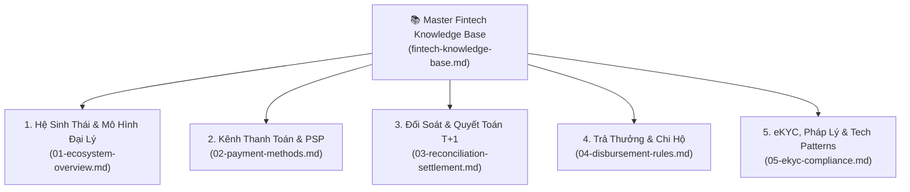

# 📚 FINTECH KNOWLEDGE BASE — Master Index & Architecture Map

| Version | Ngày | Người thực hiện | Trạng thái |
|:---:|:---:|:---:|---|
| 2.0 | 2026-10-08 | BA / Architecture Governance | Approved (Modularized DEC-007) |

> **Mã tài liệu:** `fintech-knowledge-base.md`  
> **Kiến trúc tri thức:** Hệ sinh thái tri thức Fintech phân rã (Modular Knowledge Architecture - TD-004)  
> **Nguyên tắc Context Budget:** Agent tra cứu theo module chuyên biệt để tiết kiệm context (≤ 10KB/lần nạp).

---

## 1. Bản Đồ Phân Hệ Tri Thức Fintech (5 Modules)

Hệ sinh thái tri thức Fintech của Vietlott SMS được phân rã thành **5 module chuyên biệt** tại [knowledge/product/fintech/](file:///f:/VIETLOTT-SMS/knowledge/product/fintech):

---

## 2. Danh Mục Các Module Chuyên Biệt

| Module | Tệp tin chuyên đề | Nội dung trọng tâm | Dung lượng | Tình huống nạp (Agent Lazy-load) |
|:---:|---|---|:---:|---|
| **01** | [01-ecosystem-overview.md](file:///f:/VIETLOTT-SMS/knowledge/product/fintech/01-ecosystem-overview.md) | Stakeholders, 3 phân hệ chính (App, Web Admin, Backend Core), mô hình CTV Xổ Số+, bảng thuật ngữ Glossary. | ~7 KB | Khởi tạo bối cảnh tính năng, phân rã trách nhiệm phân hệ. |
| **02** | [02-payment-methods.md](file:///f:/VIETLOTT-SMS/knowledge/product/fintech/02-payment-methods.md) | Luồng nạp tiền, giữ chỗ (Auth/Capture), VietQR, ví điện tử (ZaloPay, Viettel Money, VNPT Pay, Momo). | ~13 KB | Thiết kế API nạp vé, thanh toán vé, tích hợp cổng PSP. |
| **03** | [03-reconciliation-settlement.md](file:///f:/VIETLOTT-SMS/knowledge/product/fintech/03-reconciliation-settlement.md) | Quy trình đối soát T+1, khớp lệnh 3 bên, xử lý sai lệch (Discrepancy) và phí giao dịch. | ~8 KB | Phân tích bài toán kế toán, đối soát tài khoản dự thưởng. |
| **04** | [04-disbursement-rules.md](file:///f:/VIETLOTT-SMS/knowledge/product/fintech/04-disbursement-rules.md) | Quy tắc trả thưởng tự động (≤10 triệu) và tại quầy (>10 triệu), khấu trừ thuế TNCN 10%, tài khoản VAN chi hộ. | ~7 KB | Viết yêu cầu rút tiền thưởng, chi hộ ngân hàng. |
| **05** | [05-ekyc-compliance.md](file:///f:/VIETLOTT-SMS/knowledge/product/fintech/05-ekyc-compliance.md) | OCR CCCD, Liveness check, tuân thủ Nghị định 13/2023/NĐ-CP, Thông tư 23/2019/TT-NHNN, Idempotency & Outbox Pattern. | ~14 KB | Thiết kế luồng đăng ký tài khoản, bảo mật và tuân thủ pháp lý. |

---

## 3. Quy Tắc Sử Dụng Dành Cho AI Agents

1. **Tuân thủ Context Budget:** Khi thực hiện tác vụ kỹ thuật cụ thể (ví dụ: tạo test case đối soát), Agent **CHỈ ĐƯỢC NẠP** module tương ứng (ví dụ: `03-reconciliation-settlement.md`), **KHÔNG NẠP** toàn bộ thư mục.
2. **Cập nhật tri thức:** Mọi thay đổi về quy chế thanh toán hoặc đối tác phải được sửa trực tiếp tại module chuyên đề tương ứng trong `knowledge/product/fintech/`.
