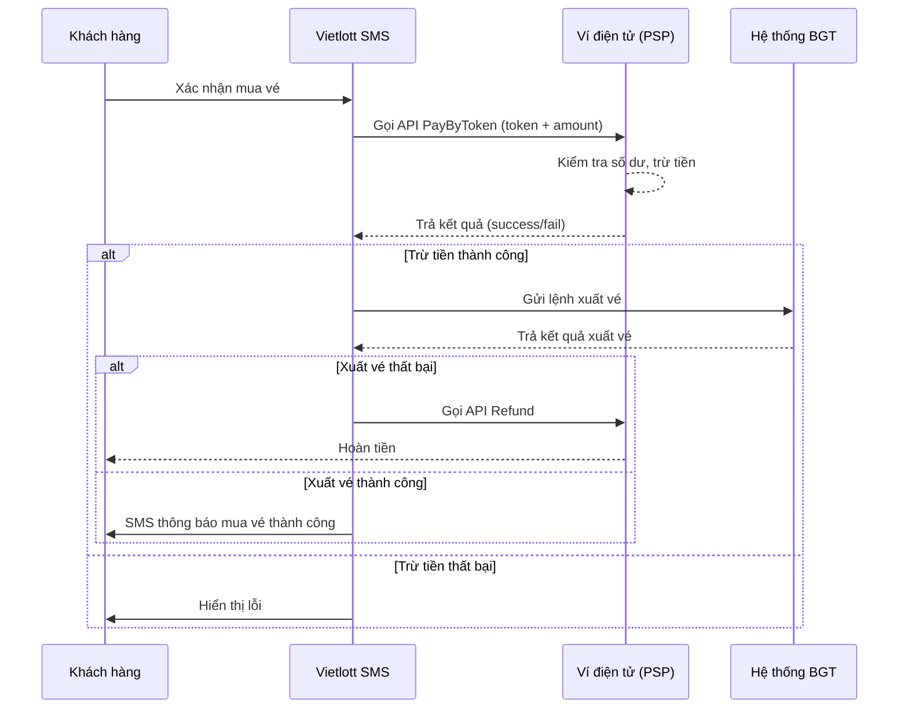

# Fintech Knowledge: Mô Hình & Kênh Thanh Toán Tích Hợp

| Version | Ngày | Người thực hiện | Trạng thái |
|:---:|:---:|:---:|---|
| 1.0 | 2026-10-08 | BA / Fintech Knowledge Team | Approved |

> **Mã module:** `KB-FINTECH-02`  
> **Thuộc hệ thống:** Kiến trúc Tri thức Fintech Vietlott SMS  
> **Master Index:** [fintech-knowledge-base.md](file:///f:/VIETLOTT-SMS/knowledge/product/fintech-knowledge-base.md)

---

## 2. Mô hình thanh toán & Phương thức tích hợp

### 2.1. Mô hình Web nhúng (Embedded Webview)

Đây là mô hình phổ biến nhất trong hệ sinh thái Vietlott SMS. Thay vì xây dựng native app riêng cho mỗi đối tác, Vietlott SMS cung cấp **Webview HTML5** nhúng trên Super App của đối tác.

```
┌─────────────────────────────────┐
│   Super App (ZaloPay/MobiFone)  │
│  ┌───────────────────────────┐  │
│  │   Webview HTML5           │  │
│  │   (Vietlott SMS)          │  │
│  │                           │  │
│  │  ┌─────┐  ┌────────────┐ │  │
│  │  │ Mua │  │ Thanh toán │ │  │
│  │  │ vé  │  │ PayByToken │ │  │
│  │  └─────┘  └────────────┘ │  │
│  └───────────────────────────┘  │
└─────────────────────────────────┘
```

**Ưu điểm:**
- Một codebase phục vụ nhiều kênh (Single codebase, multi-channel)
- Tốc độ go-to-market nhanh — không cần đối tác publish app mới
- Kiểm soát UX từ phía Vietlott SMS

**Nhược điểm:**
- Phụ thuộc vào hiệu năng WebView của đối tác
- Giới hạn tương tác native (push notification, biometric)

> **Nguồn:** Tài liệu tích hợp ZaloPay v1.7, MobiFone Money v1.9, PostPay v1.0 — `artifacts/requirements/`

### 2.2. Phương thức thanh toán PayByToken

**PayByToken** là phương thức thanh toán phổ biến nhất trong hệ sinh thái Vietlott SMS:



**Các biến thể PayByToken theo đối tác:**

| Đối tác | Biến thể | Đặc điểm |
|---------|----------|-----------|
| **ZaloPay** | PayByToken chuẩn | Luôn trừ tiền tự động, không OTP |
| **MobiFone Money** | PayByToken **có điều kiện** (Bypass OTP Threshold) | GD ≤ ngưỡng cấu hình → bypass OTP; GD > ngưỡng → yêu cầu OTP |
| **PostPay** | PayByToken + **Biometric Verification** | Có thể yêu cầu FaceID (mã lỗi 101/102) trước khi trừ tiền |

> **Nguồn:** [Master_Summary_4_Tasks.md](file:///f:/plans/completed/Master_Summary_4_Tasks.md)

### 2.3. Luồng hoàn tiền (Refund Flow)

Khi giao dịch mua vé thất bại **sau khi đã trừ tiền**, hệ thống phải khởi tạo luồng hoàn tiền:

| Kênh | Cơ chế hoàn | Đích hoàn | Ghi chú |
|------|-------------|-----------|---------|
| ZaloPay | API Refund real-time | Ví ZaloPay **hoặc** HMDT | Hoàn cả gốc + phí nếu về ví; chỉ gốc nếu về HMDT |
| MobiFone Money | API Refund | **Chỉ** ví MobiFone Money | Không hoàn về HMDT |
| PostPay | API `/refund-v2` → Queue → Manual Approve → `/confirm-v2` | Ví PostPay | Cần kế toán duyệt thủ công |
| Xổ Số+ (CTV) | Unlock (nhả tiền) TK VAN | TK CTV hoặc TK Khách hàng | Vé đã xuất → hoàn về KH; chưa xuất → nhả VAN cho CTV |

> [!IMPORTANT]
> **Quy tắc nghiệp vụ bắt buộc:** Khi giao dịch CTV mua hộ đã xuất vé thành công nhưng phát sinh lỗi sau đó → tiền hoàn về **tài khoản Khách hàng**, CTV không được hưởng.

---

## 3. Các kênh thanh toán đã tích hợp

### 3.1. ZaloPay

| Hạng mục | Chi tiết |
|----------|---------|
| **Xác thực** | OAuth 2.0 (Authorization Code → Access Token + Refresh Token) |
| **Thanh toán** | PayByToken (Merchant gọi API → ZaloPay trừ ví) |
| **Trả thưởng** | API Chi Hộ / Disbursement (cộng tiền trực tiếp vào ví KH) |
| **Hoàn tiền** | API Refund real-time |
| **Đối soát** | Chưa rõ cơ chế tự động (cần xác nhận) |
| **eKYC** | ZaloPay cung cấp dữ liệu eKYC qua API (CMND/CCCD, ngày cấp, nơi cấp) |
| **NĐ 2345** | Merchant phải đăng ký Digital Signature (Public Key upload, Private Key ký giao dịch) |

**Luồng đặc biệt — Onboarding tự động:**
1. KH mở ZaloPay → chọn Vietlott SMS
2. ZaloPay truyền `telco_code` → kiểm tra nhà mạng
3. OAuth 2.0 lấy thông tin KH (SĐT, Họ tên, eKYC)
4. Tự động tạo TKDT (nếu chưa có) + tự động liên kết TKTT ZaloPay
5. Popup gợi ý đặt ZaloPay làm TKTT mặc định + TKNT mặc định

> **Nguồn:** [ZaloPay_extracted.txt](file:///f:/VIETLOTT-SMS/artifacts/requirements/ZaloPay_extracted.txt), [Master_Summary_4_Tasks.md §1](file:///f:/plans/completed/Master_Summary_4_Tasks.md)

### 3.2. MobiFone Money

| Hạng mục | Chi tiết |
|----------|---------|
| **Xác thực** | Token-based (MobiFone truyền token khi mở Webview) |
| **Thanh toán** | PayByToken có ngưỡng bypass OTP (cấu hình trên Admin) |
| **Nguồn tiền** | 2 loại: Ví MobiFone Money **hoặc** Tiền di động (Mobile Money) |
| **Trả thưởng** | **KHÔNG hỗ trợ** trả thưởng vào TK MobiFone Money |
| **Hoàn tiền** | Chỉ hoàn về ví MobiFone Money (không hoàn về HMDT) |
| **Đối soát** | Tự động hàng ngày qua sFTP + mã hóa PGP RSA-3072 |
| **Mã lỗi đặc thù** | VLT-252 (vượt hạn mức GD), VLT-253 (vượt hạn mức tháng), VLT-254 (ví khóa), VLT-255 (ví đã đóng) |

**Khái niệm Bypass OTP Threshold:**
```
Giá trị GD ≤ Ngưỡng cấu hình  → Tự động trừ tiền, KHÔNG cần OTP
Giá trị GD > Ngưỡng cấu hình  → Yêu cầu KH nhập OTP
```

> **Nguồn:** [Mobifone_extracted.txt](file:///f:/VIETLOTT-SMS/artifacts/requirements/Mobifone_extracted.txt), Tài liệu tích hợp MobiFone Money v1.5-v1.9

### 3.3. PostPay (VNPOST)

| Hạng mục | Chi tiết |
|----------|---------|
| **Xác thực** | API `/auth` → `app_token`; Liên kết qua OTP → `user_token` |
| **Bảo mật API** | SHA256 Signature Hash trên mọi request |
| **Thanh toán** | API `/request-v2` → `/confirm-v2` (2-phase commit) |
| **Sinh trắc học** | FaceID verification khi mã lỗi 101/102 (Redirect Deeplink → PostPay app → IPN Callback) |
| **Hoàn trả** | API `/refund-v2` → Manual Approve → `/confirm-v2` → Poll `/check-state` |
| **Hủy liên kết** | 2 chiều — Webhook sync: KH hủy trên VLT → notify PostPay; KH hủy trên PostPay → webhook notify VLT |
| **Timeout handling** | Poll check-status mỗi 30s khi timeout |

**Luồng sinh trắc học (Biometric Flow):**
```
Vietlott gọi API thanh toán
     ↓
PostPay trả mã 101/102 (yêu cầu FaceID)
     ↓
Vietlott Hold đơn → Redirect Deeplink mở app PostPay
     ↓
KH quét FaceID trên PostPay
     ↓
PostPay gọi IPN Webhook → Vietlott
     ↓
Vietlott resume đơn → Confirm thanh toán
```

> **Nguồn:** [PostPay_extracted.txt](file:///f:/VIETLOTT-SMS/artifacts/requirements/PostPay_extracted.txt), PostPay API v1.8-v2.0

### 3.4. Tổng hợp toàn bộ đối tác tích hợp

Từ thư mục `03.9.Tich_Hop_Doi_Tac` trong source tài liệu gốc, hệ thống Vietlott SMS tích hợp với **18 đối tác**:

| # | Đối tác | Thư mục tài liệu | Vai trò chính |
|---|---------|-------------------|---------------|
| 1 | **ZaloPay** | `03.9.18.Tich_hop_ZaloPay` | Thanh toán, trả thưởng, eKYC, Onboarding |
| 2 | **MobiFone Money** | `03.9.4.Tich_hop_MobifoneMoney` | Thanh toán, đối soát sFTP |
| 3 | **MoMo** | `03.9.5.Tich_hop_Momo` | Thanh toán, trả thưởng |
| 4 | **VNPay** | `03.9.13.Tich_hop_VNPay` | Cổng thanh toán (nạp tiền HMDT) |
| 5 | **VNPT Money** | `03.9.14.Tich_hop_VNPTMoney` | Thanh toán site VinaPhone |
| 6 | **ViettelMoney** | `03.9.12.Tich_hop_ViettelMoney` | Thanh toán site Viettel |
| 7 | **VPBank** | `03.9.15.Tich_hop_VPBank` | Tài khoản ảo VAN (cho CTV nạp tiền) |
| 8 | **MyViettel** | `03.9.6.Tich_hop_MyViettel` | Super App Viettel |
| 9 | **Gapit/Zalo** | `03.9.2.Tich_hop_Gapit_Zalo` | Kênh phân phối/ZNS notification |
| 10 | **IPASS** | `03.9.3.Tich_hop_IPASS` | Xác thực/Single Sign-On |
| 11 | **OCR** | `03.9.7.Tich_hop_OCR` | Nhận dạng giấy tờ tùy thân (eKYC) |
| 12 | **PVCBank** | `03.9.8.Tich_hop_PVCBank` | Ngân hàng thanh toán |
| 13 | **RBM (Rich Business Messaging)** | `03.9.9.Tich_hop_RBM` | Kênh tin nhắn nâng cao |
| 14 | **SeABank** | `03.9.10.Tich_hop_SeABank` | Ngân hàng thanh toán |
| 15 | **Vinatti** | `03.9.11.Tich_hop_Vinatti` | Đối tác dịch vụ |
| 16 | **VTCPay** | `03.9.16.Tich_hop_VTCPay` | Cổng thanh toán |
| 17 | **Wooribank** | `03.9.17.Tich_hop_Wooribank` | Ngân hàng thanh toán (Hàn Quốc) |
| 18 | **PostPay (VNPOST)** | Tài liệu riêng | Thanh toán, FaceID verification |

> [!NOTE]
> **Insight:** Danh sách 18 đối tác cho thấy hệ thống Vietlott SMS không chỉ là ứng dụng xổ số đơn thuần, mà là một **Payment Hub** phức tạp tích hợp đa kênh — bao gồm ví điện tử, ngân hàng, nhà mạng, và cả ngân hàng nước ngoài (Wooribank).
>
> **Nguồn:** Cấu trúc thư mục [03.9.Tich_Hop_Doi_Tac](file:///f:/VIETLOTT-SMS/artifacts/requirements/VIETLOTT_SMS/VIETLOTT_SMS/03.Business_Analysis/03.9.Tich_Hop_Doi_Tac)

### 3.5. Tổng hợp đối soát theo đối tác

| Đối tác đối soát | Cơ chế | Giao thức |
|-------------------|--------|-----------|
| **MobiFone Money** | Tự động hàng ngày T+1 | sFTP + PGP RSA-3072 |
| **VNPay** | Đối soát qua Web Admin | REST API |
| **VNPT Pay** | Đối soát 2 tầng (nội bộ Site + với VNPT Pay) | REST API |
| **ViettelPay** | Đối soát 2 tầng (nội bộ Site + với ViettelPay) | REST API |
| **Vietlott BGT** | Đối soát doanh số bán vé & trúng thưởng | sFTP / API bảo mật (VPN site-to-site) |
| **Site Viettel** | Đối soát nội bộ trên Site nhà mạng | Import file |
| **Site VinaPhone** | Đối soát nội bộ trên Site nhà mạng | Import file |
| **Site MobiFone** | Đối soát nội bộ trên Site nhà mạng | Import file |

> **Nguồn:** Thư mục [03.6.Doi_Soat](file:///f:/VIETLOTT-SMS/artifacts/requirements/VIETLOTT_SMS/VIETLOTT_SMS/03.Business_Analysis/03.6.Doi_Soat) — 14 file tài liệu đối soát

---
