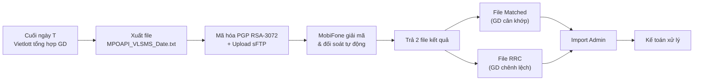

# Fintech Knowledge: Đối Soát Giao Dịch & Quyết Toán (Reconciliation)

| Version | Ngày | Người thực hiện | Trạng thái |
|:---:|:---:|:---:|---|
| 1.0 | 2026-10-08 | BA / Fintech Knowledge Team | Approved |

> **Mã module:** `KB-FINTECH-03`  
> **Thuộc hệ thống:** Kiến trúc Tri thức Fintech Vietlott SMS  
> **Master Index:** [fintech-knowledge-base.md](file:///f:/VIETLOTT-SMS/knowledge/product/fintech-knowledge-base.md)

---

## 4. Đối soát giao dịch (Reconciliation)

### 4.1. Khái niệm đối soát

**Đối soát (Reconciliation)** là quy trình kiểm tra đối chiếu dữ liệu giao dịch giữa 2 hệ thống (Vietlott SMS vs Đối tác thanh toán) để phát hiện chênh lệch, thiếu hụt hoặc sai sót.

### 4.2. Quy trình đối soát tự động (MobiFone Money — Case Study)

### 4.3. Cấu trúc file đối soát

**File đối soát gửi đi** (Vietlott → MobiFone):
- Tên: `MPOAPI_VLSMS_<Date>.txt` hoặc `MPOAPI_VIETLOTTSMS_<Date>.txt`
- Định dạng: Text, phân cách dấu phẩy (CSV-like)
- Header: `ACCTNO, TRANSACTIONID, EXTTRANSACTIONID, REFNO, PROCAT, PRODCODE, TOTALAMOUNT, ISSUEDATE, TRANS_TIME, STATUS, PROTYPE, AMOUNT, QTY`
- Mã hóa: **PGP RSA-3072** với public key do MobiFone cung cấp

**File kết quả đối soát** (MobiFone → Vietlott):
- File cân khớp: `KQ_TRUNGKHOP_MPOAPI_VLSMS_<Date>.txt`
- File chênh lệch: `KQ_MPOAPI_VLSMS_<Date>.txt`
- Mã hóa: **PGP RSA-3072** với public key do Vietlott cung cấp

### 4.4. Các loại đối soát

| Loại đối soát | Mô tả | Tần suất |
|---------------|--------|----------|
| **Đối soát thu hộ** (Collection) | Khớp tiền KH nạp vào hệ thống với đối tác | Hàng ngày |
| **Đối soát chi hộ** (Disbursement) | Khớp tiền trả thưởng cho KH | Hàng ngày |
| **Đối soát HMDT** (Credit Account) | Kiểm tra Hạn mức dự thưởng của KH | Hàng ngày |
| **Đối soát BGT** | Đối chiếu với Vietlott (nhà phát hành) | Hàng ngày |
| **Đối soát nhà mạng** | Đối chiếu GD trên từng site nhà mạng | Hàng ngày |
| **Đối soát TK người chơi** | Đối chiếu tài khoản người chơi với Vietlott | Định kỳ |

### 4.5. Phân loại sản phẩm trong thanh toán (MobiFone)

MobiFone phân loại sản phẩm theo 3 nhóm wallet (ảnh hưởng hạn mức GD):
- **WL1** (Thông thường): Nhóm không thuộc WL2, WL3
- **WL2** (Dịch vụ công): Thuế, phí, lệ phí, hành chính công
- **WL3** (Dịch vụ đặc thù): Điện, nước, y tế, giao thông, bảo hiểm

> **Nguồn:** [Mobifone_extracted.txt](file:///f:/VIETLOTT-SMS/artifacts/requirements/Mobifone_extracted.txt), Folder `03.6.Doi_Soat` trong VIETLOTT_SMS

---
