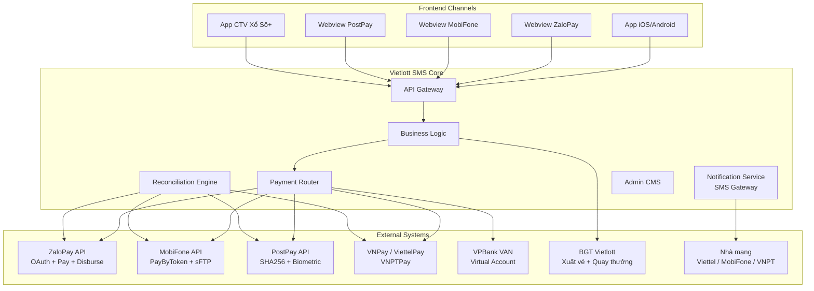

# Fintech Knowledge: eKYC, Tuân Thủ Pháp Luật & Architecture Patterns

| Version | Ngày | Người thực hiện | Trạng thái |
|:---:|:---:|:---:|---|
| 1.0 | 2026-10-08 | BA / Fintech Knowledge Team | Approved |

> **Mã module:** `KB-FINTECH-05`  
> **Thuộc hệ thống:** Kiến trúc Tri thức Fintech Vietlott SMS  
> **Master Index:** [fintech-knowledge-base.md](file:///f:/VIETLOTT-SMS/knowledge/product/fintech-knowledge-base.md)

---

## 6. eKYC & Định danh khách hàng

### 6.1. Quy trình Onboarding & eKYC

```mermaid
flowchart TD
    A[KH chọn Đăng ký] --> B[Nhập SĐT]
    B --> C{Kiểm tra trùng lặp<br>& trạng thái TB}
    C -- Không hợp lệ --> D[Báo lỗi / Dừng]
    C -- Hợp lệ --> E[Sinh OTP & Lưu tạm]
    E --> F[Gửi SMS OTP qua nhà mạng]
    F --> G[KH nhập OTP & Chụp CMND/CCCD]
    G --> H{Xác thực OTP?}
    H -- Sai --> G
    H -- Đúng --> I[Phân tích OCR & Face Matching]
    I --> J{Kết quả eKYC?}
    J -- Lỗi/Mờ --> G
    J -- Thành công --> K[Duyệt & Chuyển trạng thái<br>"Đã Định Danh"]
    K --> L[KH thiết lập Mật khẩu]
    L --> M[Hoàn tất Onboarding]
```

### 6.2. Các phương thức eKYC

| Phương thức | Mô tả | Kênh áp dụng |
|-------------|--------|---------------|
| **OCR + Face Matching** | Chụp CMND/CCCD → OCR trích xuất → So khớp khuôn mặt | App Vietlott SMS |
| **Dữ liệu eKYC từ đối tác** | ZaloPay cung cấp dữ liệu eKYC qua API | ZaloPay Webview |
| **Sinh trắc học (Biometric)** | FaceID trên PostPay app | PostPay |
| **Manual Approve** | Nhân viên duyệt thủ công (cho CTV đăng ký hộ KH) | Xổ Số+ (CTV) |

### 6.3. Trạng thái tài khoản người chơi

```
[Chưa đăng ký] → [Chờ xác thực OTP] → [Chờ eKYC] → [Đã Định Danh] → [Active]
                                                           ↓
                                                     [Bị khóa/Tạm ngưng]
```

> **Nguồn:** [onboarding-vietlott.bpmn](file:///f:/VIETLOTT-SMS/artifacts/requirements/diagrams/onboarding-vietlott.bpmn)

---

## 7. Tuân thủ pháp luật & Quy định

### 7.1. Nghị định 2345/QĐ-NHNN (Chữ ký số)

**Áp dụng cho:** Merchant Wallet trên ZaloPay

**Yêu cầu:**
- Merchant phải **đăng ký chữ ký số** (Digital Signature)
- Upload **Public Key** (certificate file) lên hệ thống ZaloPay
- Khi thực hiện giao dịch rút tiền/chuyển ví → Maker phải upload **Private Key** ký xác thực
- Trạng thái sau đăng ký: "Đang chờ duyệt" → "Đã kích hoạt"

**Luồng ON/OFF Digital Signature:**
1. Click nút "ON" → System hiển thị popup xác nhận
2. Merchant upload Private Key & click "Đồng ý"
3. System xác nhận thành công

> **Nguồn:** File "Nghị định 2345- MC wallet flow.pptx" trong [ZaloPay_extracted.txt](file:///f:/VIETLOTT-SMS/artifacts/requirements/ZaloPay_extracted.txt)
> **Tham chiếu pháp lý:** [Quyết định 2345/QĐ-NHNN](https://thuvienphapluat.vn/van-ban/Tien-te-Ngan-hang/Quyet-dinh-2345-QD-NHNN-2023-an-toan-bao-mat-thanh-toan-truc-tuyen-ngan-hang-dien-tu-572389.aspx)

### 7.2. Quy định hạn mức giao dịch

| Loại hạn mức | Mô tả | Nguồn quy định |
|--------------|--------|-----------------|
| **Hạn mức/GD** | Giới hạn tối đa 1 giao dịch | MobiFone Money, ví điện tử |
| **Hạn mức/tháng** | Giới hạn tổng GD trong 1 tháng | MobiFone Money |
| **Hạn mức Bypass OTP** | Ngưỡng GD dưới mức này không cần OTP | MobiFone Money (cấu hình) |
| **Hạn mức Bao** | Giới hạn Bao 10 cho Power/Mega (tối đa 2.1 triệu) | Quy định ví điện tử/viễn thông |

### 7.3. Quy tắc nhà mạng

- Chỉ cho phép SĐT thuộc **Viettel, MobiFone, VinaPhone** đăng ký & mua vé
- SĐT ngoài 3 nhà mạng → **chặn truy cập** (kiểm tra `telco_code`)
- Mỗi site nhà mạng có thể bật/tắt riêng kênh thanh toán

---


---

## 9. Bảo mật & Mã hóa

### 9.1. Tổng hợp cơ chế bảo mật theo kênh

| Kênh | Xác thực API | Mã hóa dữ liệu | Bảo mật GD |
|------|-------------|-----------------|-------------|
| **ZaloPay** | OAuth 2.0 + RSA Sign (`sign = RSA(requestId + time)`) | RSA Signature | NĐ 2345 Digital Signature |
| **MobiFone Money** | Token-based | PGP RSA-3072 (file đối soát) | OTP + Bypass Threshold |
| **PostPay** | SHA256 HMAC (`code_secure` header) | SHA256 Signature Hash | FaceID Biometric (mã 101/102) |
| **Nội bộ** | Session-based + Mật khẩu TKDT | OTP SMS | - |

### 9.2. Chi tiết ký API

**ZaloPay — RSA Signature:**
```
Request: {
  partnerCode: "mã đối tác do CTIN sinh",
  type: "loại sản phẩm",
  drawID: "mã kỳ quay",
  time: "yyyymmdd hh:mm:ss",
  sign: RSA(requestId + time)  ← Ký bằng Private Key
}
```

**PostPay — SHA256 HMAC:**
```
Header: {
  code_secure: SHA256(payload + secret_key)
}
```

---

## 10. Các Pattern kỹ thuật Fintech

### 10.1. Pattern tổng hợp từ dự án

| # | Pattern | Mô tả | Ví dụ trong dự án |
|---|---------|--------|-------------------|
| 1 | **PayByToken** | Lưu token liên kết, giao dịch tự động không cần nhập lại thông tin | ZaloPay, MobiFone, PostPay |
| 2 | **Bypass OTP Threshold** | GD nhỏ bypass xác thực, GD lớn yêu cầu OTP | MobiFone Money |
| 3 | **2-Phase Commit** | Request → Confirm (tách bước tạo GD và xác nhận GD) | PostPay `/request-v2` → `/confirm-v2` |
| 4 | **Webhook/IPN Callback** | Đối tác gọi ngược để thông báo kết quả async | PostPay FaceID callback, Hủy liên kết |
| 5 | **Poll Check Status** | Retry kiểm tra trạng thái khi timeout (mỗi 30s) | PostPay timeout handling |
| 6 | **Idempotent Refund** | Hoàn tiền an toàn — gọi nhiều lần không duplicate | ZaloPay Refund API |
| 7 | **Batch Reconciliation (sFTP)** | Đối soát hàng loạt qua file encrypted truyền sFTP | MobiFone Money |
| 8 | **Digital Signature (PKI)** | Ký số giao dịch bằng Public/Private Key | NĐ 2345 trên ZaloPay |
| 9 | **Pari-Mutuel** | Chia đều nồi tiền chung giữa nhiều người thắng | Jackpot Power/Mega |
| 10 | **Hold & Release** | Tạm giữ tiền → Giải phóng khi hoàn tất hoặc hủy | CTV mua hộ (TK VAN) |
| 11 | **TTL-based Confirmation** | Link xác nhận có thời hạn sử dụng | CTV SMS link |
| 12 | **T-minus Rule** | Chặn giao dịch sát deadline để tránh race condition | T-30s trước đóng kỳ |
| 13 | **OAuth 2.0 Authorization Code** | Xác thực người dùng qua Authorization Code Grant | ZaloPay Onboarding |
| 14 | **Embedded Webview** | Nhúng web app vào Super App | ZaloPay, MobiFone, PostPay |
| 15 | **Biometric Step-up Authentication** | Nâng cấp xác thực bằng FaceID cho GD rủi ro cao | PostPay (mã 101/102) |
| 16 | **Double-Entry Ledger** | Kế toán kép, ghi nhận Nợ/Có cân bằng để tránh thất thoát | Module quản lý tài chính Core |
| 17 | **Circuit Breaker** | Chặn tạm thời giao dịch khi dịch vụ đối tác bị sập | Connection Refused từ Bank/PG |
| 18 | **Database Row-level Lock** | Khóa dữ liệu người dùng khi thực hiện giao dịch song song | Chống Double Spending |

### 10.2. Các Ngoại lệ Rủi ro (Edge Cases) thường gặp
- **Read Timeout (Pending):** Khi gửi lệnh trừ tiền sang Ngân hàng/PG nhưng không nhận được phản hồi. *Xử lý:* **TUYỆT ĐỐI KHÔNG** tự động báo lỗi hay hoàn tiền ngay. Chuyển thành `Pending` và chạy Job Polling truy vấn API trạng thái.
- **Delayed Webhook (Late IPN):** Giao dịch đã thành công ở PG, nhưng Webhook bắn về quá trễ sau khi UI user đã timeout/hủy đơn. *Xử lý:* Tự động sinh ra lệnh Refund ngược lại hoặc ghi nhận vào "Ví tạm giữ".
- **Double Spending:** User bấm thanh toán trên 2 tab cùng thời điểm. *Xử lý:* Database Row-level lock trên tài khoản User.
- **Double Refund (Hoàn tiền song song):** Cùng 1 giao dịch, Hệ thống auto refund và CSKH cũng bấm nút hoàn tiền trên CMS. *Xử lý:* Trạng thái giao dịch phải được Lock khi đang thực hiện Refund.
- **Fake IPN / Man-in-the-Middle:** Hacker giả lập IPN báo GD thành công. *Xử lý:* Mọi Webhook/IPN đều phải có Checksum/Signature xác thực.

### 10.3. Kiến trúc tích hợp tổng quan



### 10.3. Các Phân tích Chuyên sâu (Deep Dives)
Để tránh file tổng hợp này trở nên quá lớn, các luồng chi tiết về hệ thống Admin, Client App và các đối tác đặc thù (như ShopeePay) đã được phân tách thành các tài liệu chuyên đề:
- [Deep Dive: Thanh toán, Nạp & Rút tiền](file:///C:/Users/MyLaptop/.gemini/antigravity-ide/brain/987c6093-c669-474e-be06-f0e5b7e2bc36/fintech-deepdive-payment.md)
- [Deep Dive: Nghiệp vụ Hoàn tiền (Refund)](file:///C:/Users/MyLaptop/.gemini/antigravity-ide/brain/987c6093-c669-474e-be06-f0e5b7e2bc36/fintech-deepdive-refund.md)
- [Deep Dive: Nghiệp vụ Đối soát (Reconciliation)](file:///C:/Users/MyLaptop/.gemini/antigravity-ide/brain/987c6093-c669-474e-be06-f0e5b7e2bc36/fintech-deepdive-reconciliation.md)
- [Deep Dive: Kế toán kép & Hạn mức bán hàng](file:///C:/Users/MyLaptop/.gemini/antigravity-ide/brain/987c6093-c669-474e-be06-f0e5b7e2bc36/fintech-deepdive-ledger.md)

---
