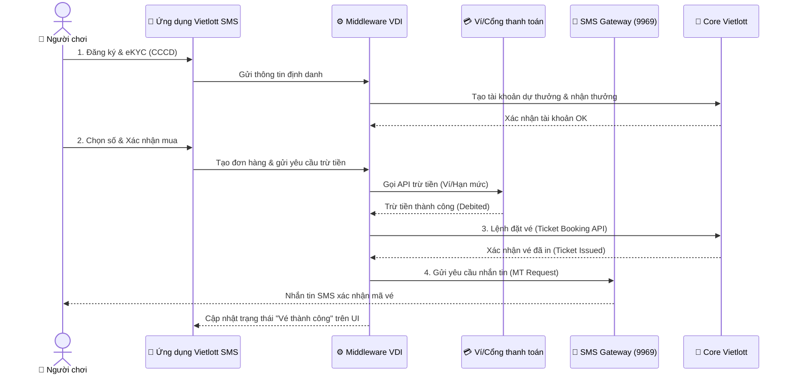

# 📋 MASTER ONBOARDING PLAN: BUSINESS ANALYST (BA) DỰ ÁN VIETLOTT SMS
## (Kế hoạch hành động chi tiết và thực chiến trong 30 ngày đầu tiên tại VDI)

- **Mã tài liệu:** `plans/active/onboarding-plan-ba-vietlottsms.md`
- **Vai trò biên soạn:** Senior Business Analyst (BA Agent)
- **Dự án áp dụng:** Vietlott SMS (Kênh phân phối vé số qua SMS phối hợp với các nhà mạng Viettel, MobiFone, VinaPhone)
- **Trạng thái:** DRAFT (Chờ phê duyệt chuyển sang `artifacts/requirements/`)
- **Tài liệu tham chiếu cốt lõi:** 
  - [ba-senior-playbook-vdi.md](file:///f:/BA-Antigravity/artifacts/requirements/ba-senior-playbook-vdi.md)
  - [domain-knowledge-fintech-ecommerce.md](file:///f:/BA-Antigravity/artifacts/requirements/domain-knowledge-fintech-ecommerce.md)
  - [financial-transaction-standards-unhappy-cases.md](file:///f:/BA-Antigravity/artifacts/requirements/financial-transaction-standards-unhappy-cases.md)

---

## 🎯 MỤC TIÊU GIAI ĐOẠN ONBOARDING
* **Hiểu hệ thống & con người (2 tuần đầu):** Trả lời được câu hỏi cốt lõi: *"Hệ thống này kiếm tiền như thế nào, ai sử dụng thực tế, và team đang đau đầu vì điều gì?"*
* **Làm chủ nghiệp vụ & Đóng góp giá trị (Tuần 3 - 4):** Có khả năng tự phân tích độc lập một yêu cầu thay đổi (CR) hoặc viết một đặc tả tính năng nhỏ mà không cần cầm tay chỉ việc.

---

## 🌌 BỨC TRANH TOÀN CẢNH NGHIỆP VỤ (BUSINESS OVERVIEW)

Hệ thống Vietlott SMS là kênh phân phối vé số chính thống qua điện thoại tại Việt Nam. VDI đóng vai trò phát triển và vận hành hệ thống **Middleware** kết nối và điều phối giao dịch giữa các thực thể: **Khách hàng/Nhà mạng (Telco)**, **Cổng thanh toán (Ví/Bank)** và **Core Vietlott**.

### 5 Trụ Cột Nghiệp Vụ Cốt Lõi BA Cần Quản Lý:
1. **Luồng Định danh (eKYC & Subscription check):** Người chơi chụp ảnh CCCD 2 mặt -> Hệ thống OCR đọc thông tin -> Face Match & Liveness Check -> API nhà mạng kiểm tra thông tin thuê bao chính chủ.
2. **Luồng Thanh toán & Hạn mức (Payment & Limit):** Tích hợp trừ tiền qua tài khoản viễn thông hoặc liên kết ví/ngân hàng. Kiểm soát hạn mức chi tiêu pháp lý tối đa 100,000 VND/ngày cho mỗi nhà mạng.
3. **Luồng Đặt vé & Nhắn tin (Booking & SMS Gateway):** Trình duyệt đặt vé sang Core Vietlott -> Core in vé thành công -> Gửi lệnh MT SMS gửi tin nhắn xác nhận (chứa thông tin vé, kỳ quay) về máy người dùng qua đầu số 9969.
4. **Luồng Trả thưởng & Thuế PIT (Awarding & Tax):** Tự động so khớp vé với kết quả mở thưởng cuối ngày -> Tự động tính thuế TNCN (10% cho phần trúng thưởng > 10 triệu VND) -> Định tuyến trả thưởng tự động (< 10 tỷ VND chuyển thẳng vào TK nhận thưởng; > 10 tỷ VND hướng dẫn khách hàng nhận tại quầy).
5. **Luồng Đối soát 3 bên (Reconciliation):** So khớp dữ liệu chéo cuối ngày giữa `Ví/Telco (Tiền đã trừ)` vs `Middleware VDI (Lệnh ghi nhận)` vs `Core Vietlott (Vé đã in)` để phát hiện lệch giao dịch (Discrepancy) trước 8h00 sáng hôm sau.

---

## 🎲 MÔ TẢ CÁCH HOẠT ĐỘNG CỦA CÁC SẢN PHẨM VIETLOTT (LOTTERY DOMAIN KNOWLEDGE)

Để hỗ trợ BA nắm bắt nhanh nghiệp vụ và sản phẩm, dưới đây là đặc tả chi tiết về cách hoạt động, quy định quay thưởng, điều kiện tham gia và các ví dụ thực tế của 4 dòng sản phẩm chính trên Vietlott:

### 1. Phân Tích Cơ Chế Các Dòng Sản Phẩm

#### A. Mega 6/45
* **Cách chơi:** Người chơi lựa chọn 6 con số trong tập hợp từ `01` đến `45` (tự chọn hoặc để hệ thống chọn ngẫu nhiên).
* **Quay thưởng:** 18h00 các ngày Thứ 4, Thứ 6 và Chủ Nhật hàng tuần.
* **Cơ chế trúng giải:** So khớp không phân biệt thứ tự. Trùng từ 3 số trở lên sẽ trúng giải. Trùng khớp toàn bộ 6 số sẽ trúng giải Jackpot (giải đặc biệt) với giá trị cộng dồn từ 12 tỷ đồng.
* **💡 Ví dụ thực tế:** 
  * *Vé mua:* Bạn tự chọn bộ 6 số là `[05 - 12 - 20 - 28 - 35 - 41]` (mệnh giá 10.000 VNĐ).
  * *Kết quả quay số:* Hệ thống quay ra 6 quả bóng là `[05 - 18 - 20 - 28 - 30 - 41]`.
  * *Kết quả dò:* Trùng 4 số (`05`, `20`, `28`, `41`). Bạn trúng Giải Nhì trị giá 300.000 VNĐ. (Nếu trùng 3 số bạn được 30.000 VNĐ, trùng 5 số được 10.000.000 VNĐ, trùng cả 6 số thì trúng Jackpot).

#### B. Power 6/55
* **Cách chơi:** Người chơi lựa chọn 6 con số trong tập hợp từ `01` đến `55`.
* **Quay thưởng:** 18h00 các ngày Thứ 3, Thứ 5 và Thứ 7 hàng tuần.
* **Cơ chế trúng giải:** Đặc biệt ở Power 6/55 là có tới 2 giải Jackpot:
  * **Jackpot 1:** Trùng khớp toàn bộ 6 con số chính (giá trị tích lũy từ 30 tỷ đồng).
  * **Jackpot 2:** Trong mỗi kỳ quay thưởng, sau khi quay 6 số chính, hệ thống sẽ quay thêm 1 số đặc biệt từ 49 quả bóng còn lại. Nếu bạn trùng 5 số chính và trùng thêm con số đặc biệt này, bạn sẽ trúng Jackpot 2 (tích lũy từ 3 tỷ đồng).
* **💡 Ví dụ thực tế (Trúng Jackpot 2):**
  * *Vé mua:* Bạn chọn bộ số `[07 - 15 - 23 - 31 - 44 - 52]` (mệnh giá 10.000 VNĐ).
  * *Kết quả quay số:* 6 số chính là `[07 - 15 - 23 - 31 - 44 - 49]`, 1 con số đặc biệt quay thêm là `[52]`.
  * *Kết quả dò:* Trùng 5 số chính (`07`, `15`, `23`, `31`, `44`) và số còn lại trên vé trùng với số đặc biệt `[52]`. Bạn đã trúng giải Jackpot 2 (tối thiểu từ 3 tỷ đồng và cộng dồn lũy tiến).

#### C. Keno (Xổ số quay nhanh)
* **Cách chơi:** Chọn từ 1 đến 10 số (gọi là bậc chơi từ bậc 1 đến bậc 10) trong tập hợp từ `01` đến `80`.
* **Quay thưởng:** Quay thưởng liên tục 8-10 phút/kỳ, kéo dài từ 06h00 đến gần 22h00 tất cả các ngày trong tuần.
* **Cơ chế trúng giải:** Hệ thống quay ngẫu nhiên 20 con số mỗi kỳ. Giải thưởng đa dạng phụ thuộc vào bậc chơi và số lượng trùng khớp. Đặc biệt ở các bậc cao (bậc 8, 9, 10), bạn không trùng con số nào vẫn trúng thưởng.
* **💡 Ví dụ thực tế:**
  * *Ví dụ 1 (Trúng theo bậc):* Bạn chơi Bậc 4 (chọn 4 số) là bộ số `[10 - 20 - 30 - 40]`. Kết quả kỳ quay ra 20 số ngẫu nhiên: `[02, 05, 10, 17, 19, 20, 22, 25, 27, 29, 30, 35, 38, 40, 45, 50, 60, 68, 72, 79]`. Cả 4 số bạn chọn đều xuất hiện. Bạn trúng giải cao nhất của bậc 4 trị giá 400.000 VNĐ.
  * *Ví dụ 2 (Luật "Không trùng vẫn trúng"):* Bạn chơi Keno Bậc 10 (chọn 10 số). Sau khi quay ra 20 số kết quả mà không có bất kỳ con số nào của bạn xuất hiện, bạn vẫn trúng giải an ủi 10.000 VNĐ (hòa vốn mua vé). Luật này áp dụng cho Keno bậc 8, 9 và 10.

#### D. Dòng sản phẩm Max 3D (Max 3D, Max 3D+, Max 3D Pro)
* **Cách chơi:** Người chơi chọn các bộ ba số (từ `000` đến `999`).
  * Max 3D: Chọn 1 bộ ba số.
  * Max 3D+ / Max 3D Pro: Chọn 2 bộ ba số.
* **Quay thưởng:** 
  * Max 3D và Max 3D+ quay vào các ngày Thứ 2, Thứ 4, Thứ 6.
  * Max 3D Pro quay vào các ngày Thứ 3, Thứ 5, Thứ 7.
* **Cơ chế trúng giải:** Dò bộ số với kết quả kỳ quay (có nhiều hạng giải). Ở một số hạng giải, bắt buộc các con số phải trùng khớp theo đúng thứ tự từ trái qua phải.
* **💡 Ví dụ thực tế (Max 3D cơ bản):**
  * *Vé mua:* Bạn thích số đẹp nên mua một bộ 3 số `[123]` (mệnh giá 10.000 VNĐ).
  * *Kết quả quay số:* Giải Nhất có 2 bộ số là `[123]` và `[456]`.
  * *Kết quả dò:* Bộ số của bạn trùng khớp đúng thứ tự `1-2-3` với một bộ của giải Nhất. Bạn trúng giải Nhất trị giá 1.000.000 VNĐ.

### 2. Quy Định Chung Khi Tham Gia Dự Thưởng

* **Mệnh giá tham chiếu:** Giá vé cơ bản cho một bộ số (một lần tham gia dự thưởng) là 10.000 VNĐ.
* **Kênh phân phối:** Có thể mua vé in trực tiếp tại các điểm bán hàng/đại lý ủy quyền trên toàn quốc hoặc mua trực tuyến qua ứng dụng Vietlott SMS chính chủ (qua các nhà mạng Viettel, VinaPhone, MobiFone) và các ví điện tử liên kết như MoMo, Viettel Money, ZaloPay...
* **Điều kiện người chơi hợp pháp:**
  * Phải là công dân Việt Nam, người Việt Nam định cư ở nước ngoài hoặc người nước ngoài nhập cảnh hợp pháp vào Việt Nam.
  * Phải đủ 18 tuổi trở lên.
  * Không phải là người bị hạn chế hoặc mất năng lực hành vi dân sự theo quy định của pháp luật.

### 3. Nguồn Tham Khảo Nghiệp Vụ
* Thể lệ chơi và cơ cấu giải Keno, Mega 6/45, Power 6/55, Max 3D tại [Cổng thông tin chính thức của Vietlott](https://vietlott.vn).
* Quy định hình thức mua vé trực tuyến trên [Ứng dụng Vietlott SMS](https://vietlott.vn/vi/choi/sms/vietlott_sms).
* Tài liệu hướng dẫn mua vé Vietlott trên ứng dụng MoMo, Viettel Money, ZaloPay.

---

## 🚀 TUẦN 1: Học Hỏi Nhanh Sản Phẩm & Nạp Kiến Thức Domain (Context & Domain)

Trọng tâm tuần đầu là biến mình thành người dùng khó tính nhất và nắm bắt bức tranh tổng thể (Big Picture).

### 1. Trải nghiệm thực tế (As-Is System Walkthrough)

* **Mục tiêu trải nghiệm:** Thấu hiểu sâu sắc hành trình khách hàng (Customer Journey), trực quan hóa các tương tác vật lý với hệ thống nhà mạng (SMS Gateway) và phát hiện các điểm nghẽn trải nghiệm (UX Pain Points) từ góc nhìn một khách hàng khó tính.

#### 📋 Kịch bản trải nghiệm chi tiết qua 4 giai đoạn:

| Giai đoạn | Thao tác thực tế | Các điểm BA cần quan sát & ghi chép |
| :--- | :--- | :--- |
| **Giai đoạn 1: Đăng ký & eKYC** | - Tải ứng dụng Vietlott SMS tương ứng với nhà mạng đang dùng. - Đăng ký tài khoản mới. - Chụp ảnh CCCD 2 mặt và quét khuôn mặt (eKYC). | - Tốc độ đọc và điền dữ liệu của OCR có chính xác không? Có bị lỗi font tiếng Việt? - Luồng hướng dẫn quét khuôn mặt (liveness check) có dễ hiểu không? Nếu cố tình chụp mờ/nghiêng đầu, hệ thống báo lỗi thế nào? |
| **Giai đoạn 2: Liên kết tài khoản & Nạp tiền** | - Liên kết tài khoản nhận thưởng (chọn Ngân hàng/Ví liên kết). - Nạp tiền vào Hạn mức dự thưởng từ ví điện tử (ví dụ: Viettel Money). | - Các kênh thanh toán hỗ trợ nạp tiền là gì? Phí nạp tiền ở các kênh có khác nhau không? - Thời gian từ khi tài khoản ví bị trừ tiền đến khi App hiển thị hạn mức dự thưởng được cộng là bao lâu? (Ghi nhận độ trễ). |
| **Giai đoạn 3: Chọn số & Đặt vé** | - Chọn 1 vé Bingo18 (chạy nhanh 10 phút/quay 1 lần). - Chọn 1 bộ số Mega 6/45. - Xác nhận mua vé và chuyển sang màn hình SMS. | - Ứng dụng tự động sinh cú pháp tin nhắn MO như thế nào? Cú pháp chứa các thông tin gì (Mã vé, kỳ quay, SĐT)? - Từ lúc gửi tin nhắn MO đến lúc nhận tin nhắn MT xác nhận in vé thành công từ đầu số 9969 mất bao nhiêu giây? - Đọc kỹ nội dung tin nhắn MT: Có chứa mã bảo mật/chữ ký số để đối chiếu không? |
| **Giai đoạn 4: So khớp kết quả & Nhận thưởng** | - Theo dõi kỳ quay số mở thưởng trực tiếp của vé đã mua. - Đợi hệ thống gửi kết quả trúng/trượt. | - App cập nhật kết quả trúng thưởng sau khi quay số xong bao lâu? - Luồng tin nhắn SMS thông báo trúng thưởng gửi về máy khi nào? Nội dung tin nhắn ra sao? |

* *Đầu ra mong đợi:* Bản báo cáo đánh giá trải nghiệm người dùng (UX Audit & Pain Points Log) liệt kê các điểm hạn chế hoặc độ trễ tin nhắn ghi nhận được.

### 2. Xây dựng Từ điển nghiệp vụ (Glossary / Data Dictionary)
Thiết lập bảng thuật ngữ chuẩn cho dự án Vietlott SMS để đồng bộ ngôn ngữ giữa BA, Dev và QA:

| Thuật ngữ | Định nghĩa nghiệp vụ | Ngữ cảnh ứng dụng trong Vietlott SMS |
| :--- | :--- | :--- |
| **eKYC** | Định danh khách hàng điện tử | Xác minh danh tính người chơi qua ảnh chụp CCCD và quét khuôn mặt để đảm bảo đủ 18 tuổi và đúng thông tin thuê bao. |
| **OCR** | Nhận dạng ký tự quang học | Tự động đọc và trích xuất thông tin từ ảnh chụp CCCD (Số CCCD, Họ tên, Ngày sinh) để điền vào form đăng ký. |
| **Liveness Check** | Kiểm tra thực thể sống | AI xác định khuôn mặt khi quét eKYC là người thật đang thao tác real-time, chống giả mạo bằng ảnh tĩnh/deepfake. |
| **Hạn mức dự thưởng (Limit)** | Số tiền tối đa được phép mua vé | Theo quy định pháp lý, người chơi chỉ được mua tối đa 100k/ngày/nhà mạng. Cần phân biệt với Hạn mức ví thanh toán. |
| **Tài khoản nhận thưởng** | Tài khoản ngân hàng/Ví liên kết | Nơi hệ thống tự động chuyển tiền thưởng cho người chơi khi trúng các giải dưới 10 tỷ đồng. |
| **Double-Entry Ledger** | Sổ cái kép | Nguyên tắc ghi nhận tài chính: Mọi giao dịch nạp tiền, trừ tiền mua vé phải được ghi đồng thời vào 2 tài khoản (Debit & Credit) để đối soát dòng tiền. |
| **Reconciliation** | Đối soát | Quy trình so khớp số liệu giao dịch mua vé và trả thưởng cuối ngày giữa VDI, các nhà mạng (Viettel/Mobi/Vina) và Vietlott. |
| **Settlement** | Quyết toán | Việc chuyển tiền thực tế từ tài khoản thu hộ của các nhà mạng/ví điện tử về tài khoản của Vietlott/VDI. |
| **MO SMS (Mobile Originated)** | Tin nhắn gửi đi từ thiết bị di động | Cú pháp đặt vé được sinh tự động trên App và gửi đến tổng đài 9969. |
| **MT SMS (Mobile Terminated)** | Tin nhắn gửi về thiết bị di động | Tin nhắn xác nhận mua vé thành công (chứa thông tin vé, kỳ quay) gửi từ 9969 về máy khách hàng. |
| **Ticket Booking API** | API đặt vé | Lệnh truyền tải thông tin vé số đã thanh toán từ Middleware VDI sang Core của Vietlott để in vé điện tử. |

### 3. Đọc tài liệu lịch sử (01_Requirements)
- **Hành động:**
  - Đọc các tài liệu đặc tả yêu cầu (BRD, SRS), tài liệu mô tả API tích hợp với SMS Gateway và Core Vietlott trong thư mục [01_Requirements](file:///f:/BA-Antigravity/01_Requirements).
  - Tập trung nghiên cứu cơ chế kết nối: Làm sao Middleware VDI nhận diện được trạng thái tin nhắn SMS từ Telco? Làm sao truyền dữ liệu đặt vé sang Core Vietlott?
- **Mục tiêu:** Hiểu rõ kiến trúc AS-IS và các ràng buộc kỹ thuật hiện tại của hệ thống.

### 4. Vẽ lại Context Diagram & Lập bản đồ Stakeholder
- **Hành động:**
  - Vẽ sơ đồ ngữ cảnh (Context Diagram) mô tả các luồng thông tin chạy giữa các bên.
  - Lập bảng ma trận RACI để xác định rõ đầu mối làm việc:
    - *Responsible (Thực hiện):* Đội ngũ DEV/QA của VDI.
    - *Accountable (Chịu trách nhiệm):* Project Manager (PM) và Solution Architect (SA) của VDI.
    - *Consulted (Tham vấn):* Đầu mối kỹ thuật phía nhà mạng Viettel/MobiFone/VinaPhone và đầu mối nghiệp vụ phía Vietlott.
    - *Informed (Nhận thông tin):* Đội vận hành (Ops), CS hỗ trợ khách hàng.

---

## 🛠️ TUẦN 2: "Đào Sâu" Hệ Thống Ngầm & Thiết Lập Quy Trình (Architecture & Governance)

Trọng tâm tuần 2 là hiểu cách dòng tiền đi và cách xử lý lỗi, vì 80% rủi ro của Vietlott SMS nằm ở luồng ngoại lệ (Exception Paths).

### 1. Họp Knowledge Transfer (KT) với Tech Lead / Solution Architect (SA)
- **Hành động:**
  - Xin 1 buổi họp 1-1 khoảng 1 tiếng với SA/Tech Lead để nghe giải thích sơ đồ cơ sở dữ liệu (ERD) và luồng gọi API.
  - **Đặt câu hỏi phản biện thực chiến:**
    - *"Khi khách hàng bị trừ tiền ở Ví Viettel Money/Hạn mức dự thưởng thành công nhưng API đặt vé sang Core Vietlott bị timeout (hoặc Core Vietlott báo lỗi hết vé/ngừng bán), hệ thống Middleware VDI sẽ xử lý thế nào? Có tự động gọi API hoàn tiền (Reversal) real-time không hay đưa vào hàng đợi đối soát thủ công cuối ngày?"*
    - *"Làm thế nào hệ thống ngăn chặn việc double-charge (trừ tiền 2 lần) khi tin nhắn SMS bị gửi lặp (do lỗi mạng nhà mạng)?"*

### 2. Nghiên cứu phân hệ Đối soát (Reconciliation)
- **Hành động:**
  - Tìm hiểu quy trình đối soát cuối ngày (thường diễn ra từ 00h00 đến 08h00 sáng hôm sau).
  - Nghiên cứu cách VDI đối chiếu dữ liệu giao dịch:
    - `Dữ liệu thanh toán của Ví/Telco` vs `Dữ liệu Middleware VDI` vs `Dữ liệu in vé của Core Vietlott`.
  - Xác định các kịch bản lệch số liệu (Discrepancy Cases) phổ biến:
    - *Case 1:* Khách bị trừ tiền nhưng không có vé in thành công trên Core Vietlott.
    - *Case 2:* Có vé in thành công trên Core Vietlott nhưng hệ thống VDI chưa ghi nhận thanh toán.
    - *Case 3:* Tin nhắn SMS xác nhận (MT) bị delay/fail khiến khách hàng nghĩ mua trượt nhưng thực chất vé đã in thành công trên Core.

### 3. Review quy trình làm việc (BA Approach)
- **Hành động:**
  - Xác định dự án chạy theo Agile Scrum hay Waterfall (Thường Vietlott SMS chạy theo Hybrid: spec chốt kỹ theo Waterfall nhưng dev triển khai theo Sprint).
  - Tìm hiểu tiêu chuẩn **Definition of Ready (DoR)** (thế nào là một User Story đủ điều kiện để dev estimate) và **Definition of Done (DoD)** (thế nào là một tính năng đã test xong và sẵn sàng deploy).

---

## ⚔️ TUẦN 3: Tham Gia Thực Chiến (Shadowing & Delivery)

Bắt đầu nhúng tay vào luồng công việc thực tế của team để tạo ra giá trị.

### 1. Nhận phân tích một chức năng/luồng lỗi nhỏ (Quick Win)
- **Hành động:**
  - Nhận một task nhỏ từ PM/BA Lead. Ví dụ: Cải tiến màn hình hiển thị mã QR thanh toán hoặc viết tài liệu đặc tả luồng hoàn tiền tự động (Auto-refund) khi giao dịch mua vé bị lỗi hệ thống.
  - Thực hành viết đặc tả màn hình (Wireframe thô) và mô tả tương tác của nút bấm.

### 2. Vẽ Bảng Quyết Định (Decision Table) cho luật mua vé
Vietlott SMS có quy định rất ngặt nghèo về hạn mức mua vé của người chơi. Hãy dùng kỹ thuật Bảng Quyết Định để mô tả luật validation này:

**Bảng Quyết Định: Kiểm tra điều kiện đặt vé của khách hàng**

| Điều kiện (Conditions) | Quy tắc 1 | Quy tắc 2 | Quy tắc 3 | Quy tắc 4 | Quy tắc 5 |
| :--- | :---: | :---: | :---: | :---: | :---: |
| Người chơi đủ 18 tuổi? | Sai (No) | Đúng (Yes) | Đúng (Yes) | Đúng (Yes) | Đúng (Yes) |
| Đã hoàn thành eKYC? | - | Chưa (No) | Đúng (Yes) | Đúng (Yes) | Đúng (Yes) |
| Hạn mức mua vé trong ngày còn lại? | - | - | ≤ 0 VND | > Giá trị vé | < Giá trị vé |
| Số dư ví/hạn mức dự thưởng đủ? | - | - | - | Đúng (Yes) | Chưa đủ (No) |
| **Hành động (Actions)** | | | | | |
| **Từ chối đặt vé & Báo lỗi độ tuổi** | **X** | | | | |
| **Từ chối đặt vé & Yêu cầu eKYC** | | **X** | | | |
| **Từ chối & Báo vượt hạn mức ngày** | | | **X** | | |
| **Từ chối & Yêu cầu nạp thêm tiền** | | | | | **X** |
| **Chấp nhận đặt vé & Trừ tiền** | | | | **X** | |

### 3. Viết User Story chuẩn BDD & Cross-Review
- **Hành động:**
  - Viết một User Story hoàn chỉnh trên Jira cho tính năng "Tự động gửi thông báo SMS khi khách hàng trúng thưởng giải Jackpot phụ".
  - Định dạng Acceptance Criteria theo chuẩn **BDD (Given-When-Then)**.
  - **Tổ chức Cross-Review:** Nhờ Tech Lead và QA Lead review tài liệu này. Việc này giúp bạn hiểu gu viết specs của DEV và QA tại VDI để điều chỉnh từ sớm.

---

## ✔️ CHECKLIST THỰC TẾ 30 NGÀY (INTERACTIVE CHECKLIST)

### 🟢 Checklist những ngày đầu tiên (Day 1 - 5)
* [ ] Đã nhận và cài đặt đầy đủ tài khoản/công cụ (Email, Jira, Confluence, Slack/Teams).
* [ ] Đã gặp Team Lead/PM để nắm rõ kỳ vọng và các mục tiêu ưu tiên trong tháng đầu.
* [ ] Xin đầy đủ danh sách tài liệu cần đọc (BRD, SRS, API specs) và lịch các buổi họp Scrum sắp tới.
* [ ] Được giới thiệu chính thức với toàn bộ team phát triển (Dev, QA, Ops, SA).
* [ ] Vẽ lại sơ đồ tổng quan hệ thống ở mức vĩ mô (System Landscape).

### 🟡 Checklist cuối Tuần 2
* [ ] Đã đọc xong tài liệu BRD và nắm được các luật nghiệp vụ xổ số chính của Vietlott SMS.
* [ ] Đã trực tiếp demo và mua thử ít nhất 1 vé Bingo18 và Mega trên môi trường UAT/Production.
* [ ] Đã 1-on-1 với ít nhất 4 stakeholder chủ chốt (PM, Tech Lead, QA Lead, Ops Lead) để lắng nghe pain points.
* [ ] Nắm rõ chu kỳ Sprint, các buổi họp và cách tạo/quản lý ticket trên Jira của team.
* [ ] Hoàn thành bản đồ Stakeholder (RACI Matrix) của dự án.
* [ ] Nắm được luồng nghiệp vụ chính (Happy Path) và có tài liệu Từ điển nghiệp vụ cá nhân (Glossary).

### 🔴 Checklist cuối Tháng 1 (Day 30)
* [ ] Đã viết hoàn chỉnh ít nhất 1 User Story/SRS nhỏ đạt tiêu chuẩn DoR và được chuyển cho DEV code.
* [ ] Tự vẽ lại toàn bộ luồng nghiệp vụ AS-IS của hệ thống bằng sơ đồ BPMN.
* [ ] Đã tham gia tối thiểu 1 buổi Sprint Planning và 1 buổi Backlog Refinement.
* [ ] Xác định được ít nhất 2 điểm thiếu sót hoặc lỗi thời trong bộ tài liệu hiện có và đề xuất cập nhật (Gap Analysis).
* [ ] Thiết lập lịch họp định kỳ (Weekly Sync) với PM/PO để nhận feedback.
* [ ] Hoàn thành và gửi báo cáo tổng kết 30 ngày (30-day Summary) cho Line Manager.

---

## 🧠 NGUYÊN TẮC XUYÊN SUỐT CHO BA MỚI ONBOARD

1. **Hỏi câu hỏi "ngây thơ" một cách có chiến lược:** Trong 2 tuần đầu, bạn có đặc quyền được hỏi bất kỳ điều gì mà không sợ bị phán xét. Hãy tận dụng triệt để cơ hội này để hỏi về **Lý do (Why)** đằng sau các quyết định thiết kế hệ thống cũ, thay vì chỉ hỏi hệ thống làm **Cái gì (What)**.
2. **Phân biệt "Doc đang dùng" với "Doc lưu kho":** Tài liệu trên hệ thống wiki có thể đã outdate 6 tháng trước. Luôn xác nhận lại với Senior Dev/QA xem tài liệu bạn đang đọc có khớp với code chạy thực tế hay không.
3. **Mảng nghiệp vụ nhạy cảm:** Đối với Vietlott SMS, hãy dành 80% sự chú ý cho **Compliance (Tuân thủ pháp lý)**, **SLA của SMS Gateway**, và **luồng đối soát tài chính 3 bên (Reconciliation)**. Đây là những phần khó nhất giúp bạn tạo sự khác biệt và xây dựng uy tín nhanh nhất.
4. **Deliverable đầu tiên nên nhỏ và hoàn chỉnh (Quick Win):** Thay vì nhận một tài liệu phân tích lớn rồi làm dang dở, hãy hoàn thành xuất sắc một User Story nhỏ, viết tốt Acceptance Criteria và vẽ rõ ràng flowchart. Sự tin tưởng của team dành cho bạn được xây dựng từ những hành động nhỏ nhưng chỉn chu.

---

## 🛑 ĐỘC LẬP & TƯ DUY PHẢN BIỆN: CÁC CẢNH BÁO ĐỎ TỪ SENIOR BA (DEVIL'S ADVOCATE)

> [!WARNING]
> **1. Rủi ro dùng thông tin thật để eKYC & Giao dịch trên Production (Tuần 1):**
> Việc tự eKYC bằng CCCD thật để trải nghiệm luồng mua vé trên Production là cần thiết để hiểu sản phẩm. Tuy nhiên:
> * **Tuyệt đối không** dùng tài khoản cá nhân này để thử nghiệm các luồng lỗi hoặc nạp/rút tiền bất thường trên Production nhằm tránh bị thuật toán chống rửa tiền (AML/CFT) tự động khóa tài khoản hoặc gửi báo cáo đáng ngờ lên Ngân hàng Nhà nước theo [Thông tư 27/2025/TT-NHNN](file:///f:/BA-Antigravity/artifacts/requirements/financial-transaction-standards-unhappy-cases.md#L393-L410).
> * Hãy yêu cầu PM cấp tài khoản **Mock/Sandbox** trên môi trường UAT để có thể thoải mái test các case lỗi eKYC (mờ ảnh, sai số CCCD, deepfake check) mà không ảnh hưởng đến dữ liệu cá nhân thật của bạn.

> [!WARNING]
> **2. Rào cản bảo mật thông tin nội bộ khi tiếp cận ERD & Database (Tuần 2):**
> Việc xin Tech Lead/SA sơ đồ ERD chi tiết và quyền truy cập Database trực tiếp trong tuần thứ 2 thường sẽ gặp khó khăn do chính sách bảo mật thông tin (Information Security) của VDI đối với dự án Fintech/Telco.
> * Thay vì xin quyền truy cập Database trực tiếp, hãy đề xuất SA cung cấp **tài liệu Data Model cấp logic** hoặc sơ đồ thiết kế API specs.
> * Tập trung hiểu cấu trúc các trường thông tin trong API Request/Response (JSON payload) vì đó là nơi bạn làm việc trực tiếp để dịch chuyển yêu cầu nghiệp vụ thành đặc tả kỹ thuật.

> [!CAUTION]
> **3. Rủi ro "Mắc kẹt dòng tiền" (Pending State) trong thanh toán qua nhà mạng (Tuần 2):**
> Trong dự án Vietlott SMS, luồng thanh toán trừ tiền trực tiếp qua tài khoản viễn thông (ví dụ: Viettel Money) rất dễ gặp case **Timeout**. Hệ thống trừ tiền từ ví người chơi thành công nhưng tin nhắn SMS xác nhận vé in bị delay do mạng nghẽn.
> * Với vai trò BA, bạn phải kiểm tra xem hệ thống Middleware đang xử lý trạng thái `PENDING` này như thế nào. 
> * **Quy tắc bắt buộc:** Tuyệt đối không được tự động chuyển trạng thái giao dịch sang `FAILED` và hoàn tiền ngay khi gặp timeout API từ phía Core Vietlott nếu chưa có kết quả đối soát chính thức hoặc lệnh truy vấn trạng thái (Query Transaction API) xác nhận vé chưa được in. Nếu tự động hoàn tiền trong khi vé thực tế đã được in trên Core Vietlott, khách hàng sẽ nhận được vé "miễn phí" và trúng giải Jackpot thì VDI/nhà mạng phải tự đền bù tài chính.

---
